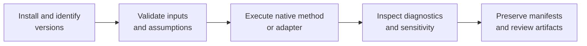

# Runtime Operations

Operating scientific software means preserving the reasoning around a run,
not merely obtaining a zero exit status. These guides connect environment,
inputs, method choice, execution, diagnostics, artifacts, and review.

## Start By Outcome

| Outcome | Guide |
| --- | --- |
| create a reliable environment | [Installation and setup](installation-and-setup.md) |
| move from input data to a reviewable result | [Common workflows](common-workflows.md) |
| run owned maximum-likelihood inference | [Native maximum-likelihood workflows](native-maximum-likelihood-workflows.md) |
| run a supported Bayesian DNA path | [Native Bayesian workflows](native-bayesian-workflows.md) |
| interpret benchmark records | [Native benchmark review](native-benchmark-review.md) |
| understand what automation cannot decide | [Operational boundaries](operational-boundaries.md) |

## The Operational Contract

A defensible run records:

- installed runtime and, where applicable, external-engine versions;
- immutable or checksummed input identities;
- taxon reconciliation and validation outcomes;
- model, partition, search, sampling, and seed configuration;
- warnings, convergence state, support, uncertainty, or sensitivity diagnostics;
- a declared output inventory and the command or call that produced it.

The exact fields vary by method. The invariant is that a reviewer should not
have to guess which assumptions created the result.

## Native And External Execution

Native workflows fail within the Python runtime and can return rich diagnostic
state directly. Adapter workflows add executable discovery, subprocess exit,
captured stdout/stderr, output parsing, and engine-version provenance. Plan for
those additional failure and reproducibility boundaries.

## Reproducibility Levels

| Level | What it establishes |
| --- | --- |
| command recorded | invocation can be inspected |
| environment recorded | software identity is known |
| inputs and configuration fixed | the run can be reconstructed |
| deterministic or seeded replay passes | the declared execution reproduces within its contract |
| reference or evidence checks pass | bounded comparison claims gain additional support |

Do not collapse these levels into “reproducible.” State which one applies.

## Before Interpretation

Review validation warnings, optimizer or sampler diagnostics, support and
uncertainty, missing-data behavior, taxon coverage, and sensitivity to material
choices. A result object existing is an execution fact; it is not an automatic
scientific verdict.

## Generated References

The exhaustive [CLI surface](../interfaces/cli-surface.md) and generated parts
of [common workflows](common-workflows.md) are lookup references. Use this
operations section to decide *why* and *how* to run; use generated references
to confirm exact arguments and available methods.
