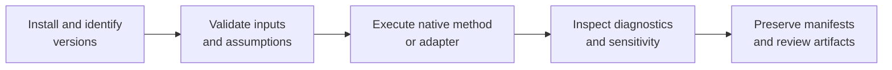

# Runtime Operations

Operating scientific software means preserving the reasoning around a run,
not merely obtaining a zero exit status. These guides connect environment,
inputs, method choice, execution, diagnostics, artifacts, and review.



## Start By Outcome

| Outcome | Guide |
| --- | --- |
| create a reliable environment | [Installation and setup](installation-and-setup.md) |
| move from input data to a reviewable result | [Common workflows](common-workflows.md) |
| run owned maximum-likelihood inference | [Native maximum-likelihood workflows](native-maximum-likelihood-workflows.md) |
| run a supported Bayesian DNA path | [Native Bayesian workflows](native-bayesian-workflows.md) |
| interpret benchmark records | [Native benchmark review](native-benchmark-review.md) |
| understand what automation cannot decide | [Operational boundaries](operational-boundaries.md) |

## Establish The Run Identity First

Before selecting a model, record the input set and the runtime that will own
the result:

```bash
bijux-phylogenetics --version
bijux-phylogenetics env --json
bijux-phylogenetics inspect dataset/tree.nwk --json
bijux-phylogenetics alignment validate-input dataset/alignment.fasta --json
```

The last two commands are independent intake checks; use only the objects
present in the analysis. For trait work, validate the tree–table join and
retain the reconciliation output before fitting a model. For external engines,
capture executable discovery and version output before execution.

## The Operational Contract

A defensible run records:

- installed runtime and, where applicable, external-engine versions;
- immutable or checksummed input identities;
- taxon reconciliation and validation outcomes;
- model, partition, search, sampling, and seed configuration;
- warnings, convergence state, support, uncertainty, or sensitivity diagnostics;
- a declared output inventory and the command or call that produced it.

The exact fields vary by method. The invariant is that a reviewer should not
have to guess which assumptions created the result.

## Native And External Execution

Native workflows fail within the Python runtime and can return rich diagnostic
state directly. Adapter workflows add executable discovery, subprocess exit,
captured stdout/stderr, output parsing, and engine-version provenance. Plan for
those additional failure and reproducibility boundaries.

## Reproducibility Levels

| Level | What it establishes |
| --- | --- |
| command recorded | invocation can be inspected |
| environment recorded | software identity is known |
| inputs and configuration fixed | the run can be reconstructed |
| deterministic or seeded replay passes | the declared execution reproduces within its contract |
| reference or evidence checks pass | bounded comparison claims gain additional support |

Do not collapse these levels into “reproducible.” State which one applies.

## Before Interpretation

Review validation warnings, optimizer or sampler diagnostics, support and
uncertainty, missing-data behavior, taxon coverage, and sensitivity to material
choices. A result object existing is an execution fact; it is not an automatic
scientific verdict.

Use a refusal or incomplete status as information. A taxon mismatch, missing
engine, unconverged optimizer, low effective sample size, incomplete support
replicates, or absent required artifact should stop the corresponding claim.
Changing presentation or omitting the failed check does not make the run
complete.

## Minimum Handoff Record

Preserve enough state for a second person to answer these questions without
terminal history:

- Which exact inputs and taxa were analyzed?
- Which runtime and external-engine versions executed?
- Which model, partitions, transformations, priors, costs, and seeds applied?
- Which diagnostics passed, warned, failed, or remained unavailable?
- Which files are canonical machine output and which are presentations?
- Which comparison or Evidence Book claim, if any, supports interpretation?

## Generated References

The exhaustive [CLI surface](../interfaces/cli-surface.md) and generated parts
of [common workflows](common-workflows.md) are lookup references. Use this
operations section to decide *why* and *how* to run; use generated references
to confirm exact arguments and available methods.
