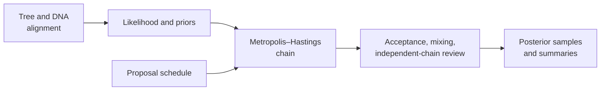

# Native Bayesian Inference

The native dispatcher runs supported DNA models with an explicitly compatible
proposal schedule. Priors, moves, iteration policy, sampling interval, and
seed are part of the inference contract—not hidden execution details.



## Fixed-Topology DNA

The supplied topology remains fixed while branch lengths and supported
substitution parameters are sampled.

```python
from bijux_phylogenetics.bayesian import (
    build_dirichlet_simplex_substitution_parameter_prior,
    build_exponential_branch_length_prior,
    build_exponential_positive_substitution_parameter_prior,
    build_fixed_topology_dna_model_definition,
    build_fixed_topology_dna_proposal_schedule,
    build_substitution_parameter_prior_bundle,
    run_bayesian_inference,
)
from bijux_phylogenetics.io.fasta.core import load_fasta_alignment
from bijux_phylogenetics.io.trees import load_tree

tree = load_tree("dataset/tree.nwk")
records = load_fasta_alignment("dataset/alignment.fasta")

model = build_fixed_topology_dna_model_definition(
    substitution_model_name="HKY85",
    branch_length_prior=build_exponential_branch_length_prior(rate=4.0),
    substitution_parameter_prior_bundle=build_substitution_parameter_prior_bundle(
        kappa_prior=build_exponential_positive_substitution_parameter_prior(
            rate=1.5
        ),
        base_frequency_prior=build_dirichlet_simplex_substitution_parameter_prior(
            expected_component_names=("A", "C", "G", "T"),
            concentration_parameters={"A": 2.0, "C": 2.0, "G": 2.0, "T": 2.0},
        ),
    ),
)

proposals = build_fixed_topology_dna_proposal_schedule(
    model_definition=model,
    branch_length_move_weight=1.0,
    branch_length_log_scale_standard_deviation=0.25,
    kappa_move_weight=1.0,
    kappa_log_scale_standard_deviation=0.35,
    base_frequency_move_weight=1.0,
    base_frequency_coordinate_standard_deviation=0.45,
)

report = run_bayesian_inference(
    tree=tree,
    records=records,
    model_definition=model,
    proposal_schedule=proposals,
    iteration_count=20_000,
    sample_every=20,
    seed=11,
)
```

The documented parameterized substitution families are `K80`, `HKY85`, and
`GTR`; `JC69` is not accepted by this builder contract.

## Joint-Topology DNA

Joint inference adds a topology prior and topology moves to the sequence-model
schedule:

```python
from bijux_phylogenetics.bayesian import (
    build_joint_topology_dna_model_definition,
    build_joint_topology_dna_proposal_schedule,
    build_uniform_rooted_tree_topology_prior,
)

joint_model = build_joint_topology_dna_model_definition(
    sequence_model_definition=model,
    topology_prior=build_uniform_rooted_tree_topology_prior(
        ["A", "B", "C", "D"]
    ),
)

joint_proposals = build_joint_topology_dna_proposal_schedule(
    sequence_proposal_schedule=proposals,
    nni_move_weight=1.0,
)

joint_report = run_bayesian_inference(
    tree=tree,
    records=records,
    model_definition=joint_model,
    proposal_schedule=joint_proposals,
    iteration_count=20_000,
    sample_every=20,
    seed=7,
)
```

Taxa in the topology prior, starting tree, and alignment must agree. Topology
diversity is exposed through `distinct_topology_count` and
`distinct_topology_ids`; diversity alone does not establish adequate mixing.

## Dispatcher Invariants

The dispatcher rejects unknown definitions and schedules, fixed-topology
models paired with joint schedules, and joint-topology models paired with fixed
schedules. It never routes these calls through BEAST or MrBayes.

## Posterior Review

Inspect `model_definition`, `proposal_schedule`, `observation_policy`,
`chain_report`, and `posterior_rows`. A defensible analysis also evaluates:

- move-level acceptance rates rather than one aggregate count;
- burn-in and retained-sample policy;
- autocorrelation and effective sample size;
- stability of summaries across independent seeds;
- trace behavior and topology visitation where applicable;
- prior sensitivity for weakly identified parameters.

Iteration count in an example is not a convergence guarantee. Extend or tune a
chain based on diagnostics, then preserve the diagnostics with summaries.

## Scope

The dispatcher contract covers supported fixed- and joint-topology DNA paths.
Other native Bayesian modules have their own contracts and maturity. External
BEAST, MrBayes, and `MCMCglmm` workflows remain separately attributed.
Posterior computation does not by itself validate the biological model or
close an Evidence Book claim.
