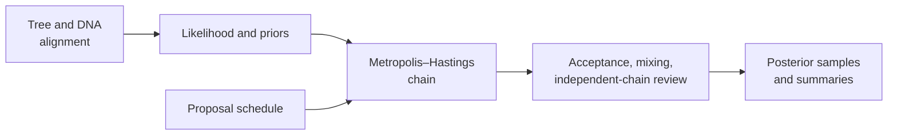
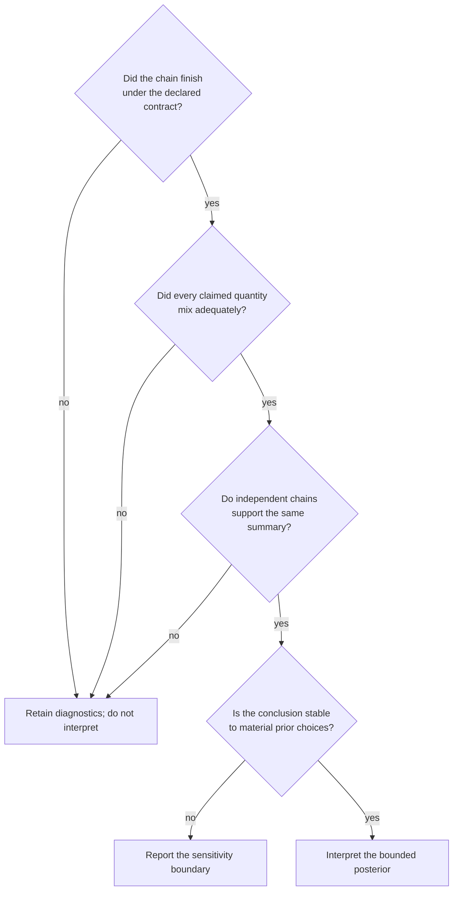

# Native Bayesian Inference

The native dispatcher runs supported DNA models with an explicitly compatible
proposal schedule. Priors, moves, iteration policy, sampling interval, and
seed are part of the inference contract—not hidden execution details.



## Fixed-Topology DNA

The supplied topology remains fixed while branch lengths and supported
substitution parameters are sampled.

Before sampling, write down the estimand and the state allowed to move:

| Contract choice | Fixed-topology run | Joint-topology run |
| --- | --- | --- |
| topology | conditioned on the supplied tree | sampled under the declared topology prior |
| branch lengths | sampled under the branch-length prior | sampled together with topology |
| substitution parameters | sampled when supported by the chosen model | sampled through the embedded sequence model |
| topology proposals | none | at least one positive NNI, SPR, or TBR move weight |
| topology uncertainty | outside the run | represented by sampled topology identities |

These are different posterior models. A fixed-topology chain cannot be
reinterpreted as topology-marginal inference after it has run.

```python
from bijux_phylogenetics.bayesian import (
    build_dirichlet_simplex_substitution_parameter_prior,
    build_exponential_branch_length_prior,
    build_exponential_positive_substitution_parameter_prior,
    build_fixed_topology_dna_model_definition,
    build_fixed_topology_dna_proposal_schedule,
    build_substitution_parameter_prior_bundle,
    run_bayesian_inference,
)
from bijux_phylogenetics.io.fasta.core import load_fasta_alignment
from bijux_phylogenetics.io.trees import load_tree

tree = load_tree("dataset/tree.nwk")
records = load_fasta_alignment("dataset/alignment.fasta")

model = build_fixed_topology_dna_model_definition(
    substitution_model_name="HKY85",
    branch_length_prior=build_exponential_branch_length_prior(rate=4.0),
    substitution_parameter_prior_bundle=build_substitution_parameter_prior_bundle(
        kappa_prior=build_exponential_positive_substitution_parameter_prior(
            rate=1.5
        ),
        base_frequency_prior=build_dirichlet_simplex_substitution_parameter_prior(
            expected_component_names=("A", "C", "G", "T"),
            concentration_parameters={"A": 2.0, "C": 2.0, "G": 2.0, "T": 2.0},
        ),
    ),
)

proposals = build_fixed_topology_dna_proposal_schedule(
    model_definition=model,
    branch_length_move_weight=1.0,
    branch_length_log_scale_standard_deviation=0.25,
    kappa_move_weight=1.0,
    kappa_log_scale_standard_deviation=0.35,
    base_frequency_move_weight=1.0,
    base_frequency_coordinate_standard_deviation=0.45,
)

report = run_bayesian_inference(
    tree=tree,
    records=records,
    model_definition=model,
    proposal_schedule=proposals,
    iteration_count=20_000,
    sample_every=20,
    seed=11,
)
```

The documented parameterized substitution families are `K80`, `HKY85`, and
`GTR`; `JC69` is not accepted by this builder contract.

## Observation Policy Changes The Likelihood

`observation_policy` is part of the model identity, not an input-cleaning
convenience:

| Policy | Treatment | Interpretation boundary |
| --- | --- | --- |
| `reject` | refuse gaps, ambiguity, or explicit missing states outside the strict DNA contract | strongest refusal semantics; preprocessing must be separately recorded |
| `treat-as-missing` | allow supported non-base observations to contribute as missing | discards state-specific information at affected cells |
| `ambiguity-vector` | map supported IUPAC ambiguity symbols to compatible base-state vectors | likelihood integrates the declared ambiguity set |
| `fifth-state` | treat gap as an additional modeled state under supported contracts | changes the state space and compatible root/model assumptions |

Runs with different observation policies target different likelihoods even
when the tree, alignment file, and substitution-model label match. Preserve
the policy in every posterior comparison and predictive check.

## Joint-Topology DNA

Joint inference adds a topology prior and topology moves to the sequence-model
schedule:

```python
from bijux_phylogenetics.bayesian import (
    build_joint_topology_dna_model_definition,
    build_joint_topology_dna_proposal_schedule,
    build_uniform_rooted_tree_topology_prior,
)

joint_model = build_joint_topology_dna_model_definition(
    sequence_model_definition=model,
    topology_prior=build_uniform_rooted_tree_topology_prior(
        ["A", "B", "C", "D"]
    ),
)

joint_proposals = build_joint_topology_dna_proposal_schedule(
    sequence_proposal_schedule=proposals,
    nni_move_weight=1.0,
)

joint_report = run_bayesian_inference(
    tree=tree,
    records=records,
    model_definition=joint_model,
    proposal_schedule=joint_proposals,
    iteration_count=20_000,
    sample_every=20,
    seed=7,
)
```

Taxa in the topology prior, starting tree, and alignment must agree. Topology
diversity is exposed through `distinct_topology_count` and
`distinct_topology_ids`; diversity alone does not establish adequate mixing.

## Dispatcher Invariants

The dispatcher rejects unknown definitions and schedules, fixed-topology
models paired with joint schedules, and joint-topology models paired with fixed
schedules. It never routes these calls through BEAST or MrBayes.

## Read The Returned Record

Both dispatcher paths return the model definition, proposal schedule,
observation policy, underlying `chain_report`, and retained `posterior_rows`.
Joint-topology reports additionally expose `distinct_topology_ids` and
`distinct_topology_count`.

```python
print(report.observation_policy)
print(len(report.posterior_rows))
print(report.chain_report)

if hasattr(report, "distinct_topology_count"):
    print(report.distinct_topology_count)
```

Preserve the model and schedule with posterior rows. A table of sampled values
without the priors, proposal kernels, iteration policy, seed, and observation
policy is not a reconstructable posterior record.

## Read One Posterior Row

Each retained row records `sample_index`, `iteration_index`, `topology_id`,
substitution model, total log prior, log likelihood, posterior log score,
prior-component contributions, branch lengths, scalar parameters, and vector
parameters. These fields form one coherent state; joining values from different
rows creates a state the chain never visited.

```text
posterior log score = total log prior + log likelihood
```

Check the retained identity before summarizing:

- `sample_index` identifies order in the retained sample, while
  `iteration_index` identifies the chain iteration that produced it;
- `topology_id` is constant for fixed-topology runs and varies only when a
  joint-topology chain accepts topology moves;
- prior-component rows explain the total prior contribution and should remain
  aligned with the model definition;
- scalar/vector parameter names and branch identities must be consistent
  across rows before computing summaries.

## The Chain Report Owns Execution State

`chain_report` retains iteration count, sampling interval, seed, accepted and
rejected counts, aggregate acceptance rate, initial and final state, sampled
states, and iteration-level proposal rows. The proposal rows expose changed
fields, validity, Hastings ratio, acceptance decision, and posterior scores.

Aggregate acceptance can hide a frozen parameter family. Review movement and
validity by proposal target, then assess autocorrelation and effective sample
size on every quantity used in the conclusion. Independent chains are
separate executions with separate seeds and initial states; concatenating one
chain’s segments does not create an independent-chain denominator.

## Posterior Review

Inspect `model_definition`, `proposal_schedule`, `observation_policy`,
`chain_report`, and `posterior_rows`. A defensible analysis also evaluates:

- move-level acceptance rates rather than one aggregate count;
- burn-in and retained-sample policy;
- autocorrelation and effective sample size;
- stability of summaries across independent seeds;
- trace behavior and topology visitation where applicable;
- prior sensitivity for weakly identified parameters.

Iteration count in an example is not a convergence guarantee. Extend or tune a
chain based on diagnostics, then preserve the diagnostics with summaries.

## Decide Whether The Run Is Interpretable



Run completion and sample count are necessary bookkeeping, not convergence
evidence. Apply diagnostics to every quantity used by the conclusion; topology
mixing cannot be inferred from a well-mixed substitution parameter.

## Scope

The dispatcher contract covers supported fixed- and joint-topology DNA paths.
Other native Bayesian modules have their own contracts and maturity. External
BEAST, MrBayes, and `MCMCglmm` workflows remain separately attributed.
Posterior computation does not by itself validate the biological model or
close an Evidence Book claim.
