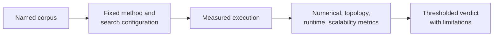

# Native Benchmark Review

A benchmark is a named experiment, not a permanent adjective attached to a
method. Review its corpus, configuration, environment, metrics, and acceptance
rule before using it to support a claim.



## Start With The Question

Benchmarks in this repository can address different questions: numerical
agreement, recovered topology, likelihood quality, robustness across a corpus,
runtime scaling, or behavior relative to a reference engine. One record rarely
answers all of them.

## Required Context

| Context | Why it matters |
| --- | --- |
| corpus identity | defines taxa, sequence length, model stress, and representativeness |
| runtime and engine versions | ties behavior to implementations actually measured |
| hardware and concurrency | qualifies time and memory comparisons |
| model/search configuration | prevents default differences from masquerading as algorithm differences |
| seed and repetition policy | exposes stochastic variability |
| metric and tolerance | defines what “agreement” or “pass” means |

## Review Order

1. Read the benchmark manifest and corpus description.
2. Confirm the method under review is the one named in the configuration.
3. Separate correctness-oriented metrics from resource-oriented metrics.
4. Inspect per-case results before aggregate summaries.
5. Review failures, exclusions, timeouts, and missing values explicitly.
6. Apply the declared acceptance criteria; do not invent a friendlier one
   after seeing the result.
7. State the benchmark scope alongside any conclusion.

## Run The Governed Maximum-Likelihood Suite

The unified CLI combines speed, peak-memory, simulated-truth accuracy, and
cached wrapper-correspondence observations without collapsing their meanings:

```bash
mkdir -p artifacts/native-benchmark
bijux-phylogenetics benchmark native-maximum-likelihood-suite \
  --replicates 3 \
  --size-class compact --taxon-count 8 --site-count 200 \
  --size-class extended --taxon-count 16 --site-count 400 \
  --scaling-model hky85 --scaling-search-method nni \
  --accuracy-model hky85 --accuracy-search-method nni \
  --start-tree-count 4 --start-tree-seed 17 \
  --manifest artifacts/native-benchmark/manifest.json \
  --json > artifacts/native-benchmark/report.json
```

Repeated size-class, taxon-count, and site-count arguments are positional
partners. Keep them in the same order. The manifest preserves invocation
identity; the JSON report preserves the measured observations and suite
summary. Shell redirection is explicit because `--json` writes the report to
standard output.

For accuracy-only review, use
`benchmark native-maximum-likelihood-accuracy`. That lane compares inferred
topology, parameters, and likelihood quality with governed simulated truth;
it is not a timing benchmark.

## Read Suite Dimensions Separately

| Dimension | Primary observation | Safe conclusion |
| --- | --- | --- |
| speed | runtime by size class, fixed model, search method, and replicate policy | measured runtime behavior for the named lanes |
| memory | peak bytes and growth status under the benchmark measurement boundary | measured memory behavior for the named lanes |
| simulated truth | topology recovery, Robinson–Foulds distance, parameter deltas, likelihood shortfall | recovery behavior for the generating cases |
| wrapper correspondence | native and cached-wrapper values under a named comparison policy | relationship for supported wrapper cases |

The suite retains statuses such as native advantage, native bug, expected
assumption difference, and unsupported case. Only the first is a performance
result; only `native-bug` is an implementation-failure classification. Never
convert an unsupported comparison into a pass by excluding it from the
denominator.

## Metric Interpretation

Likelihood differences require comparable model parameterization and numerical
conventions. Topology metrics require compatible taxon sets and rootedness
semantics. Runtime comparisons require comparable hardware, concurrency, and
workload. Memory peaks need consistent measurement boundaries.

A faster result with a worse objective, or a matching objective from an
incompatible model, is not a clean performance win.

## Benchmark Versus Evidence

Benchmark records characterize implementation behavior on named corpora.
Evidence bundles connect bounded study claims to provenance, checks, and
verdicts. A benchmark may contribute to evidence, but it does not automatically
establish a biological interpretation or study parity.

## Minimum Publication Packet

Publish the benchmark question, command or API configuration, input corpus or
simulation policy, runtime and hardware identity, raw observations, aggregate
summary, all limitations, and the acceptance rule. Preserve the selected,
executed, failed, unsupported, and omitted denominators.

A chart without the observation table cannot be audited. A table without the
configuration cannot be reproduced. A summary without limitations cannot be
generalized safely.

## Honest Claim Patterns

Prefer: “On corpus X, configuration Y, and environment Z, the native method
met tolerance T for metric M.” Avoid: “The native method is equivalent,”
“faster,” or “validated” without scope.

## Failure Is Data

Timeouts, convergence failures, parser errors, and excluded cases belong in the
record. Hiding them changes the experiment. If the benchmark contract permits
an exclusion, report the rule and count; otherwise the exclusion is a failed
or incomplete verdict.

Continue with [native inference and benchmarks](../interfaces/native-inference-and-benchmarks.md)
for the public result surface and [validation lanes](../quality/validation-lanes.md)
for the broader proof hierarchy.
