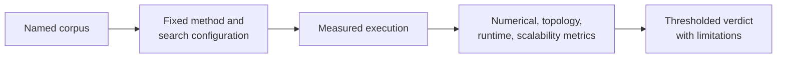

# Native Benchmark Review

A benchmark is a named experiment, not a permanent adjective attached to a
method. Review its corpus, configuration, environment, metrics, and acceptance
rule before using it to support a claim.

## Start With The Question

Benchmarks in this repository can address different questions: numerical
agreement, recovered topology, likelihood quality, robustness across a corpus,
runtime scaling, or behavior relative to a reference engine. One record rarely
answers all of them.

## Required Context

| Context | Why it matters |
| --- | --- |
| corpus identity | defines taxa, sequence length, model stress, and representativeness |
| runtime and engine versions | ties behavior to implementations actually measured |
| hardware and concurrency | qualifies time and memory comparisons |
| model/search configuration | prevents default differences from masquerading as algorithm differences |
| seed and repetition policy | exposes stochastic variability |
| metric and tolerance | defines what “agreement” or “pass” means |

## Review Order

1. Read the benchmark manifest and corpus description.
2. Confirm the method under review is the one named in the configuration.
3. Separate correctness-oriented metrics from resource-oriented metrics.
4. Inspect per-case results before aggregate summaries.
5. Review failures, exclusions, timeouts, and missing values explicitly.
6. Apply the declared acceptance criteria; do not invent a friendlier one
   after seeing the result.
7. State the benchmark scope alongside any conclusion.

## Metric Interpretation

Likelihood differences require comparable model parameterization and numerical
conventions. Topology metrics require compatible taxon sets and rootedness
semantics. Runtime comparisons require comparable hardware, concurrency, and
workload. Memory peaks need consistent measurement boundaries.

A faster result with a worse objective, or a matching objective from an
incompatible model, is not a clean performance win.

## Benchmark Versus Evidence

Benchmark records characterize implementation behavior on named corpora.
Evidence bundles connect bounded study claims to provenance, checks, and
verdicts. A benchmark may contribute to evidence, but it does not automatically
establish a biological interpretation or study parity.

## Honest Claim Patterns

Prefer: “On corpus X, configuration Y, and environment Z, the native method
met tolerance T for metric M.” Avoid: “The native method is equivalent,”
“faster,” or “validated” without scope.

## Failure Is Data

Timeouts, convergence failures, parser errors, and excluded cases belong in the
record. Hiding them changes the experiment. If the benchmark contract permits
an exclusion, report the rule and count; otherwise the exclusion is a failed
or incomplete verdict.

Continue with [native inference and benchmarks](../interfaces/native-inference-and-benchmarks.md)
for the public result surface and [validation lanes](../quality/validation-lanes.md)
for the broader proof hierarchy.
