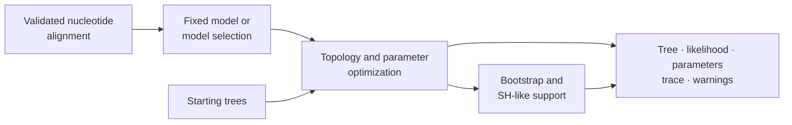

# Native Maximum-Likelihood Inference

Native nucleotide inference jointly exposes model choice, tree search,
parameter fitting, support estimation, and search provenance through one
`NucleotideMaximumLikelihoodResult`.



## Input Preconditions

- The alignment must contain a compatible DNA alphabet and useful sites.
- Taxon labels must be unique and stable across every downstream artifact.
- Model selection and fixed-model runs answer different review questions.
- Starting-tree count and seed are part of search configuration.
- Support resampling needs its own replicate counts and seeds.

Validate biological sampling, alignment homology, recombination assumptions,
and model suitability outside the optimizer; a syntactically valid FASTA file
does not establish them.

## Run A Search

```python
from pathlib import Path

from bijux_phylogenetics.phylo.likelihood import (
    infer_nucleotide_maximum_likelihood_result_from_alignment,
    write_nucleotide_maximum_likelihood_result_json,
)

result = infer_nucleotide_maximum_likelihood_result_from_alignment(
    Path("dataset/alignment.fasta"),
    model_name="auto",
    model_selection_criterion="aic",
    search_method="nni",
    start_tree_count=4,
    start_tree_seed=17,
)

write_nucleotide_maximum_likelihood_result_json(
    Path("artifacts/native-maximum-likelihood/result.json"),
    result,
)
```

`model_name="auto"` performs governed selection across the supported
nucleotide family. Use `jc69`, `k80`, `f81`, `hky85`, or `gtr` when the model
is fixed by the analysis contract. Record the criterion when selection is
enabled; AIC and other criteria are not interchangeable labels.

## Add Branch Support

```python
result = infer_nucleotide_maximum_likelihood_result_from_alignment(
    Path("dataset/alignment.fasta"),
    model_name="hky85",
    search_method="nni",
    start_tree_count=4,
    start_tree_seed=17,
    bootstrap_replicate_count=200,
    bootstrap_seed=5,
    sh_like_resampling_replicate_count=200,
    sh_like_resampling_seed=11,
)
```

Bootstrap and SH-like values have different resampling and interpretation
contracts. Preserve method identity with every support value. Replicate count
affects Monte Carlo stability; it should be justified rather than copied from
an example.

## Inspect Before Reporting

```python
print(result.model_name)
print(result.final_log_likelihood)
print(result.final_topology_fingerprint)
print(result.parameter_values)
print(result.warning_messages)

for run in result.run_summaries:
    print(run)
```

Review all starting runs, not only the selected optimum. Repeated convergence
to the same topology and likelihood provides stronger search evidence than one
successful start. Inspect accepted moves and warnings for stagnation,
degenerate branch lengths, or model-fit problems.

## Stable Result State

The public contract includes model and selection fields, final tree and
topology fingerprint, log likelihood, fitted parameters, search method,
multi-start summaries, accepted search trace rows, support reports, warnings,
and optional benchmark metadata. It supports dictionary and JSON round trips.

Persist the whole result. A Newick tree alone loses model, objective,
parameters, search history, support method, warnings, and software identity.

## Wrapper Correspondence

`include_wrapper_correspondence_benchmark=True` attaches the configured
wrapper-comparison summary. This is useful for a result-level comparison
record, but it does not turn one run into corpus-wide benchmark evidence or a
governed study verdict.

## Interpretation Boundaries

- Maximum likelihood identifies an optimum under the supplied data, model,
  and search—not the uniquely true evolutionary history.
- A higher likelihood is comparable only under compatible data and model
  parameterization.
- Branch support is not posterior probability and is not evidence that the
  model fits.
- Search agreement does not remove alignment, sampling, or model error.
- The documented native inference contract is currently nucleotide-focused;
  broader likelihood foundations do not imply matching inference maturity.

Use [native benchmark review](native-benchmark-review.md) for corpus-level
behavior and [artifact contracts](../interfaces/artifact-contracts.md) when
publishing the result.
