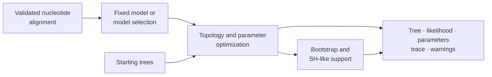
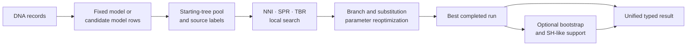

# Native Maximum-Likelihood Inference

Native nucleotide inference jointly exposes model choice, tree search,
parameter fitting, support estimation, and search provenance through one
`NucleotideMaximumLikelihoodResult`.



## Input Preconditions

- The alignment must contain a compatible DNA alphabet and useful sites.
- Taxon labels must be unique and stable across every downstream artifact.
- Model selection and fixed-model runs answer different review questions.
- Starting-tree count and seed are part of search configuration.
- Support resampling needs its own replicate counts and seeds.

Validate biological sampling, alignment homology, recombination assumptions,
and model suitability outside the optimizer; a syntactically valid FASTA file
does not establish them.

## Choose The Inference Contract

Decide which uncertainty belongs in the run before choosing arguments:

| Decision | Use | Retained evidence |
| --- | --- | --- |
| substitution model is fixed by the study | `model_name="jc69"`, `"k80"`, `"f81"`, `"hky85"`, or `"gtr"` | fitted parameters and the fixed model identity |
| model choice is part of inference | `model_name="auto"` plus an explicit selection criterion | every model-selection row, selected model, criterion, and warnings |
| topology search may depend on initialization | multiple starting trees with a recorded seed | one run summary per start and the winning source label |
| split stability matters | bootstrap, SH-like support, or both | method-specific reports with replicate counts and seeds |
| a result will be reviewed later | serialize `NucleotideMaximumLikelihoodResult` | tree, objective, parameters, traces, support, warnings, and optional benchmark metadata |

Do not enable support or model selection merely to make the result look more
complete. Each additional lane changes the computational question and must be
interpreted under its own assumptions.

## Understand The Search Pipeline



Model selection, starting-tree selection, local topology search, parameter
optimization, and branch support are separately inspectable. The best run is
selected from completed run summaries; its trace does not represent moves from
the losing starts. Preserve all run summaries to retain the search
denominator.

| Search method | Neighborhood meaning | Evidence to retain |
| --- | --- | --- |
| `nni` | nearest-neighbor interchange around internal edges | candidate/move trace, accepted improvements, topology fingerprints |
| `spr` | subtree pruning and regrafting over a broader neighborhood | evaluation budget where used, regraft trace, reoptimization policy |
| `tbr` | tree bisection and reconnection neighborhood | candidate trace, termination, computational budget and accepted topology changes |

A broader move family is not automatically a better analysis. Search budget,
reoptimization, starting pool, and termination must make the comparison fair.

## Run A Search

```python
from pathlib import Path

from bijux_phylogenetics.phylo.likelihood import (
    infer_nucleotide_maximum_likelihood_result_from_alignment,
    write_nucleotide_maximum_likelihood_result_json,
)

result = infer_nucleotide_maximum_likelihood_result_from_alignment(
    Path("dataset/alignment.fasta"),
    model_name="auto",
    model_selection_criterion="aic",
    search_method="nni",
    start_tree_count=4,
    start_tree_seed=17,
)

write_nucleotide_maximum_likelihood_result_json(
    Path("artifacts/native-maximum-likelihood/result.json"),
    result,
)
```

`model_name="auto"` performs governed selection across the supported
nucleotide family. Use `jc69`, `k80`, `f81`, `hky85`, or `gtr` when the model
is fixed by the analysis contract. Record the criterion when selection is
enabled; AIC and other criteria are not interchangeable labels.

## Add Branch Support

```python
result = infer_nucleotide_maximum_likelihood_result_from_alignment(
    Path("dataset/alignment.fasta"),
    model_name="hky85",
    search_method="nni",
    start_tree_count=4,
    start_tree_seed=17,
    bootstrap_replicate_count=200,
    bootstrap_seed=5,
    sh_like_resampling_replicate_count=200,
    sh_like_resampling_seed=11,
)
```

Bootstrap and SH-like values have different resampling and interpretation
contracts. Preserve method identity with every support value. Replicate count
affects Monte Carlo stability; it should be justified rather than copied from
an example.

## Inspect Before Reporting

```python
print(result.model_name)
print(result.final_log_likelihood)
print(result.final_topology_fingerprint)
print(result.parameter_values)
print(result.warning_messages)

for run in result.run_summaries:
    print(run)
```

## Read The Result Hierarchy

| Result field | Scientific role | Review rule |
| --- | --- | --- |
| `inference_report` | complete model-selection, starting-run and best-search state | use when reconstructing how the winner was selected |
| `final_tree_newick` | portable selected topology and branch lengths | never report without model/search identity |
| `final_topology_fingerprint` | stable topology identity for comparison | compare only after taxon/rooting reconciliation |
| `final_log_likelihood` | objective for the selected fitted model | compare only under the same data and likelihood convention |
| `parameter_values` | fitted substitution/model parameters | inspect units, bounds and warning rows |
| `run_summaries` | every retained start and terminal outcome | denominator for multi-start stability |
| `search_trace_rows` | moves for the selected best search | inspect improvements, boundaries and termination; not all starts |
| `support_reports` | optional bootstrap and SH-like observations | preserve method and replicate identity |
| `warning_messages` | model, parameter, search and support qualifications | resolve or publish; never discard during serialization |
| `benchmark_metadata` | optional condensed wrapper correspondence | not a substitute for the full benchmark report |

Review all starting runs, not only the selected optimum. Repeated convergence
to the same topology and likelihood provides stronger search evidence than one
successful start. Inspect accepted moves and warnings for stagnation,
degenerate branch lengths, or model-fit problems.

### Compare Search Outcomes, Not Just Scores

Two starts can have nearly equal likelihoods and different topologies, or the
same topology and materially different boundary parameters. Review topology
fingerprints, objectives, fitted parameters, warnings, and termination
together. A single scalar tolerance cannot establish search equivalence.

Use an acceptance record that names the intended claim. At minimum, record:

| Review dimension | Evidence in the result | Refuse or qualify when |
| --- | --- | --- |
| model choice | selection rows, criterion, selected model | candidates failed, warnings are material, or parameter counting is incompatible with the claimed comparison |
| search behavior | run summaries, topology fingerprints, accepted search trace | starts settle on materially different optima or the chosen search did not explore the required neighborhood |
| parameter fit | fitted values and boundary warnings | estimates sit on bounds, are non-finite, or have no interpretable scale |
| branch support | method-specific support report | replicate policy is too weak, support semantics are mixed, or required splits are unstable |
| reproducibility | seeds, search policy, complete JSON record | configuration or the serialized result is missing |

Acceptance is claim-specific. A tree may be adequate for illustrating an API
while remaining unsuitable for a biological conclusion.

## Stable Result State

The public contract includes model and selection fields, final tree and
topology fingerprint, log likelihood, fitted parameters, search method,
multi-start summaries, accepted search trace rows, support reports, warnings,
and optional benchmark metadata. It supports dictionary and JSON round trips.

Persist the whole result. A Newick tree alone loses model, objective,
parameters, search history, support method, warnings, and software identity.

Reload the record through the typed contract rather than treating its JSON as
an undocumented dictionary:

```python
from pathlib import Path

from bijux_phylogenetics.phylo.likelihood import (
    load_nucleotide_maximum_likelihood_result_json,
)

restored = load_nucleotide_maximum_likelihood_result_json(
    Path("artifacts/native-maximum-likelihood/result.json")
)
assert restored.final_topology_fingerprint == result.final_topology_fingerprint
```

The round trip checks schema reconstruction. It does not rerun the optimizer
or establish that a stored result remains suitable after the input, model, or
software revision changes.

## Wrapper Correspondence

`include_wrapper_correspondence_benchmark=True` attaches the configured
wrapper-comparison summary. This is useful for a result-level comparison
record, but it does not turn one run into corpus-wide benchmark evidence or a
governed study verdict.

## Interpretation Boundaries

- Maximum likelihood identifies an optimum under the supplied data, model,
  and search—not the uniquely true evolutionary history.
- A higher likelihood is comparable only under compatible data and model
  parameterization.
- Branch support is not posterior probability and is not evidence that the
  model fits.
- Search agreement does not remove alignment, sampling, or model error.
- The documented native inference contract is currently nucleotide-focused;
  broader likelihood foundations do not imply matching inference maturity.

Use [native benchmark review](native-benchmark-review.md) for corpus-level
behavior and [artifact contracts](../interfaces/artifact-contracts.md) when
publishing the result.
