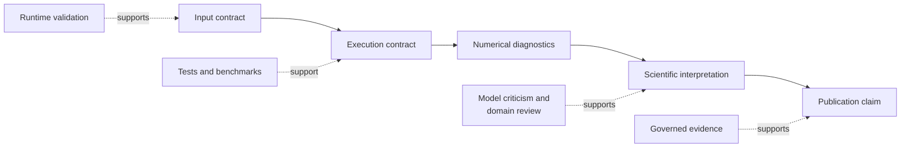

# Operational And Scientific Boundaries

Execution correctness and scientific interpretation are separate review
problems. The runtime can establish that a declared procedure was applied and
preserve its diagnostics. It cannot establish that the procedure answers the
right biological question.

## Boundary Matrix

| Surface | Runtime can establish | Requires scientific judgment |
| --- | --- | --- |
| tree validation | parseability, identifiers, rootedness, branch constraints | whether the tree and sampling represent the question |
| alignment validation | alphabet, length, coding, partition structure | homology, recombination, locus suitability |
| optimization | objective, parameters, search trace, warnings | model adequacy and biological meaning |
| posterior sampling | draws, acceptance, trace and chain diagnostics | prior adequacy, identifiability, interpretation |
| ancestral reconstruction | conditional estimates and uncertainty | whether assumptions support historical inference |
| benchmark | metrics on a named corpus and environment | generalization to a new workload |
| report | faithful structured presentation | correctness of the scientific conclusion |

## External Engines

Adapter success means inputs were prepared, a named executable ran, outputs
were captured and parsed, and normalized artifacts were produced. It does not
transfer algorithm ownership to this repository. Preserve executable version,
command configuration, captured diagnostics, and original outputs.

## Stochastic Work

Seeds make a run identifiable; they do not remove Monte Carlo error or search
uncertainty. Use multiple starts or independent chains when required, inspect
between-run stability, and report variation rather than selecting the most
convenient result.

## Failure Handling

Do not flatten these states into one generic failure:

- invalid input contract;
- unavailable or incompatible external executable;
- numerical non-convergence or inadequate sampling;
- output parsing or schema incompatibility;
- artifact persistence failure;
- failed benchmark or evidence acceptance criterion.

Each has a different owner and corrective action.

## Classify Before Retrying

| Observed state | Establish | Correct response | Unsafe response |
| --- | --- | --- | --- |
| input refusal | violated identifier, alphabet, dimension, tree, or model precondition | correct or explicitly exclude the offending input, then create a new identity | coerce silently or drop rows without an exclusion ledger |
| external engine unavailable | requested path, resolution attempt, version probe, and workflow requirement | install/select a compatible executable or retain the unavailable state | reuse an unrelated old output |
| timeout or interrupted process | active/incomplete marker, command, elapsed budget, and partial files | reject or explicitly clean the identified incomplete run | treat file presence as completion |
| numerical non-convergence | objective or chain state, warnings, bounds, starts/seeds, diagnostics | revise the declared numerical strategy and preserve the failed attempt | publish the best-looking estimate without convergence context |
| parser/schema rejection | native file identity, expected grammar/schema, parser version | correct the producer/consumer contract or use a supported parser | hand-edit output until it parses without recording the change |
| artifact persistence failure | result status, expected inventory, filesystem error, and checksums | repair persistence and regenerate the complete bundle | cite an in-memory value as though the bundle exists |
| acceptance-rule failure | raw observations, normalization, tolerance, and denominator | preserve the failed row and investigate the scientific or implementation cause | widen tolerance after observing the result without governance |

Retrying is a new execution unless the surface defines verified resume
semantics. The new record must not overwrite the failed attempt when that
attempt is evidence needed to explain the final result.

## Minimum Diagnostic Packet

Before escalating an operational failure, retain:

- command or callable identity, package version, Python/platform identity, and
  external executable version when applicable;
- input locators, content checksums, accepted/excluded taxa or records, and
  model configuration;
- seed, threads, timeout, search/sampler controls, and resume policy;
- structured status, warnings, exception category, captured standard streams,
  and active/incomplete markers;
- expected output inventory, files actually present, parser state, and
  checksums for accepted artifacts.

This packet attributes the failure without requiring a reviewer to infer state
from directory names or terminal history.

## Stop Conditions

Stop interpretation when object identity is ambiguous, the requested model is
unsupported, a required engine or output is absent, diagnostics invalidate the
estimate, or the comparison rule cannot align the estimands. A partial result
may still be useful for diagnosis, but it must remain partial in structured
status and public language.

## Publication Threshold

Before a result becomes a public scientific claim, retain exact inputs,
versions, configuration, seeds, diagnostics, exclusions, artifacts, and the
evidence scope supporting the wording. A capability may be fully implemented
while its study verdict remains open; publication language must preserve both
facts.
