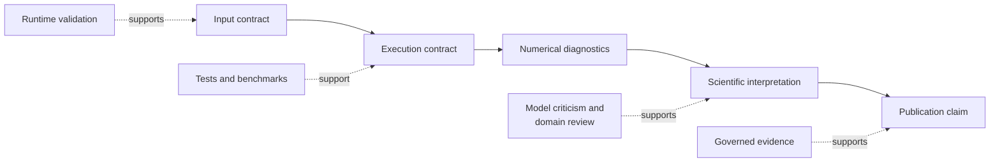

# Operational And Scientific Boundaries

Execution correctness and scientific interpretation are separate review
problems. The runtime can establish that a declared procedure was applied and
preserve its diagnostics. It cannot establish that the procedure answers the
right biological question.

## Boundary Matrix

| Surface | Runtime can establish | Requires scientific judgment |
| --- | --- | --- |
| tree validation | parseability, identifiers, rootedness, branch constraints | whether the tree and sampling represent the question |
| alignment validation | alphabet, length, coding, partition structure | homology, recombination, locus suitability |
| optimization | objective, parameters, search trace, warnings | model adequacy and biological meaning |
| posterior sampling | draws, acceptance, trace and chain diagnostics | prior adequacy, identifiability, interpretation |
| ancestral reconstruction | conditional estimates and uncertainty | whether assumptions support historical inference |
| benchmark | metrics on a named corpus and environment | generalization to a new workload |
| report | faithful structured presentation | correctness of the scientific conclusion |

## External Engines

Adapter success means inputs were prepared, a named executable ran, outputs
were captured and parsed, and normalized artifacts were produced. It does not
transfer algorithm ownership to this repository. Preserve executable version,
command configuration, captured diagnostics, and original outputs.

## Stochastic Work

Seeds make a run identifiable; they do not remove Monte Carlo error or search
uncertainty. Use multiple starts or independent chains when required, inspect
between-run stability, and report variation rather than selecting the most
convenient result.

## Failure Handling

Do not flatten these states into one generic failure:

- invalid input contract;
- unavailable or incompatible external executable;
- numerical non-convergence or inadequate sampling;
- output parsing or schema incompatibility;
- artifact persistence failure;
- failed benchmark or evidence acceptance criterion.

Each has a different owner and corrective action.

## Publication Threshold

Before a result becomes a public scientific claim, retain exact inputs,
versions, configuration, seeds, diagnostics, exclusions, artifacts, and the
evidence scope supporting the wording. A capability may be fully implemented
while its study verdict remains open; publication language must preserve both
facts.
