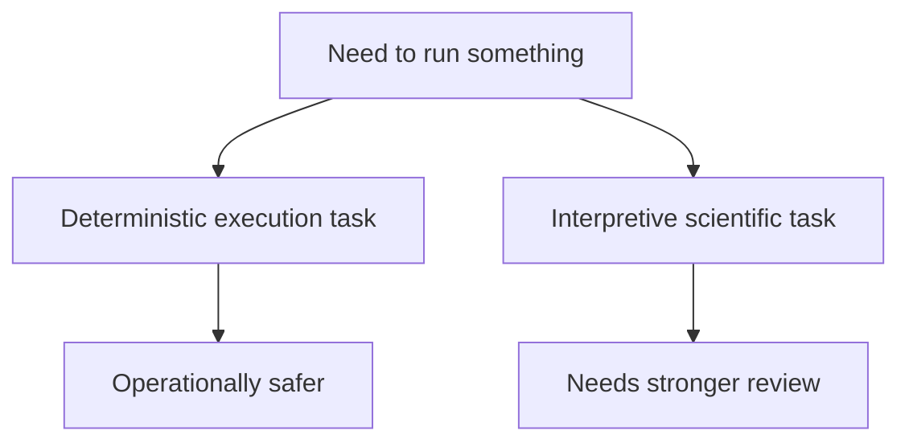

# Operational Boundaries

Some runtime surfaces are safe operational tools. Others depend on stronger
scientific judgment.

If the first question is which public surface to use at all, start from the
[surface selection guide](../interfaces/surface-selection.md) before applying
these operational boundaries.

## Operationally Safer Surfaces

- tree validation and inspection
- deterministic formatting and reporting
- explicit bundle and artifact packaging
- dataset preparation where the main question is structural correctness rather
  than biological interpretation

## Surfaces That Need Stronger Review

- comparative model interpretation
- ancestral inference interpretation
- external-engine results used in publication claims
- native benchmark interpretation when one difference may reflect model
  assumptions rather than one generic success or failure
- mixed-model or posterior claims where the repository documents the boundary
  more strongly than it reproduces the underlying lecture workflow

## Practical Rule

If the output mainly answers "did the runtime execute the declared procedure
correctly?", the surface is closer to operational. If the output mainly answers
"what biological conclusion should I publish?", the surface needs stronger
scientific review.

That distinction keeps operational convenience from turning into false
scientific certainty.
