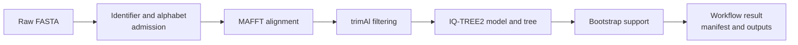

# Sequence-To-Tree Study

A sequence-to-tree run is a chain of scientific decisions, not one opaque
command. Bijux owns validation, orchestration, artifact linkage, and result
semantics. MAFFT, trimAl, and IQ-TREE2 own the external computations used by
this route.



## Declare The Study Before Execution

Record the sequence population, molecule type, identifier policy, trimming
rule, inference model policy, support replicate count, seed, thread count, and
required outputs. Normalizing identifiers or removing invalid records changes
the admitted population; those options are data transformations, not cosmetic
repairs.

The Python workflow makes every external owner explicit:

```python
from pathlib import Path

from bijux_phylogenetics.api import run_sequence_to_tree_workflow

result = run_sequence_to_tree_workflow(
    Path("study/sequences.fasta"),
    out_dir=Path("artifacts/sequence-to-tree"),
    prefix="study-tree",
    mafft_executable="mafft",
    trimal_executable="trimal",
    iqtree_executable="iqtree2",
    sequence_type="dna",
    bootstrap_replicates=1000,
    seed=17,
    threads=4,
    normalize_identifiers=False,
    remove_invalid_records=False,
    incomplete_run_policy="reject",
)

result.write_json(Path("artifacts/sequence-to-tree/workflow.json"))
result.write_tsv(Path("artifacts/sequence-to-tree/workflow.tsv"))
```

`sequence_type="dna"` is an assertion about the admitted alphabet. It does
not excuse illegal symbols. Validate unexpected or mixed alphabets before
choosing an inference model.

## Review Every Stage

| Stage | Review before continuing | Preserve |
| --- | --- | --- |
| admission | duplicate identifiers, empty records, illegal symbols, length outliers | original input and validation report |
| alignment | engine version, command, sequence count and ordering | native alignment and captured engine record |
| trimming | selected mode, threshold, removed-site count | untrimmed and trimmed alignments |
| inference | selected model, likelihood, engine completion state | native IQ-TREE2 files and normalized result |
| support | requested and observed replicate state, support-tree identity | support tree, table and incomplete-run decision |

Do not use the final tree to conceal a failed earlier stage. A support tree
cannot establish that identifier normalization was safe, and a complete
alignment cannot establish that inference finished.

## Treat Preflight Refusal As A Result

Executable discovery and compatibility checks occur before the output
directory is created. A missing or unsupported IQ-TREE2 executable raises an
`EngineWorkflowError` with a stable code and blocking-engine details. Preserve
that exception record; changing the executable or relaxing an incomplete-run
policy creates a distinct execution branch.

`resume=True` is safe only when the retained manifest and native files belong
to the same inputs, configuration, executable identities, and prefix. Similar
filenames are not resume identity.

## Accept The Tree Deliberately

Accept the run only when the declared stages completed, required outputs are
present, manifest paths resolve, warnings are understood, and the tree is
suitable for the intended downstream question. The workflow result exposes
the output paths, selected model, runtime, and linked stage records; it does
not decide whether taxon sampling, model adequacy, or support is scientifically
sufficient.

Publish the tree beside the admitted FASTA identity, alignments, model and
support settings, external-engine versions, workflow JSON, manifest, warnings,
and any excluded records. A Newick file alone cannot reconstruct this study.
