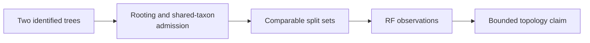

# Topology Comparison Study

A topology comparison answers a structural question about two identified
trees. It does not compare likelihoods, branch-length accuracy, support
calibration, or biological plausibility unless those are separately measured.

## Define The Comparison Population

Record both tree identities, rootedness, taxon sets, duplicate-label checks,
and the overlap policy before calculating a distance. The default public
workflow prunes to shared taxa; therefore its denominator may be smaller than
either input tree.

```python
from pathlib import Path

from bijux_phylogenetics.api import run_tree_comparison_workflow

comparison = run_tree_comparison_workflow(
    Path("study/candidate.nwk"),
    Path("study/reference.nwk"),
    rf_mode="rooted",
    taxon_overlap_policy="prune-to-shared",
)

comparison.write_json(Path("artifacts/topology/comparison.json"))
comparison.write_tsv(Path("artifacts/topology/comparison.tsv"))
```

The result records the input paths, shared taxa, rooted and unrooted
Robinson–Foulds distances, normalized distance, and topology-equality flags.
Persist the JSON when the full admitted population matters; the TSV is a
compact projection for tabular review.

## Interpret Distance In Context



| Observation | What it can support | What it cannot support alone |
| --- | --- | --- |
| `topology_equal` | equality under the selected rooted comparison | equal branch lengths, support, likelihood or provenance |
| `same_unrooted_topology` | equality after ignoring root placement | agreement about the root |
| normalized RF | structural difference relative to the eligible split count | comparability across changed taxon populations without qualification |
| shared taxon count | the admitted comparison population | completeness of either original tree |

A zero distance after pruning proves equality only for the retained taxa under
the selected mode. List taxa unique to either input and do not summarize that
result as whole-tree identity.

## Separate Support From Topology

Bootstrap or posterior support labels annotate clades; they are not part of a
plain RF topology comparison. Compare support with a clade-keyed ledger that
defines absent clades, incompatible splits, and missing values. Do not align
support rows by node number or traversal order across independently parsed
trees.

## Review A Collection Of Trees

For multiple candidates, declare the complete candidate set before selection.
Retain one comparison record per eligible pair, failures and excluded trees,
the ranking or acceptance rule, and ties. Reporting only the nearest candidate
changes the denominator and prevents review of search or sensitivity coverage.

Accept a topology claim only when input identity, rooting, taxon admission,
comparison mode, eligible split denominator, and result all remain linked.
Create a new comparison record whenever any of those facts changes.
