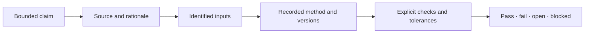

# Evidence Honesty And Limits

Evidence earns trust when readers can see both what it supports and where it
stops. The project therefore treats an open, failed, or externally blocked
verdict as useful information rather than a wording problem.

## Claim Anatomy

If a link is absent, say so. A narrative that leaps from source material to a
passing verdict without inputs and checks is not a complete evidence chain.

## Verdict Meanings

| Verdict | Meaning |
| --- | --- |
| pass | the declared checks satisfy the declared acceptance rule |
| fail | execution completed or was reviewed, and a required rule was not met |
| open | the claim is defined but evidence is incomplete or inconclusive |
| blocked | a named dependency prevents the required execution or review |

These verdicts apply to the claim, not to an entire package or study by
contagion. A study family may contain all four.

## Common Overclaims

- **Parity** without naming compared outputs, conventions, and tolerance.
- **Reproduced** when only the Python-side preparation ran.
- **Native** for a workflow whose computation is owned by an external engine.
- **Validated** because nearby methods have evidence.
- **Current** when the bundle predates material runtime or input changes.
- **Scientifically correct** because an execution is deterministic.

## External Boundaries

When an engine, posterior workflow, source dataset, or lecture-specific
interpretation remains external, record that boundary in the claim and bundle.
An adapter can be fully implemented and tested while the end-to-end study
verdict stays blocked or open. Those are compatible facts.

## Freshness

Evidence is tied to code, configuration, inputs, and sources. A change to any
material dependency can make a prior verdict stale without making it
historically false. Freshness reports should identify that state; documentation
should not keep presenting an old verdict as current.

## Negative Results

Failed comparisons, fragile examples, and sensitivity are part of the
scientific record. Preserve the configuration and observed difference, explain
whether the cause is understood, and define the next closure criterion. Do not
delete a difficult case from an aggregate without a declared exclusion rule.

## How To Write A Public Claim

Prefer: “For the named PCM study bundle, the implementation agrees with the
reference output within the declared tolerance; the posterior extension remains
external.” Avoid: “The comparative workflow has full parity.”

The first statement lets a reader verify strength and limitation. The second
borrows confidence from unspecified work.

## Reviewer Standard

Trace the claim ID to its bundle, source provenance, inputs, runtime versions,
checks, and verdict. Confirm it is fresh. Then read exclusions and open
boundaries before the headline result. If the chain cannot be followed, treat
the statement as documentation, not evidence.
