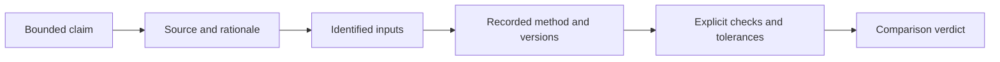
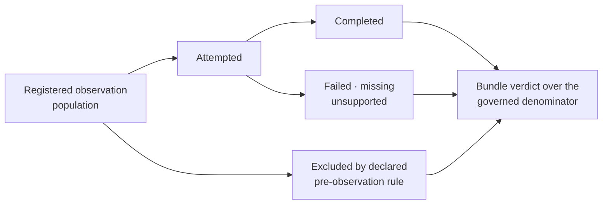

# Evidence Honesty And Limits

Evidence earns trust when readers can see both what it supports and where it
stops. The project therefore treats unexplained mismatches, non-comparable
claims, open follow-through, and external blockers as useful information rather
than wording problems.

## Write Every Claim With A Positive And A Boundary

A complete public statement has two inseparable clauses:

```text
supported statement = observed subject + population + method + rule + verdict
claim boundary      = exclusions + unresolved observations + freshness scope
```

For example, “the named PGLS coefficients agree within their registered
tolerances on the 75-species primate fixture” is incomplete unless it also
preserves the unresolved early-burst rows and non-comparable intercept sweep
when the surrounding sentence describes PCM2 more broadly. The boundary is
not defensive wording; it prevents a local observation from being promoted to
an unobserved method family.

When space is limited, narrow the positive clause rather than deleting the
boundary. A precise one-sentence claim is stronger than a broad headline whose
qualifiers exist only on another page.

## Claim Anatomy



If a link is absent, say so. A narrative that leaps from source material to a
passing verdict without inputs and checks is not a complete evidence chain.

## Governed Verdict Meanings

| Evidence verdict | Meaning |
| --- | --- |
| `matched` | every declared comparable observation satisfies its exact or structural rule |
| `matched_with_tolerance` | declared numerical differences remain within explicit tolerances |
| `mismatch_explained` | a mismatch is retained and attributed to a governed assumption or implementation difference |
| `mismatch_unexplained` | a required comparable observation disagrees without a resolved cause |
| `not_comparable` | execution, assumptions, ownership, or outputs do not support the proposed comparison |

Resolution workflow is a separate axis. A mismatch or non-comparable bundle
may have open follow-through, a named blocker, or an accepted bounded state.
Do not replace the evidence verdict with that workflow label. Verdicts apply to
registered claims and bundles, not to an entire package or study by contagion.

## Observation Status And Bundle Verdict

A bundle can contain several observation statuses and one governed summary
verdict. The summary must account for mismatches, plot-only fragments,
unsupported cases, and missing comparisons; it cannot report only the passing
subset. Read the observation ledger before interpreting the bundle headline.

## Keep The Observation Population Stable

Define the population of required, optional, and explicitly excluded
observations before comparison. Record selected, attempted, completed, failed,
missing, unsupported, and excluded counts separately. Those categories may
explain a result; they may not disappear from the audit trail.



A rerun may add new observations or resolve prior states, but it creates a new
identified comparison record. Do not compare the headline success rate across
runs until the registered population and category rules align. In particular,
“matched 8 of 8 completed” is not equivalent to “matched 8 of 10 required”
when two required observations failed or were never produced.

## Common Overclaims

- **Parity** without naming compared outputs, conventions, and tolerance.
- **Reproduced** when only the Python-side preparation ran.
- **Native** for a workflow whose computation is owned by an external engine.
- **Validated** because nearby methods have evidence.
- **Current** when the bundle predates material runtime or input changes.
- **Scientifically correct** because an execution is deterministic.

## Match Language To The Record

| Available record | Defensible language | Language not yet supported |
| --- | --- | --- |
| exported function and contract tests | “implemented” or “supported by the documented interface” | “numerically validated” |
| successful adapter bundle | “executed through the named external engine and parsed” | “native” or “equivalent” |
| passing registered parity case | “the named observations passed for this case and version pair” | “full package parity” |
| benchmark with acceptance rule | “met the named threshold on this corpus and environment” | “universally accurate” or “faster” |
| `matched` evidence bundle | “the registered claim matched under its exact rules” | “the entire study was reproduced” |
| `matched_with_tolerance` bundle | “the registered observations agreed within declared tolerances” | “identical output” |
| `mismatch_unexplained` observation | “a required comparison remains unexplained” | any passing aggregate that omits the row |
| `not_comparable` bundle | “the claim is documented but no valid aligned comparison exists” | “failed parity” or “open verdict” |

Words such as *native*, *parity*, *reproduced*, and *validated* describe
different ownership and evidence properties. Use them only when the owning
record exists.

## External Boundaries

When an engine, posterior workflow, source dataset, or lecture-specific
interpretation remains external, record that boundary in the claim and bundle.
An adapter can be fully implemented and tested while the end-to-end study
verdict remains `not_comparable`. Those are compatible facts.

## Freshness

Evidence is tied to code, configuration, inputs, and sources. A change to any
material dependency can make a prior verdict stale without making it
historically false. Freshness reports should identify that state; documentation
should not keep presenting an old verdict as current.

## Negative Results

Failed comparisons, fragile examples, and sensitivity are part of the
scientific record. Preserve the configuration and observed difference, explain
whether the cause is understood, and define the next closure criterion. Do not
delete a difficult case from an aggregate without a declared exclusion rule.

## Handle Contradictions Explicitly

A contradiction exists when records that should agree name different inputs,
versions, counts, values, statuses, or verdicts. Resolve it in this order:

1. identify which record owns each disputed field;
2. confirm that both records describe the same claim and revision;
3. inspect primary machine-readable observations before rendered summaries;
4. retain the contradiction as a blocker for the affected public statement;
5. regenerate projections from the corrected owner rather than editing each
   summary independently.

Do not average conflicting values, select the friendlier verdict, or demote the
conflict to a prose caveat. Until ownership and freshness agree, the strongest
safe conclusion is that the affected claim is unresolved.

## How To Write A Public Claim

Prefer: “For the named PCM study bundle, the implementation agrees with the
reference output within the declared tolerance; the posterior extension remains
external and non-comparable.” Avoid: “The comparative workflow has full parity.”

The first statement lets a reader verify strength and limitation. The second
borrows confidence from unspecified work.

## Reviewer Standard

Trace the claim ID to its bundle, source provenance, inputs, runtime versions,
checks, and verdict. Confirm it is fresh. Then read exclusions and open
boundaries before the headline result. If the chain cannot be followed, treat
the statement as documentation, not evidence.

The reviewer should be able to answer three questions without inference: what
was observed, what rule produced the status, and exactly where the conclusion
stops. If any answer depends on reputation or proximity to other passing work,
the claim is too broad.
