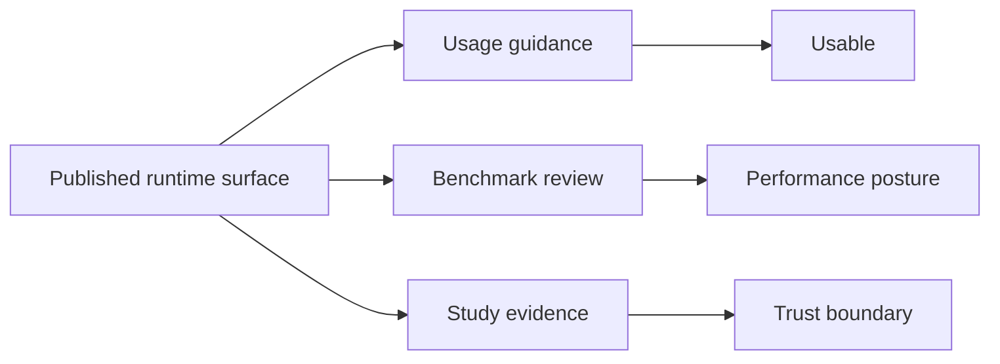

# Evidence Honesty And Limits

The public docs should make the repository look serious without making it look
broader, more closed, or more validated than it really is.

## What Honest Documentation Looks Like

- the runtime handbook explains what the product surface does today
- the runtime handbook distinguishes native ownership from wrapper-backed
  workflow ownership
- benchmark reports separate native advantage, native bug,
  expected-assumption-difference, and unsupported-case outcomes instead of
  flattening them into one score
- the evidence-book explains study-grounded parity, freshness, and bounded
  trust
- unresolved gaps stay visible instead of being rounded away in summary prose

## What Readers Should Not Infer

- a documented feature is not automatically evidence-closed
- one green validation lane is not blanket scientific validation
- one benchmark win is not proof that all nearby methods are stronger
- one study family is not proof for unrelated datasets or model families

## Why This Matters

Phylogenetics readers will naturally overread polished documentation. This
page exists so the repository resists that pressure deliberately. The result is
less flashy than a blanket maturity claim, but much more credible.
