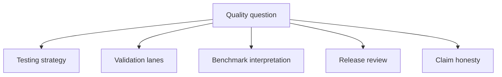

# Quality And Limits

This section explains how the repository tests itself, how it describes its
confidence boundaries, and how it decides whether a release is serious enough
to publish.

Start with validation lanes when the question is what a green result actually
proves.

Quality matters here because the runtime surface is broad. A single green
check cannot mean the same thing for unit behavior, benchmark posture,
comparative evidence, and release readiness.

## What This Section Answers

- Which validation lane proves which kind of behavior?
- How should benchmark results be interpreted?
- What makes a release believable instead of merely green?
- How does the project keep public claims narrower than the evidence supports?

## Quality Reading Model

- read validation lanes to understand what runtime behavior was actually
  checked
- read benchmark evidence to understand performance signals without turning
  them into blanket scientific claims
- read release review and publication gates to understand whether the public
  repository story is still aligned
- read evidence honesty guidance whenever a green check might be mistaken for
  broader scientific closure

## Proof Surfaces

| Proof surface | What it helps a reader judge |
| --- | --- |
| Test strategy | what kinds of behavior the repository bothers to check at all |
| Validation lanes | which green results correspond to which level of proof |
| Benchmark evidence | how to read performance and native-inference signals without overclaiming |
| Release review | whether docs, metadata, and governed reports remain aligned |
| Evidence honesty | where the code surface is broader than the closed evidence surface |

## Why This Section Is Public, Not Internal

This repository has enough scientific and runtime breadth that readers need a
public explanation of how trust is earned. Quality pages are not maintainer
notes. They are part of the user-facing truth surface.

## Read Next

- [Test strategy](test-strategy.md)
- [Validation lanes](validation-lanes.md)
- [Native benchmark evidence](native-benchmark-evidence.md)
- [Release review workflow](release-review-workflow.md)
- [Release and publication gates](release-and-publication-gates.md)
- [Evidence honesty and limits](evidence-honesty-and-limits.md)
