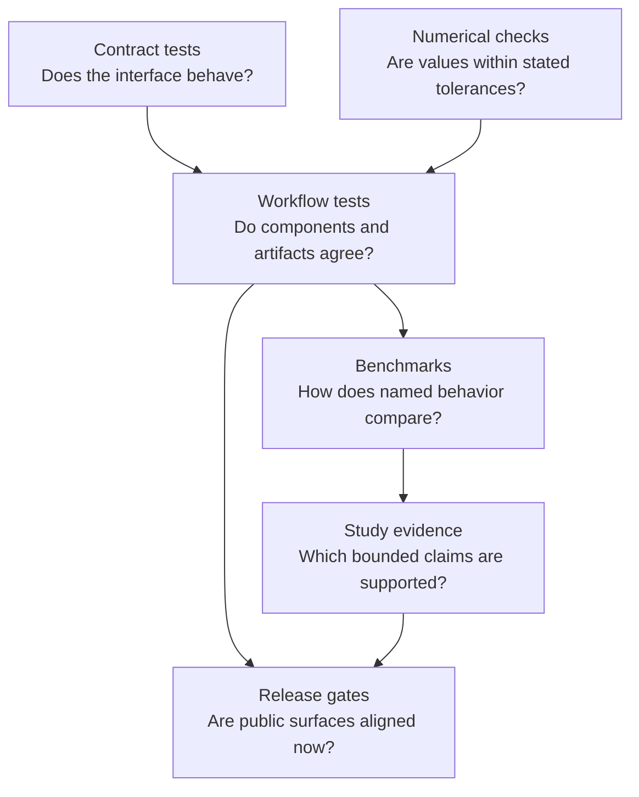
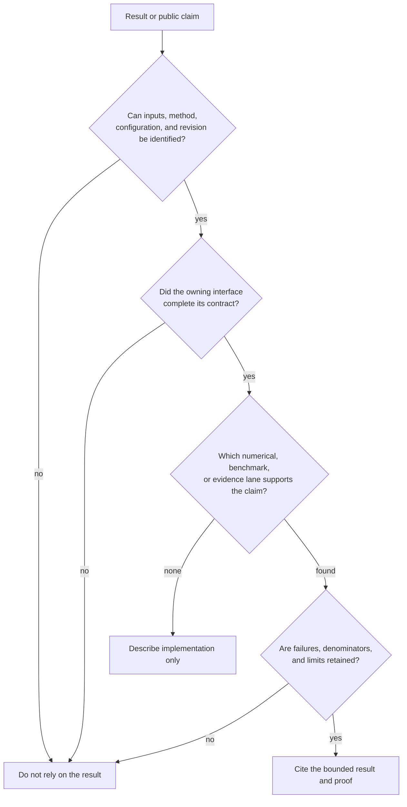

# Quality And Scientific Limits

Quality is not one green check. Scientific software needs evidence about API
contracts, numerical behavior, workflow integration, packaging, documentation,
and bounded study claims. Each proof surface answers a different question.

The arrows show increasing context, not a universal promotion ladder. A method
can have strong numerical tests without belonging to a published study.

## Read By Question

| Question | Page |
| --- | --- |
| What does each class of check prove? | [Validation lanes](validation-lanes.md) |
| How are tests organized? | [Test strategy](test-strategy.md) |
| How should public claims expose incomplete proof? | [Evidence honesty and limits](evidence-honesty-and-limits.md) |
| What does native benchmark evidence establish? | [Native benchmark evidence](native-benchmark-evidence.md) |
| What blocks publication? | [Release and publication gates](release-and-publication-gates.md) |
| How should a release be reviewed? | [Release review workflow](release-review-workflow.md) |

## Evaluate One Result

Start with the artifact or value you intend to rely on, not the repository's
largest green aggregate:

For example, a serialized maximum-likelihood result can pass its contract and
round-trip tests while its starting trees disagree or its benchmark corpus
reveals a recovery failure. The artifact is valid; the stronger scientific
claim is not. Preserve both conclusions.

## Proof Must Name Its Scope

A trustworthy claim identifies the subject, fixture or corpus, method and
configuration, comparison or invariant, tolerance or acceptance rule, and
current verdict. “Validated” without those qualifiers forces the reader to
invent a stronger meaning than the evidence may support.

## Count Independent Proof Deliberately

Several passing checks can be projections of the same underlying observation.
A unit test, benchmark row, parity summary, and report generated from one
fixture do not become four independent confirmations merely because they live
in different files.

| Shared dependency | What can still be claimed | What cannot be multiplied |
| --- | --- | --- |
| same input fixture and expected value | several contracts consumed one governed case correctly | independent data coverage |
| same implementation path exposed by Python and CLI | both interfaces preserve the result contract | independent numerical implementations |
| same external-engine output parsed into several tables | each projection is internally consistent | repeated external execution or algorithmic agreement |
| same reference observation reused across parity and evidence | both records can cite the observation within their scopes | independent reference confirmation |
| same random seed or simulated history across metrics | multiple properties of one replicate are inspectable | replicate count or stochastic robustness |
| same release report summarized on several pages | public projections agree with one decision | additional release gates |

Record the proof lineage and count independence at the level relevant to the
claim: distinct inputs, implementations, executions, chains, replicates,
references, or reviewers. Correlated proof can be valuable, but its shared
parent must remain visible.

## Quality Decision Record

| Field | Reviewer requirement |
| --- | --- |
| subject | exact parser, method, workflow, adapter, artifact, package, or claim |
| scope | fixtures, corpus, taxa, models, versions, configuration, and exclusions |
| owner | native implementation, Bijux adapter, or named external engine |
| observation | invariant, value, topology, distribution summary, artifact, or gate condition |
| rule | exact, tolerance-based, structural, distributional, or policy acceptance criterion |
| denominator | selected, executed, passed, failed, skipped, and missing cases |
| status | lane-specific verdict plus warnings and unresolved boundaries |
| revision | code, data, reference, schema, and environment identity |

A percentage without its denominator and exclusions is not an adequate quality
record. Neither is a green aggregate whose failed or skipped components cannot
be enumerated.

## Important Separations

- Correct serialization does not establish correct science.
- Agreement with a reference does not establish that the reference model fits
  a new biological question.
- Reproducibility does not eliminate systematic error.
- Passing benchmarks do not guarantee behavior outside their corpus.
- A release gate proves alignment at a particular revision, not permanent
  quality.
- Documentation can disclose proof; it cannot manufacture it.

## Failure And Uncertainty Are Outputs

Warnings, non-convergence, weak support, sensitivity, excluded cases, and open
evidence verdicts must remain visible. A pipeline that converts all completed
processes into success destroys information reviewers need.

## Assemble A Trust Packet

For any result used in a publication or downstream decision, retain:

1. input identities and the exact analytical population;
2. runtime, model, configuration, seeds, and external-owner versions;
3. structured result plus warnings, diagnostics, and partial state;
4. the closest numerical, benchmark, or evidence record;
5. acceptance rule, denominator, verdict, and unresolved observations;
6. the revision and freshness state under which the conclusion was reviewed.

This packet is deliberately result-scoped. A repository release report can
show that public surfaces align, but the result's own scientific evidence must
still travel with it.

## Stronger Context Can Reveal New Failure

A method may pass unit and known-answer tests yet fail integration because
taxa are misaligned, fail a benchmark because a boundary case is unstable, or
remain non-comparable in a study because the external reference cannot be
executed under matched assumptions. Later lanes add context; they do not merely
repeat earlier checks at larger scale.

## Reader Standard

For a result you plan to rely on, locate the closest proof surface, inspect its
inputs and acceptance rule, confirm freshness against the current runtime, and
state limitations with the result. If the appropriate proof does not exist,
describe the capability as implemented or experimental according to its actual
contract—not as validated by association.

When two proof surfaces disagree, use the weaker claim until the contradiction
is resolved. A passing summary never erases a retained mismatch, and an old
successful run never overrides a freshness failure at a newer revision.
