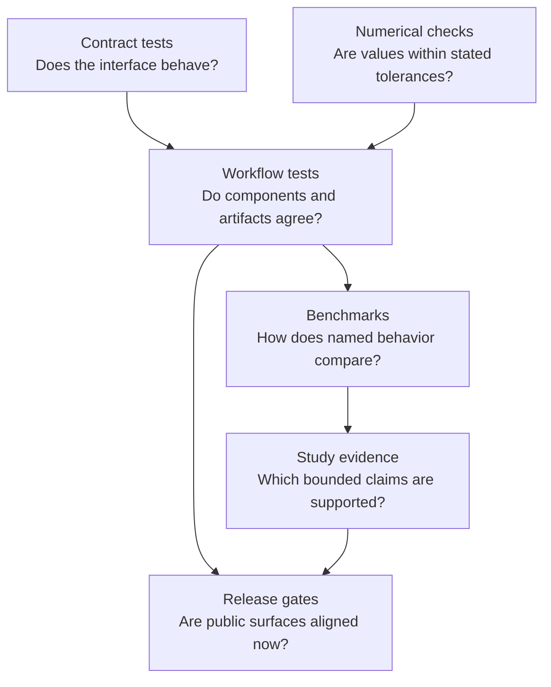

# Quality And Scientific Limits

Quality is not one green check. Scientific software needs evidence about API
contracts, numerical behavior, workflow integration, packaging, documentation,
and bounded study claims. Each proof surface answers a different question.

The arrows show increasing context, not a universal promotion ladder. A method
can have strong numerical tests without belonging to a published study.

## Read By Question

| Question | Page |
| --- | --- |
| What does each class of check prove? | [Validation lanes](validation-lanes.md) |
| How are tests organized? | [Test strategy](test-strategy.md) |
| How should public claims expose incomplete proof? | [Evidence honesty and limits](evidence-honesty-and-limits.md) |
| What does native benchmark evidence establish? | [Native benchmark evidence](native-benchmark-evidence.md) |
| What blocks publication? | [Release and publication gates](release-and-publication-gates.md) |
| How should a release be reviewed? | [Release review workflow](release-review-workflow.md) |

## Proof Must Name Its Scope

A trustworthy claim identifies the subject, fixture or corpus, method and
configuration, comparison or invariant, tolerance or acceptance rule, and
current verdict. “Validated” without those qualifiers forces the reader to
invent a stronger meaning than the evidence may support.

## Important Separations

- Correct serialization does not establish correct science.
- Agreement with a reference does not establish that the reference model fits
  a new biological question.
- Reproducibility does not eliminate systematic error.
- Passing benchmarks do not guarantee behavior outside their corpus.
- A release gate proves alignment at a particular revision, not permanent
  quality.
- Documentation can disclose proof; it cannot manufacture it.

## Failure And Uncertainty Are Outputs

Warnings, non-convergence, weak support, sensitivity, excluded cases, and open
evidence verdicts must remain visible. A pipeline that converts all completed
processes into success destroys information reviewers need.

## Reader Standard

For a result you plan to rely on, locate the closest proof surface, inspect its
inputs and acceptance rule, confirm freshness against the current runtime, and
state limitations with the result. If the appropriate proof does not exist,
describe the capability as implemented or experimental according to its actual
contract—not as validated by association.
