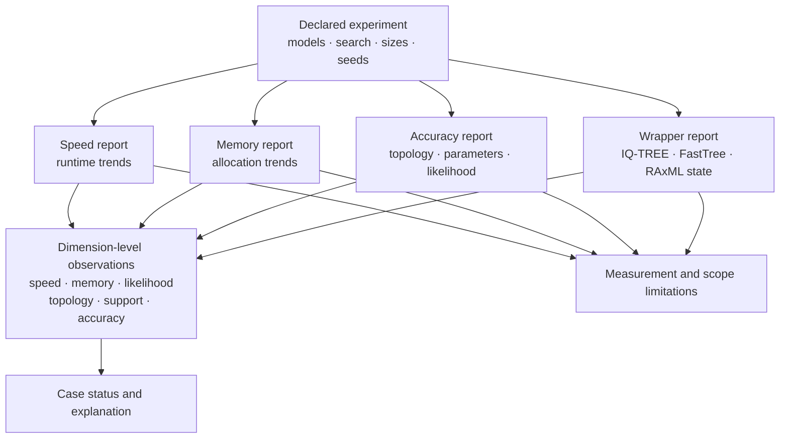

# Native Maximum-Likelihood Benchmark Evidence

The native maximum-likelihood benchmark family measures scaling, Python-owned
peak allocation, simulated-truth recovery, and correspondence with cached
wrapper references. These are separate dimensions. The unified suite keeps
their observations and limitations visible instead of collapsing them into a
single speed or quality score.



## Choose The Measurement Surface

| Command | Primary output | Use it to answer |
| --- | --- | --- |
| `benchmark native-maximum-likelihood-speed` | observations and size-class runtime trends | How does native runtime change across declared sizes, models, and searches? |
| `benchmark native-maximum-likelihood-memory` | allocation observations and growth classifications | How does Python-traced owned allocation change across the same lanes? |
| `benchmark native-maximum-likelihood-accuracy` | simulated-truth recovery records | Does inference recover governed topology, parameter, and likelihood expectations? |
| `benchmark maximum-likelihood-wrapper-comparison` | cached wrapper comparison rows | How does the selected native surface correspond to governed IQ-TREE, FastTree, and RAxML reference state? |
| `benchmark native-maximum-likelihood-suite` | integrated reports, dimension observations, status summaries, limitations | What does the complete governed benchmark record support? |

The integrated suite is the review surface. Individual commands isolate one
measurement family for diagnosis.

## Execute A Reconstructable Suite

```bash
mkdir -p artifacts/native-maximum-likelihood
bijux-phylogenetics benchmark native-maximum-likelihood-suite \
  --replicates 3 \
  --size-class compact \
  --taxon-count 8 \
  --site-count 128 \
  --size-class extended \
  --taxon-count 16 \
  --site-count 512 \
  --scaling-model jc69 \
  --scaling-model k80 \
  --scaling-search-method nni \
  --accuracy-model k80 \
  --accuracy-search-method nni \
  --start-tree-count 4 \
  --start-tree-seed 17 \
  --upper-branch-length-bound 1.0 \
  --json \
  --manifest artifacts/native-maximum-likelihood/manifest.json \
  > artifacts/native-maximum-likelihood/suite.json
```

Repeated `--size-class`, `--taxon-count`, and `--site-count` options form
positionally corresponding scaling definitions. Name sizes by their durable
workload meaning; always retain the actual counts. The accuracy corpus has its
own governed cases, model selection, simulation seeds, and truth records.

For Python consumers, the integrated entry point is
`benchmark_native_maximum_likelihood_suite`. The returned
`NativeMaximumLikelihoodSuiteReport` retains the speed, memory, accuracy, and
wrapper subreports alongside unified observations and limitations.

## Record Experimental Identity

A benchmark comparison is admissible only when the following are explicit:

- repository and installed distribution revision;
- operating system, architecture, Python and dependency versions;
- CPU and memory context, system load policy, and concurrency;
- taxon count, site count, sequence composition, and corpus identity;
- nucleotide model and parameterization;
- search algorithm, starting-tree count and seed, branch bounds, and stopping
  behavior;
- bootstrap or support settings when measured;
- repetition count, warm-up policy, aggregation, and outlier policy;
- measurement instrument, boundary, units, and acceptance thresholds;
- native and reference implementation identity.

Without this record, a timing or memory number is not a portable performance
claim.

## Interpret The Six Dimensions

| Dimension | Comparison record | Required context |
| --- | --- | --- |
| speed | native and wrapper seconds or native size-class trend | hardware, concurrency, workload, repetition, measurement boundary |
| memory | native and wrapper bytes or native growth trend | instrument and allocation/RSS boundary |
| likelihood | native and reference log likelihood plus delta | identical data, model meaning, parameters, optimization and sign convention |
| topology | Robinson–Foulds distance and normalized distance | reconciled taxa, canonical splits, rootedness policy |
| support | maximum support-percent delta over comparable canonical splits | support method, replicate policy, split identity, missing splits |
| accuracy | normalized RF plus parameter and likelihood recovery state | simulation model, seed, true tree, acceptance rules and search coverage |

Read observation values with their `case_id`, `dimension`, `native_surface`,
`comparison_surface`, `measurement_unit`, delta, status, and notes. Summary
counts never replace these rows.

## Respect Measurement Boundaries

Native memory lanes use Python `tracemalloc` peak allocations. They represent
owned likelihood context and cache growth, not full process resident memory.
Cached wrapper memory can originate from macOS `/usr/bin/time` maximum resident
set size. Those absolute values use different instruments and are
lane-specific; a raw subtraction is retained for inspection but is not
same-instrument memory parity.

Runtime shares a similar boundary problem. A Python native implementation, a
compiled exact engine, and an approximate engine can differ in language,
algorithm, model, and process-launch cost. Report the measurement; do not
rewrite a slower but scientifically acceptable native case as a correctness
bug.

## Read Status In Context

| Suite status | Meaning | Publication constraint |
| --- | --- | --- |
| `native-advantage` | the native value is favorable under the dimension's declared policy, or a governed truth/correspondence check clears | quote only the specific case, dimension, and policy |
| `native-bug` | a supported native result violates a governed correctness or recovery expectation | blocking for `all_supported_cases_clear` |
| `expected-assumption-difference` | a documented instrument, model, algorithm, or execution difference explains non-agreement | retain the difference; do not present it as parity |
| `unsupported-case` | the required native or reference comparison record is absent | exclude from favorable claims and keep the gap visible |

`all_supported_cases_clear` means the unified observations contain no
`native-bug`. It does not mean that unsupported cases are covered, assumption
differences disappeared, every model was measured, or the implementation is
universally faster.

The wrapper report uses a narrower vocabulary: `tolerance-match`,
`expected-model-assumption-difference`, `unsupported-case`, and `native-bug`.
The suite maps those observations into its own status namespace. Preserve the
original wrapper record when explaining that mapping.

## Understand Current Wrapper Scope

- The IQ-TREE likelihood lane compares a governed cached JC69 reference with a
  `1e-3` likelihood tolerance.
- The IQ-TREE support lane compares canonical unrooted splits with a `1e-9`
  support-percent tolerance, preventing root placement from creating false
  clade disagreement.
- The FastTree lane is an expected model-assumption difference because its
  approximate JC+CAT likelihood surface is not the same statistical quantity,
  and the cached compact case lacks a separately comparable support table.
- The RAxML lane is explicitly unsupported until a governed compact reference
  corpus includes runtime, memory, likelihood, topology, and support evidence.

These boundaries are part of the result, not documentation caveats to be
removed from a summary.

## Review Scaling Separately From Accuracy

Speed and memory reports exercise declared size classes. They provide
observations and trends, but they do not populate the unified comparison rows
as independent proof of accuracy. The suite comparison rows are anchored to
wrapper and simulated-truth cases measured under governed policies.

Truth recovery asks whether the inferred topology is recovered, the likelihood
shortfall remains acceptable, and applicable parameters satisfy recovery
rules. Passing simulated cases establishes behavior under those generating
assumptions. It does not prove natural-data correctness or identify a best
biological model.

## Preserve Missing And Failed Cases

Timeouts, crashes, parser failures, unavailable references, unsupported models,
excluded datasets, non-converged searches, and empty support comparisons belong
in the inventory. Report their IDs and reasons alongside the selected
denominator. Removing a difficult case after observing it changes the
experiment and requires a new identity.

If a metric cannot be compared, retain `null` values with the governing status
and notes. Zero is a scientific value; it is not a safe encoding for missing
measurement.

## Minimum Publication Packet

Publish together:

1. suite JSON and reproducibility manifest;
2. exact command and software/environment identity;
3. declared corpora, size classes, models, search settings, seeds, bounds, and
   repetitions;
4. all dimension-level observation rows and status summary rows;
5. speed, memory, accuracy, and wrapper subreports;
6. selected, measured, failed, and unsupported denominators;
7. every generated limitation and the interpretation allowed by it.

A defensible claim names the case and dimension: for example, “the governed
IQ-TREE JC69 likelihood case is within the declared tolerance.” It does not
generalize that observation to all engines, models, alignments, or hardware.

## Evidence Boundary

Benchmark evidence supports implementation claims on its named corpora and
measurement policies. It does not validate a biological interpretation,
confer parity on unmeasured models, establish universal performance, or replace
an Evidence Book bundle. Wrapper-correspondence metadata attached to one
inference result is narrower than this governed suite.

See [native benchmark review](../operations/native-benchmark-review.md) for the
operational review procedure and
[native inference contracts](../interfaces/native-inference-and-benchmarks.md)
for result fields.
