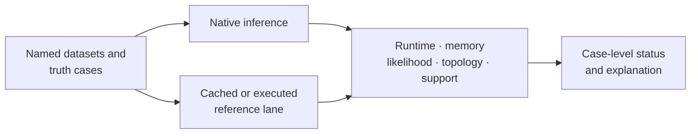

# Native Maximum-Likelihood Benchmark Evidence

The native benchmark family measures four distinct properties: scaling,
memory, recovery accuracy, and correspondence with wrapper-backed reference
lanes. The unified suite preserves those dimensions rather than reducing them
to one performance score.

## Benchmark Commands

- `benchmark native-maximum-likelihood-speed`;
- `benchmark native-maximum-likelihood-memory`;
- `benchmark native-maximum-likelihood-accuracy`;
- `benchmark native-maximum-likelihood-suite`;
- `benchmark maximum-likelihood-wrapper-comparison`.

The suite is the integrated review surface. Individual commands remain useful
when diagnosing one metric or execution lane.

## Required Experimental Context

Every conclusion depends on corpus identity, taxon and site counts, model,
search configuration, starting trees, seeds, support settings, runtime and
reference versions, hardware, concurrency, repetitions, metric, and acceptance
threshold. Without those fields, a number is an observation without a
reconstructable experiment.

## Status Semantics

| Status | Required interpretation |
| --- | --- |
| `native-advantage` | native behavior is favorable for the declared metric and comparable configuration |
| `native-bug` | native behavior violates a correctness expectation or acceptance rule |
| `expected-assumption-difference` | a documented model, convention, or execution difference explains non-agreement |
| `unsupported-case` | the native or comparison contract does not cover the case |

Statuses are case-specific. One advantage does not make the implementation
universally faster; one unsupported case does not invalidate supported cases.

## Metric Boundaries

- Runtime needs comparable hardware, concurrency, warm-up, and workload.
- Peak memory needs the same measurement boundary and process accounting.
- Likelihood needs identical data, model meaning, and parameter conventions.
- Topology needs reconciled taxa and compatible rootedness semantics.
- Support needs the same resampling method and comparable replicate policy.
- Truth recovery on simulation establishes behavior under the simulation
  assumptions, not natural-data correctness.

## Missing And Failed Cases

Timeouts, crashes, parser failures, unavailable reference engines, excluded
datasets, and non-converged searches belong in the result inventory. Aggregate
summaries must expose their counts and reasons. Removing a difficult case after
measurement changes the benchmark contract.

## Evidence Boundary

Benchmark evidence supports implementation claims on its named corpora. It
does not validate a biological interpretation, confer parity on unmeasured
models, or replace Evidence Book bundles. Attached wrapper-correspondence
metadata on one inference result is narrower than the governed suite.

See [native benchmark review](../operations/native-benchmark-review.md) for the
review procedure and [native inference contracts](../interfaces/native-inference-and-benchmarks.md)
for result fields.
