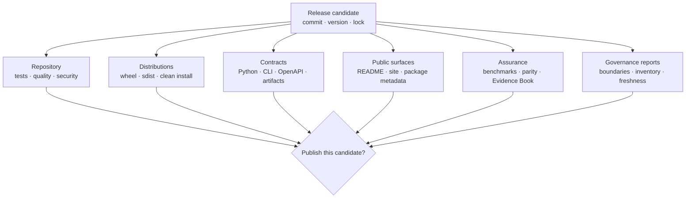

# Release And Publication Gates

A release is one identified revision expressed through source, three Python
distributions, command and API contracts, documentation, artifacts,
benchmarks, and 43 Evidence Book bundles. Publication is safe only when those
surfaces agree about identity, ownership, capability, limitations, and
scientific status.

## Separate Software Publication From Scientific Acceptance

| Decision | Core question | A favorable decision means | It does not mean |
| --- | --- | --- | --- |
| software publication | may this identified source and distribution candidate be published under repository policy? | public packages, interfaces, documentation, assurance records, and bounded limitations agree | every scientific claim matched |
| result acceptance | may this identified analysis result be used for its declared purpose? | population, method, diagnostics, outputs, and limitations satisfy the consumer rule | the repository release is current or generally validated |
| claim publication | may this exact scientific statement be cited now? | governed observations support the claim verdict and freshness is current | neighboring methods or datasets inherit the verdict |

A software candidate can be publishable while openly carrying
`not_comparable` study claims, provided those boundaries are current and no
public text implies missing evidence exists. Conversely, a historically
matched study claim does not authorize publishing a candidate whose wheel,
schema, documentation, or version identity is contradictory.



Green checks are necessary but not self-interpreting. The decision packet must
show which revision, packages, engines, cases, schemas, and evidence records
were actually reviewed.

## Define Candidate Identity Before The Gate

The candidate identity includes:

- commit and resolved version;
- dependency lock and governed configuration;
- wheel and source-distribution filenames and digests;
- canonical runtime, compatibility alias, and maintainer package versions;
- OpenAPI schema hash and artifact schema versions;
- selected optional engines and executable versions;
- evidence input and output identities;
- exact verification commands and environment.

A new commit, rebuilt artifact, changed lock, refreshed evidence bundle, or
different optional-engine denominator creates a different candidate. Previous
reports remain historical context; they cannot be relabeled as evidence for
the new identity.

## Gate Matrix

| Gate | Evidence required | Representative blocker |
| --- | --- | --- |
| repository | lock consistency, configuration source of truth, boundaries, tests, lint, quality, security, SBOM | failing or omitted owned check |
| distribution | wheel/sdist build, metadata inspection, Twine validation, clean install, public command and resource smoke | repository source path hides a missing packaged resource |
| identity | runtime, alias, maintainer package roles and versions agree across metadata and installed behavior | alias ships divergent scientific ownership |
| interface | curated Python, CLI, OpenAPI hash, artifact producer/consumer contract | public example uses a private or removed surface |
| documentation | managed assets, strict site build, semantic truth tests, executable syntax, valid links | prose claims external computation is native |
| scientific assurance | selected benchmark/parity denominators, evidence integrity, freshness, coverage, verdicts, resolution state | failed observation or unsupported case disappears from summary |
| publication | tag/version agreement, licenses, artifact inventory, trusted workflow and registry target | artifact is published outside the governed candidate identity |

Passing a software release gate does not assert that every scientific
comparison matched. It asserts that published capability and limitation claims
are supported, contradictions are absent, and bounded gaps remain visible.

## Governed Gate Composition

```bash
make check
make package-verify
make report-release-readiness
make check-release-readiness
```

The commands answer different questions:

| Command | Decision surface |
| --- | --- |
| `make check` | routine source, test, quality, security, documentation, build, and SBOM composition |
| `make package-verify` | wheel/sdist metadata, validation, clean installation, CLI, and packaged-resource proof |
| `make report-publish-readiness` | non-enforcing publish scorecard at `artifacts/root/publish-readiness.json` |
| `make check-publish-readiness` | hard enforcement of the scorecard blocker register |
| `make report-release-readiness` | report-mode composition of evidence, artifact, execution, package, and publish surfaces |
| `make check-release-readiness` | enforcing composition of those governance surfaces |

`report-release-readiness` produces a packet of governed JSON records rather
than one opaque release file. Its current outputs include configuration,
Evidence Book validation and completeness, artifact governance, execution
surfaces, package boundaries, package bundles, and publish readiness under
`artifacts/root/`.

Report mode exposes findings for review. Check mode must fail on governed
blockers. Neither substitutes for `make package-verify`, the complete test lane
appropriate to the candidate, or the final cross-surface review.

## Read The Publish Scorecard

`publish-readiness.json` contains four decision areas:

- `summary.overall_status` and blocker count;
- `blocker_register` with issue codes, ownership, and remediation context;
- `closure_criteria` for runtime publishability, evidence-program
  publishability, and repository-standards alignment;
- the detailed inventories and audits from which the decision is derived.

Inspect the issue records, not only `overall_status`. A ready score describes
the current policy inputs. It is not a substitute for the package, docs, test,
engine, benchmark, or human scientific-language evidence outside that report.

## Preserve Status Ownership

| Record | Status question |
| --- | --- |
| command or workflow | Did this execution complete, refuse, fail, skip, or return partial state? |
| parity case | Did the selected live or fixture comparison pass, fail, or skip? |
| benchmark observation | Is this dimension a native advantage, native bug, expected assumption difference, or unsupported case? |
| Evidence Book bundle | Is the governed claim matched, matched with tolerance, mismatched, or not comparable? |
| resolution register | Which missing execution, observation, adjudication, or external decision is open or blocked? |
| publish readiness | Is this software candidate ready under repository policy? |

Release prose may quote these statuses but may not translate one namespace
into another. A ready release can carry an explicit `not_comparable` evidence
boundary. A passed parity case is not automatically a matched Evidence Book
claim.

## Non-Comparable Claims And Open Follow-Through

An Evidence Book claim recorded as `not_comparable` does not automatically
block a software release. The bundle must remain structurally valid and fresh,
its provenance and missing comparison state must remain visible, and no public
claim may imply numerical agreement.

Open or blocked follow-through belongs to the resolution workflow rather than
the verdict vocabulary. It names the missing execution, primary output,
observation, adjudication, or external decision. A release may carry that
bounded work when policy permits it; it may not rewrite the bundle verdict as “open,”
“pending,” or passing.

Structural corruption, missing provenance, stale inputs, concealed mismatch,
or contradictory public language remains a blocker even when the intended
scientific conclusion would have been favorable.

## Release Blockers

Block publication when any of the following applies:

- revision, version, lock, schema, or built-artifact identity cannot be
  reconstructed;
- wheel or sdist contents, metadata, license assets, or clean installation
  fail;
- canonical and alias imports, commands, resources, or ownership diverge;
- OpenAPI or artifact compatibility is unresolved;
- docs or examples contradict supported runtime behavior;
- external computation is attributed to Bijux native code;
- expected outputs, selected cases, skips, failures, warnings, or limitations
  disappear from retained records;
- evidence provenance, integrity, freshness, or claim mapping fails;
- a tolerance, denominator, gate, or report is weakened to manufacture a pass;
- publication target, credentials, or artifact inventory bypasses the governed
  workflow.

## Release Decision Record

Retain an append-only packet for the exact candidate:

1. candidate identity and intended artifact inventory;
2. executed commands, timestamps, environment, and selected optional lanes;
3. source/test/quality/security/SBOM results;
4. distribution filenames, hashes, metadata, and clean-install proofs;
5. schema hash, strict documentation result, and interface compatibility;
6. governance reports with blocker registers and closure criteria;
7. benchmark, parity, and evidence denominators, verdicts, freshness, and open
   boundaries;
8. final ready or blocked decision, bounded limitations, and reviewer.

This packet is the durable release argument after transient CI logs expire.
Continue with the [release review workflow](release-review-workflow.md) for the
execution sequence.
