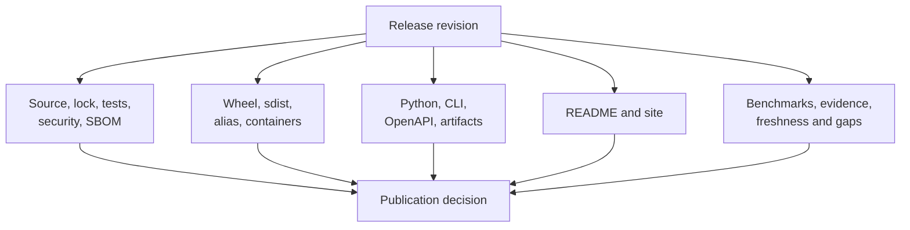

# Release And Publication Gates

A release joins independently versioned and reviewable surfaces: source,
runtime and alias distributions, containers, OpenAPI schema, documentation,
artifacts, benchmarks, and evidence. Publication requires agreement across the
surfaces affected by the release.

## Gate Matrix

| Gate | Required evidence |
| --- | --- |
| repository | clean lock, source-of-truth configuration, boundaries, tests, lint, security, SBOM |
| package | wheel/sdist build, Twine validation, clean installation, public command and resource smoke tests |
| compatibility | canonical and alias imports, commands, versions, metadata, and package data align |
| contract | curated Python behavior, CLI reference, OpenAPI schema/hash, artifact compatibility |
| documentation | strict site build, managed asset integrity, executable examples, current links and claims |
| scientific | benchmark scope, evidence integrity, freshness, gaps, and open verdicts are visible |
| publication | trusted workflow identity, version/tag consistency, license assets, target registry metadata |

## Governed Commands

- `make check` composes the routine repository gate.
- `make package-verify` validates wheel and source-distribution installation.
- `make check-publish-readiness` evaluates publication policy.
- `make check-release-readiness` composes release evidence and governance.
- `bijux-phylogenetics report release-truth ...` emits a runtime-facing release
  truth report where applicable.

Generated reports belong under `artifacts/` and should record the reviewed
revision. A report from another revision is context, not current gate evidence.

## Blocking Conditions

- built distributions omit declared code, data, examples, licenses, or metadata;
- canonical and alias behavior or versions diverge;
- schema content and pinned identity disagree;
- public examples depend on private imports or repository-only files;
- documentation attributes external computation to the native runtime;
- evidence indexes disagree with bundles or material dependencies are stale;
- a failing benchmark/evidence case is hidden, excluded without policy, or
  rewritten as passing;
- publication credentials or registry targets bypass governed workflows.

## Open Scientific Verdicts

An open or blocked study verdict does not automatically block a software
release. It must be accurately represented, current, and excluded from claims
that require closure. Structural corruption, missing provenance, stale status,
or contradictory publication language is a release defect.

## Release Record

Retain the revision, version, build identities, executed commands, relevant
reports, package hashes, schema hash, documentation result, evidence freshness,
and accepted open boundaries. This makes the publication decision auditable
after transient CI logs expire.
