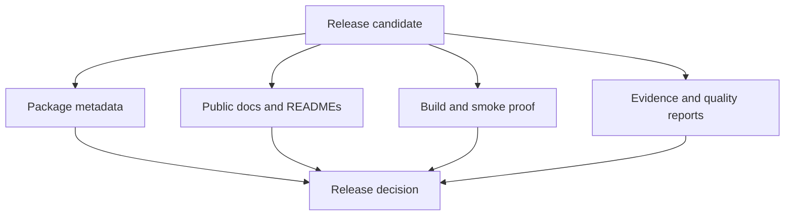

# Release And Publication Gates

Release readiness is earned, not assumed.

Before this project claims a clean release state, it checks package metadata,
shared-standards sync, build proof, evidence-governance rules, and
publication-readiness reports together.

## Questions A Serious Release Must Answer

- Do the documented packages, READMEs, and handbook pages describe the runtime
  truthfully?
- Do package metadata, release descriptions, and public docs describe the same
  product surface?
- Do native inference and benchmark claims stay bounded by explicit runtime
  contracts?
- Do wrapper-backed workflows remain clearly labeled as wrapper orchestration
  when that is still the honest boundary?
- Do publication-readiness and evidence-governance reports stay green on the
  repository state being released?

## Governed Release Surfaces

- `make report-publish-readiness`
- `make check-publish-readiness`
- `make report-release-readiness`
- `make check-release-readiness`
- `bijux-phylogenetics report release-truth ...`

Use the [release review workflow](release-review-workflow.md) when you need the
practical reading order.

## Failure Patterns To Reject

Treat a release as weak, even when some checks are green, if any of these are
still true:

- docs say more than metadata
- metadata says more than evidence
- benchmark or native claims are broader than the documented runtime contract
- wrapper-backed surfaces are described as if they were native ownership
- freshness or coverage gaps are hidden behind generic release wording
