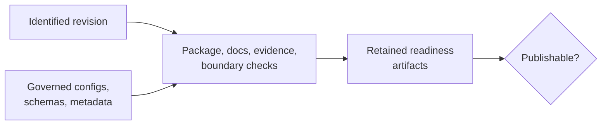

# Release Review Workflow

Release review decides whether one identified revision is publishable under
the repository's declared package, documentation, schema, artifact, evidence,
and governance contracts. It is a reconstruction exercise, not a visual
inspection of green checks.



## Start With Governed Repository Reports

The repository already exposes governed readiness surfaces through root make
targets:

```bash
make report-publish-readiness
make check-publish-readiness
make report-release-readiness
make check-release-readiness
```

Those commands write governed report artifacts under `artifacts/root/` and
separate scorecard production from hard-gate enforcement.

## What Each Surface Answers

- `report-publish-readiness`
  Builds the repository publish-readiness scorecard without acting as the final
  release gate.
- `check-publish-readiness`
  Fails when the repository still has unresolved publish-readiness issues.
- `report-release-readiness`
  Builds the broader release-readiness evidence and governance surface.
- `check-release-readiness`
  Enforces the full release-readiness gate.

Use the `report-*` surfaces when you are auditing or preparing. Use the
`check-*` surfaces when the repository should already be held to the gate.

## Required Evidence Set

| Surface | Minimum retained evidence |
| --- | --- |
| source revision | commit identity and clean intentional worktree state |
| distributions | wheel/sdist build, metadata inspection, clean install and packaged-resource smoke |
| canonical/alias contract | import, command, version, resource, and metadata alignment |
| documentation | managed asset integrity, strict site build, semantic contract tests |
| API and artifacts | pinned schema/hash validation and producer/consumer compatibility checks |
| Evidence Book | structural validity, integrity, freshness, coverage, verdict and open-boundary reports |
| execution surfaces | configured native and external ownership/boundary audit |
| readiness decision | exact report/check commands, status, warnings, blockers, and artifact paths |

## Add The Runtime Truth Review

When the release question includes full-suite test truth and real-engine test
truth together with owned workflow outputs, run the governed CLI summary:

```bash
bijux-phylogenetics report release-truth \
  --test-report artifacts/pytest/full-suite.xml \
  --real-engine-test-report artifacts/pytest/real-engine.xml \
  --out artifacts/release-truth-report.html \
  --json
```

That surface complements the repository readiness reports by reviewing runtime
and validation evidence in one place.

## Review Procedure

1. Identify the revision, governed configuration, and intended release
   artifacts.
2. Build canonical and alias distributions and install them into clean
   environments.
3. Validate public imports, commands, versions, package resources, metadata,
   and license assets from built artifacts.
4. Build documentation strictly and inspect semantic documentation contracts.
5. Validate API/schema and artifact compatibility surfaces.
6. Validate Evidence Book integrity and freshness; retain every open,
   mismatched, and non-comparable boundary.
7. Generate readiness reports, then run their enforcing checks.
8. Compare reports with public capability and evidence statements.
9. Confirm the release artifact inventory and worktree state before
   publication.

## Release Questions To Ask Explicitly

- Do README, package metadata, built artifacts, and the site identify the same
  distributions and runtime?
- Do native claims resolve to owned implementations and external claims retain
  their engine owner?
- Do examples execute through installed public surfaces with current syntax?
- Do reports preserve warnings, exclusions, partial outputs, and failed cases?
- Do evidence statements match current bundle verdicts and freshness?
- Can another reviewer reconstruct the decision from retained artifacts?

## Release Blockers

Stop publication when package identity diverges, built artifacts fail clean
installation, public contracts contradict runtime behavior, schema or artifact
compatibility is unresolved, required readiness output is missing, evidence
provenance or freshness cannot be established, or a failing gate has been
weakened or omitted.

An intentionally open or `not_comparable` scientific boundary can ship when it
is governed and disclosed. An unacknowledged contradiction cannot.

## What This Workflow Does Not Replace

- it does not replace package build verification
- it does not replace benchmark or parity review
- it does not replace the evidence-book
- it does not turn one green check into full scientific closure
