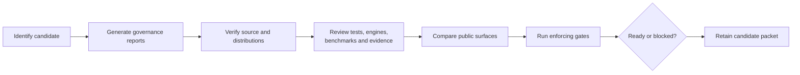

# Release Review Workflow

Release review reconstructs whether one identified revision can be published
under the repository's package, interface, documentation, artifact, evidence,
and governance contracts. The outcome is a retained decision packet, not a
screenshot of green checks.



## Required Evidence Set

| Surface | Minimum retained evidence |
| --- | --- |
| candidate | commit, resolved version, dependency lock, governed configuration, intended distributions |
| source verification | exact test/lint/quality/security/docs/build/SBOM commands and outcomes |
| distributions | wheel and sdist names, digests, metadata inspection, Twine result, clean-install smoke |
| runtime and alias | imports, commands, versions, package resources, metadata, and ownership alignment |
| contracts | Python/CLI tests, OpenAPI schema/hash, artifact producer/consumer compatibility |
| scientific assurance | selected test and engine denominators, benchmark observations, parity cases, Evidence Book verdicts |
| governance | configuration, artifact, execution-surface, package-boundary, package-bundle, evidence, and readiness reports |
| public claims | README, package metadata, docs, examples, release notes, and evidence statements reviewed against owners |
| decision | ready/blocked state, exact blockers, bounded limitations, reviewer, timestamp, packet location |

## Establish Candidate Identity

Before running a gate, record:

```bash
git rev-parse HEAD
git status --short --branch
bijux-phylogenetics --version
```

Also retain the lock digest, intended distribution versions, optional-engine
selection, and governed configuration identity. Do not combine reports across
commits or reuse a package proof after rebuilding the artifact.

## Generate Reviewable Reports First

```bash
make report-publish-readiness
make report-release-readiness
```

Review the generated records under `artifacts/root/` before enforcing them:

| Record | Review focus |
| --- | --- |
| `config-ssot-audit.json` | required root configuration and forbidden package-local drift |
| `evidence-book-validation.json` | registered study and bundle structure |
| `evidence-completeness.json` | expected inputs, local artifacts, and missing bundle surfaces |
| `artifact-governance.json` | output paths and generated-artifact discipline |
| `execution-surfaces.json` | make, tox, workflow, native, and external ownership |
| `package-boundaries.json` | runtime, alias, and maintainer dependency/export policy |
| `package-bundles.json` and its directory | wheel/sdist target and content policy |
| `publish-readiness.json` | blocker register, closure criteria, and overall status |

Report mode does not grant a waiver. It makes the complete finding set
available before a hard-gate exit stops the workflow.

## Verify Source And Built Artifacts

Run the gate appropriate to the candidate and retain exact output:

```bash
make check
make package-verify
```

Inspect built wheels and source distributions as release inputs in their own
right. Confirm filenames, versions, dependencies, licenses, included package
data, command entry points, canonical and alias imports, packaged examples,
and structured output from clean installations. A source-tree import does not
prove the wheel contains the same contract.

## Add The Runtime Truth Review

When full-suite and real-engine JUnit records are part of the release argument,
build the governed runtime-facing report:

```bash
mkdir -p artifacts/release-review
bijux-phylogenetics report release-truth \
  --test-report artifacts/pytest/full-suite.xml \
  --real-engine-test-report artifacts/pytest/real-engine.xml \
  --stress-tier small \
  --out artifacts/release-review/release-truth.html \
  --json \
  --manifest artifacts/release-review/manifest.json \
  > artifacts/release-review/result.json
```

The input reports must identify the candidate and expose selected, passed,
failed, skipped, and deselected tests. A generated HTML page cannot repair
missing test provenance or prove that an optional engine ran.

## Review Scientific Assurance By Record Type

1. Reconstruct the selected denominator for tests, real engines, parity cases,
   benchmark observations, and evidence bundles.
2. Read failures, skips, unsupported cases, warnings, and non-comparable
   verdicts before favorable aggregates.
3. Confirm benchmark hardware, workload, instrument, models, seeds, and
   tolerances.
4. Validate all 43 Evidence Book bundle structures, inputs, checksums,
   freshness, claim mappings, observations, and verdict distributions.
5. Keep open resolution work separate from runtime, benchmark, parity, and
   evidence status.

No assurance report should be summarized beyond its declared corpus and
policy.

## Compare Reader-Facing Claims With Owners

Trace each material statement in README, package metadata, docs, examples, and
release notes to an owning record:

- supported Python and CLI behavior to the installed distribution;
- native methods to runtime source and numerical assurance;
- MAFFT, trimAl, IQ-TREE2, FastTree, RAxML, MrBayes, and BEAST results to
  external-engine manifests;
- parity language to the selected registry and observation ledger;
- study conclusions to exact Evidence Book claim and bundle IDs;
- limitations to current freshness, coverage, and resolution records.

Reject vague statements such as “fully validated” when the retained proof is a
bounded fixture, one engine version, an expected assumption difference, or a
`not_comparable` bundle.

## Review Procedure

1. Identify candidate revision, version, lock, configuration, distributions,
   schemas, evidence state, and optional-engine denominator.
2. Generate report-mode governance records and inspect every issue.
3. Run source verification and package verification against the same candidate.
4. Validate installed imports, commands, resources, metadata, licenses, and
   structured results for runtime and alias distributions.
5. Build docs strictly and run semantic documentation truth tests.
6. Validate API hash and artifact compatibility.
7. Review test, real-engine, benchmark, parity, and Evidence Book records with
   denominators and limitations intact.
8. Compare every material public statement with its owning contract.
9. Run `make check-publish-readiness` and `make check-release-readiness`.
10. Reconfirm candidate identity and clean intentional worktree state before
    recording the decision.

## Invalidate Stale Evidence

Repeat affected review whenever any of these changes:

- commit, version, lock, configuration, schema, or generated contract;
- wheel, sdist, container, license, or registry metadata;
- public import, CLI option, output schema, default, or failure behavior;
- numerical implementation, tolerance, corpus, seed, or benchmark instrument;
- external executable path/version or selected engine coverage;
- evidence input, check, output, verdict, freshness, or public claim.

Rerun only the unaffected report is not enough; rerun every downstream gate
whose conclusion depended on the changed identity.

## Release Questions To Answer Explicitly

- Do source metadata and built artifacts identify the same version and package
  roles?
- Do canonical and alias clean installations execute documented imports and
  commands?
- Do examples use installed public surfaces and current syntax?
- Are native and external computations attributed to their actual owners?
- Do manifests preserve warnings, exclusions, partial state, and failed cases?
- Do evidence statements match exact current verdicts and freshness?
- Are skipped optional engines and unsupported comparisons visible?
- Can a second reviewer reconstruct the conclusion without transient CI logs?

## Release Blockers

Stop publication when identity diverges, a built artifact fails clean
installation, runtime and public contracts contradict, API or artifact
compatibility is unresolved, expected readiness output is missing, scientific
denominators are incomplete, evidence provenance or freshness fails, or a gate
has been weakened or omitted.

An explicit, fresh, governed `not_comparable` boundary can ship when policy
permits it. An unacknowledged contradiction cannot.

## Complete The Decision Packet

Record ready or blocked, not merely the final process exit. Include candidate
identity, artifact hashes, exact commands, report paths, denominator counts,
blockers, bounded limitations, skipped optional lanes, reviewer, and timestamp.
If publication proceeds, that packet must resolve to the exact artifacts sent
to the registry.
