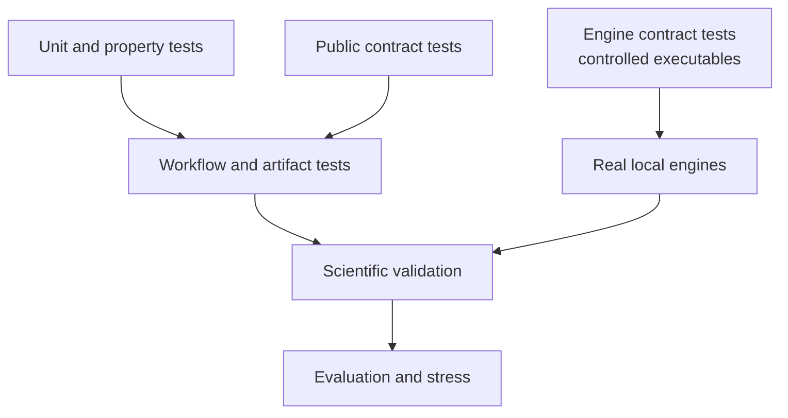

# Test Strategy

Tests are organized by the kind of failure they can detect. Fast contract
tests defend deterministic behavior; real-engine and scientific-validation
lanes exercise integrations; stress and evaluation lanes probe behavior that
is too costly for every routine run.

## Test Families

| Family | Detects | Does not establish |
| --- | --- | --- |
| unit/property | local invariants, edge cases, numerical properties | assembled workflow correctness |
| public contract | imports, signatures, errors, CLI behavior, serialization | scientific reference agreement |
| integration | component composition and artifact completeness | real executable compatibility unless invoked |
| package | wheel/sdist contents, clean installation, packaged resources | scientific validity |
| engine contract | invocation and parsing through controlled executable behavior | compatibility with an installed scientific binary |
| real engine | discovery, invocation, output parsing against actual binaries | every platform/version or study claim |
| scientific validation | governed workflow outputs against reference records | generalization beyond declared cases |
| evaluation/stress | accuracy, scale, runtime, memory, and output pressure | routine support for every measured extreme |

## External-Engine Separation

`engine_contract` tests use controlled executables to cover command formation,
failure propagation, and parser behavior deterministically. `engine_real` tests
under `packages/bijux-phylogenetics/tests/real_local/` run available MAFFT,
trimAl, IQ-TREE2, FastTree, MrBayes, and BEAST binaries on compact inputs.
`scientific_validation` tests compare governed workflow outputs with stored
review records.

A passing parser test cannot replace a real-engine run. A successful
real-engine run cannot replace reference-output comparison. A reference match
does not establish suitability for an unrelated study.

## Numerical Tests

Numerical assertions must name scale, tolerance, convention, and expected
failure behavior. Known-answer fixtures protect exact scenarios; property
tests cover invariants across generated inputs; reference comparisons detect
implementation drift. Loose tolerances require scientific or numerical
justification rather than convenience.

## Package Tests

Built-artifact checks install wheels and source distributions into clean
environments, import public modules, invoke commands, and exercise packaged
examples and datasets. This prevents editable source paths from hiding missing
files or undeclared dependencies.

## Execution Gates

| Command | Intended coverage |
| --- | --- |
| `make test` | routine repository test suite |
| `make test-external-engines` | real executables plus non-slow scientific validation |
| `make package-verify` | wheel/sdist validation and clean-install smoke proofs |
| `make test-all` | slow, evaluation, stress, and real-local tests without the routine timeout budget |
| `make test-all-plus-run-time` | exhaustive suite with per-test duration reporting |
| `make check` | lock, boundaries, lint, tests, quality, security, docs, build, and SBOM |

Slow scientific-validation and stress targets are intentionally guarded from
standalone accidental execution; their owned entry point is the exhaustive
`test-all*` lane.

## Failure Reporting

Preserve the failing seed, fixture, executable version, command, captured
output, measured tolerance, and generated artifact paths. Quarantining,
weakening, or excluding a failure requires an explicit governed rule; it must
not happen merely to recover a green aggregate.

See [validation lanes](validation-lanes.md) for claim vocabulary and
[release gates](release-and-publication-gates.md) for publication composition.
