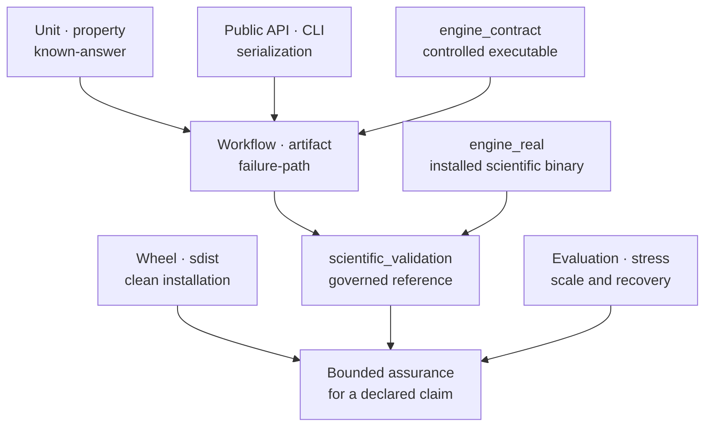
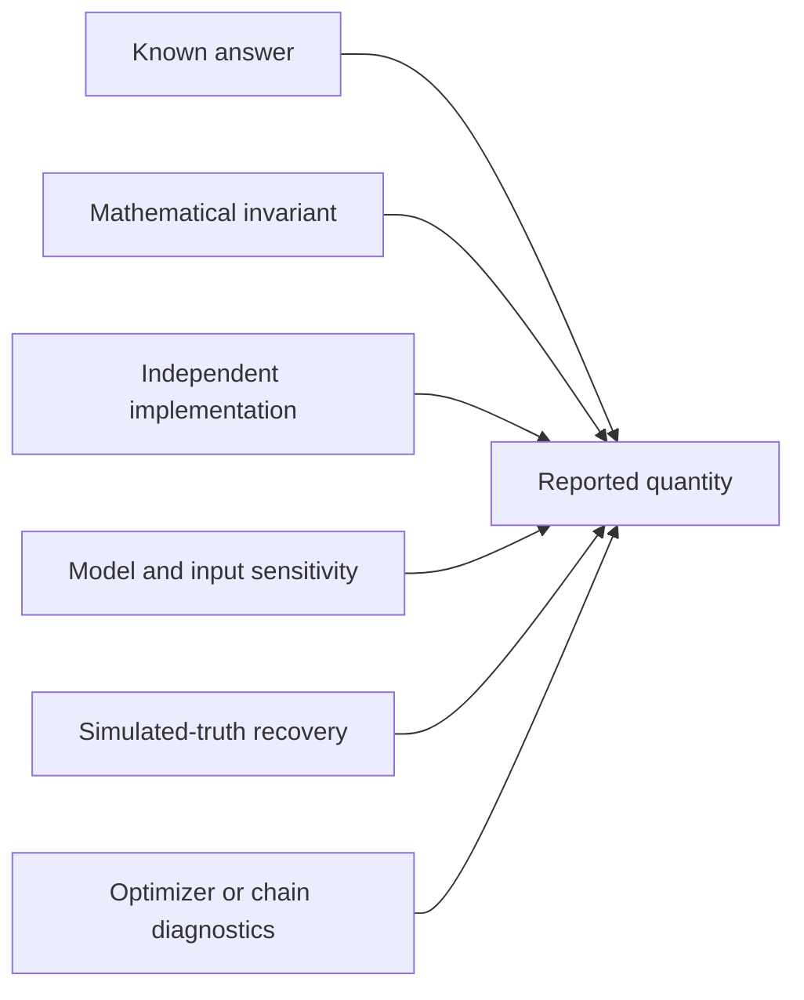

# Test Strategy

No single green test result establishes that a phylogenetic analysis is
trustworthy. Bijux Phylogenetics separates tests by the failure they can
detect, the dependencies they exercise, and the strength of conclusion they
support. Confidence comes from combining independent lanes without promoting
one lane beyond its scope.

The arrows show evidence composition, not a promotion ladder. A large stress
run does not supersede a known-answer test, and a reference comparison does not
replace packaging or failure-path coverage.

## Match The Lane To The Question

| Lane | Primary question | Representative failure detected | Does not establish |
| --- | --- | --- | --- |
| unit and property | Does a local contract hold over exact and generated cases? | invariant violation, edge case, numerical instability | assembled workflow behavior |
| known-answer and regression | Does a named result remain equal or within a justified tolerance? | scientific or serialization drift | behavior outside the fixture |
| public contract | Can supported imports, signatures, CLI arguments, errors, and schemas be consumed? | compatibility break | numerical reference agreement |
| workflow and artifact | Do components preserve identity, status, inventory, and failure state? | lost provenance, incomplete bundle, unsafe recovery | real external-binary compatibility unless invoked |
| `engine_contract` | Does governed invocation and parsing behave under controlled executable responses? | malformed command, parser regression, timeout or exit propagation failure | compatibility with an installed scientific binary |
| `engine_real` | Can the adapter discover and execute an actual supported binary? | version, invocation, native-output, or environment incompatibility | all platforms, versions, datasets, or claims |
| `scientific_validation` | Does a governed workflow agree with a named reference record? | unexplained scientific difference | general correctness beyond the selected cases |
| package | Does the wheel or sdist work without repository source leakage? | missing resource, undeclared dependency, bad entry point | scientific validity |
| evaluation and stress | How do recovery, runtime, memory, and artifacts behave under declared pressure? | scaling cliff, resource blowup, degradation at size | routine support for every measured extreme |

## Build Numerical Claims From Independent Checks

A numerical result should be challenged from several directions:

Every numerical assertion must make four choices explicit:

1. the quantity, scale, units, parameterization, and sign convention;
2. the expected value or invariant and its independent origin;
3. absolute and relative tolerance with numerical or scientific rationale;
4. failure behavior at boundaries, invalid inputs, non-convergence, and missing
   comparison state.

Tolerances are part of the method contract. Widening one because a test fails
changes the accepted scientific behavior and requires evidence, review, and a
recorded rationale. Decimal closeness alone is insufficient when topology,
taxon reconciliation, state coding, root treatment, or likelihood
parameterization differs.

## Protect Oracle Independence

A test is not independent merely because expected values are stored in a
different file. Review how the oracle was produced and which implementation
assumptions it shares with the code under test.

| Oracle source | Independence risk | Required challenge |
| --- | --- | --- |
| literal known answer | transcription or convention error | derive it from a cited analytic case and assert units and parameterization |
| second local implementation | shared helper, parser, or formula | remove shared computation from the comparison path |
| external implementation | aligned bugs or mismatched defaults | register versions, conventions, inputs, and compared fields |
| simulated truth | generator and estimator share the same defect | vary generators or use analytic and independently generated cases |
| snapshot or golden file | accidental approval of a regression | review semantic fields and explain every governed regeneration |
| broad invariant | defect preserves an invariant while changing the result | pair it with directional examples and reference observations |

Challenge the test suite by deliberately perturbing sign, scale, order,
rooting, taxon identity, status propagation, and boundary behavior in a
controlled review. The relevant test should fail for the intended reason. If
the same production function creates both the observed value and its expected
value, the check establishes repeatability, not correctness.

## Separate External-Engine Proofs

Controlled executables make rare states deterministic: missing files,
unsupported versions, timeouts, nonzero exits, truncated output, parser
warnings, unsafe paths, and partial runs. That is the purpose of
`engine_contract` tests.

Tests marked `engine_real` under
`packages/bijux-phylogenetics/tests/real_local/` execute installed MAFFT,
trimAl, IQ-TREE2, FastTree, MrBayes, or BEAST binaries on bounded inputs. They
record environment and engine identity and detect integration assumptions that
a controlled executable cannot reproduce.

`scientific_validation` then compares declared outputs, diagnostics, and
denominators against governed reference records. The three lanes answer,
respectively:

1. Did the adapter behave correctly under a controlled contract?
2. Did the selected real executable run through that adapter?
3. Did the governed scientific output agree with its reference policy?

A pass in one lane cannot be quoted as a pass in another.

## Test Failure And Refusal Paths

Success-only tests reward systems that silently omit difficult cases. Workflow
and artifact tests must exercise:

- ambiguous taxa, duplicate identifiers, malformed trees, illegal symbols,
  missing states, and incompatible model inputs;
- unavailable and unsupported engines, nonzero exits, timeouts, interruptions,
  parser warnings, and incomplete run directories;
- optimizer boundaries, non-convergence, insufficient chain diagnostics,
  absent support, and empty comparison denominators;
- path traversal, input overwrite, checksum mismatch, schema mismatch, and
  missing declared outputs;
- resume rejection when input, configuration, executable, or output identity
  changes.

The expected response may be a refusal, structured partial result, explicit
skip, or failed observation. The test should assert the retained evidence, not
only the exception type.

## Validate Distribution Artifacts

Editable source imports can hide missing package data and undeclared
dependencies. Package verification builds the wheel and source distribution,
checks their metadata, installs each in a clean environment, imports the public
namespaces, invokes the command-line entry point, and exercises packaged
resources.

The resulting proof is tied to the built artifact digest. A source-tree test
run and a wheel smoke run are complementary records, not interchangeable
descriptions of the same environment.

## Use The Execution Gates Deliberately

| Command | Intended coverage | Appropriate claim |
| --- | --- | --- |
| `make test` | routine repository test selection | current default suite passes |
| `make test-external-engines` | real engines plus non-slow scientific validation | available supported binaries pass the governed local lane |
| `make package-verify` | wheel/sdist checks and clean-install smoke proofs | built artifacts satisfy the installation contract |
| `make test-all` | slow, evaluation, stress, and real-local tests without the routine timeout budget | exhaustive registered test surfaces pass in this environment |
| `make test-all-plus-run-time` | exhaustive suite plus duration inventory | exhaustive result with per-test timing |
| `make check` | lock, boundaries, lint, test, quality, security, docs, build, and SBOM | composed repository gate passes |

Slow scientific-validation and stress targets are guarded from accidental
standalone execution. Their owned route is the exhaustive `test-all*` lane so
fixtures, environment rules, and artifact destinations remain consistent.

## Read A Test Report Without Losing Scope

Record:

- repository revision and built-distribution identity where applicable;
- operating system, architecture, Python version, dependency lock, and
  external executable versions;
- exact command, marker expression, selected count, passed, failed, skipped,
  deselected, and expected-failure counts;
- seeds, repetitions, tolerances, resource settings, and timeout policy;
- failing case IDs, captured diagnostics, and retained artifact paths;
- tests not executed and the reason.

“All tests pass” is defensible only when the denominator is named. Skipped real
engines, deselected slow tests, and unavailable comparisons remain visible.

## Respond To A Failure Without Weakening The Evidence

1. Preserve the failing seed, fixture, command, environment, executable,
   captured output, and artifacts.
2. Reproduce the narrowest failing contract without changing its identity.
3. Classify whether the defect belongs to the implementation, test oracle,
   reference, environment, tolerance, or unsupported boundary.
4. Correct the owning contract and add the smallest regression that would have
   detected the defect.
5. Rerun the narrow lane, then every composed gate whose conclusion depended
   on it.

Quarantining, weakening, or excluding a case requires an explicit governed
rule and a visible denominator change. A green aggregate obtained by hiding a
failure is not evidence.

See [validation lanes](validation-lanes.md) for claim vocabulary,
[native benchmark evidence](native-benchmark-evidence.md) for measurement
interpretation, and [release gates](release-and-publication-gates.md) for the
composed publication decision.
