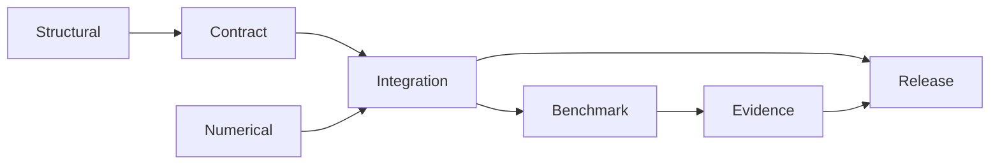

# Validation Lanes

Use the narrowest truthful lane name when describing confidence. Lanes are
orthogonal proof families; passing one never silently grants another.

| Lane | Core question | Typical proof | Does not prove |
| --- | --- | --- | --- |
| structural | Is the input or artifact well formed? | parsers, schemas, manifests | scientific appropriateness |
| contract | Does the public interface obey its documented behavior? | unit and API tests | numerical reference agreement |
| numerical | Does computation satisfy invariants or tolerances? | known answers, properties, reference values | workflow completeness |
| integration | Do components compose and preserve state? | workflow and artifact tests | external scientific parity |
| benchmark | How does behavior compare on a named corpus? | metrics with environment and thresholds | universal superiority |
| evidence | Do governed records support named study claims? | provenance, checks, verdicts | claims outside the study |
| release | Are packages, docs, schemas, and evidence aligned? | build and publication gates | future or untested behavior |

## Lane Relationships

This is a common dependency shape, not a claim that all capabilities must reach
every node. Release checks may legitimately publish a well-tested feature with
no study evidence if documentation says exactly that.

## Select A Lane From The Claim

| Proposed statement | Required lane | Missing proof if only the previous lane passes |
| --- | --- | --- |
| “the file is interpretable” | structural | public behavior and scientific values remain unchecked |
| “the documented command behaves as specified” | contract | numerical correctness remains unchecked |
| “the method returns the declared value within tolerance” | numerical | composed workflow and artifact behavior remain unchecked |
| “the workflow preserves inputs, diagnostics, and outputs” | integration | reference agreement and scale behavior remain unchecked |
| “behavior meets a target on this corpus” | benchmark | transfer beyond the corpus remains unchecked |
| “this study claim has the recorded verdict” | evidence | claims outside the registered scope remain unchecked |
| “this revision is publishable under repository policy” | release | future revisions and undeclared scientific scope remain unchecked |

Start from the statement being made, not the check that is easiest to run.

## Trace One Native Inference Claim

Consider the statement “the native maximum-likelihood workflow recovered the
generating topology for the governed case.” Its proof crosses several lanes:

| Lane | Required record | Failure consequence |
| --- | --- | --- |
| structural | valid alignment, unique taxa, interpretable states | inference never has an admissible input |
| contract | typed result, complete fields, stable serialization | the runtime result cannot be consumed reliably |
| numerical | finite likelihoods, valid parameters, topology-distance calculation | the reported recovery metric is not trustworthy |
| integration | search, support, warnings, and artifact links agree | the workflow record is incomplete or contradictory |
| benchmark | generating tree, simulation seed, recovered topology, declared status | no corpus-scoped recovery claim exists |
| evidence | claim mapping if the result is used in a study dossier | no study-scoped conclusion exists |
| release | aligned package and documentation revision | the public distribution may not contain the reviewed behavior |

Passing the benchmark lane does not retroactively create study evidence, and
passing the release lane does not repair a failed numerical observation.

## Structural Lane

Checks formats, required fields, taxon uniqueness, manifest shape, and schema
compatibility. Structural validity establishes that later stages can interpret
the input, not that its biological content is correct.

## Contract Lane

Checks types, public imports, documented errors, CLI exit behavior, and output
shape. Contract tests defend user expectations while leaving numerical and
scientific questions to their own lanes.

## Numerical Lane

Checks invariants, known-answer fixtures, tolerances, and property behavior.
Tolerance must reflect scale and algorithmic expectations; unexplained loose
tolerances are not honest robustness.

## Integration Lane

Checks end-to-end composition, adapter capture, result normalization, and
artifact completeness. Integration success can coexist with a diagnostic that
makes a scientific result unusable; preserve both outcomes.

## Benchmark Lane

Checks defined metrics on named corpora under recorded environments. Always
report failures and exclusions. See [native benchmark review](../operations/native-benchmark-review.md).

For every aggregate, retain selected, executed, successful, failed, skipped,
and missing counts. A benchmark that reports only completed cases cannot
support a corpus-wide claim.

## Evidence Lane

Checks claim IDs against sources, inputs, executions, and verdict rules in the
Evidence Book. Open follow-through and named blockers are valid resolution
states and must not be rewritten as matched because adjacent claims pass.

Evidence Book verdicts use their governed comparison vocabulary:
`matched`, `matched_with_tolerance`, `mismatch_explained`,
`mismatch_unexplained`, and `not_comparable`. Workflow resolution such as open
follow-through is recorded separately; do not substitute one namespace for the
other.

## Propagate Failure To The Right Boundary

| Observed problem | Owning lane | What remains usable |
| --- | --- | --- |
| malformed manifest | structural | unrelated runtime calculations whose records are intact |
| documented command returns the wrong shape | contract | direct lower-level methods proven independently |
| reference value exceeds tolerance | numerical | serialization and execution evidence, not the agreement claim |
| one corpus case times out | benchmark | completed cases with a denominator that includes the timeout |
| study bundle is `not_comparable` | evidence | implemented runtime capability and other claim-scoped bundles |
| documentation and wheel expose different versions | release | historical evidence tied to its identified revision |

Scope failure narrowly enough to preserve valid evidence, but never so narrowly
that the failed observation disappears from the denominator of the claim it
actually affects.

## Resolve Cross-Lane Contradictions By Dependency

Lane results are not votes. When two records disagree, follow the dependency
that connects the public claim to its primary observations. A downstream pass
can prove that its own mechanism ran while remaining unusable for a claim whose
upstream premise failed.

| Contradiction | Preserve | Public consequence |
| --- | --- | --- |
| structure passes, contract fails | interpretable input and failing interface observation | withdraw the interface claim; do not relabel the input invalid |
| contract passes, numerical fails | callable behavior and numerical disagreement | retain execution evidence, reject the value-agreement claim |
| integration passes, benchmark fails | complete workflow record and failed corpus observations | report operability without corpus performance or recovery language |
| benchmark passes, evidence bundle is stale | historical benchmark and stale dependency state | no current study claim until freshness is re-established |
| evidence passes, release fails | historical bounded verdict and release blocker | do not publish the revision as aligned |
| summary passes, primary observation contradicts it | primary observation and projection defect | block the summary claim and regenerate from the owner |

No lane can overwrite another lane's owned result. If a higher-level record
has already consumed a failed or stale dependency, mark that conclusion
invalidated or unresolved until it is recomputed. Preserve both timestamps and
revision identities so a reader can distinguish a real contradiction from two
records describing different executions.

## Release Lane

Checks that distributions build, public metadata agrees, docs render, schemas
validate, and declared evidence is fresh enough for publication. It protects
the declared release surface; it cannot broaden the underlying proofs.

## Claim Template

State: **subject + lane + scope + acceptance rule + verdict + revision**.
For example: “The native inference result passed topology agreement tolerance
T on corpus C under configuration K at revision R.” This is more useful than
“native inference is validated.”

For a non-pass, use the same template and state the consequence: **subject +
lane + scope + failed or absent rule + retained status + resulting claim
boundary + revision**. Negative evidence should be as reproducible as a pass.
