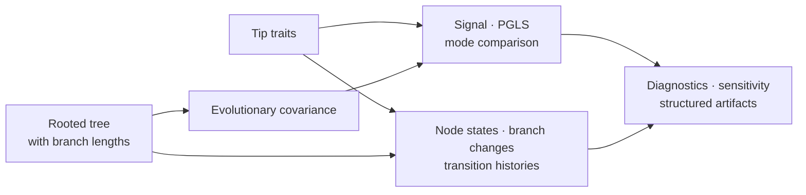

# Comparative And Ancestral Methods

Comparative analysis treats related species as statistically dependent.
Ancestral reconstruction uses the same tree, branch lengths, and evolutionary
assumptions to estimate unobserved states inside the tree. The runtime keeps
the fitted model, uncertainty, and tree context attached to both kinds of
result.

## The Shared Contract

Every analysis begins with an explicit mapping between tree tips and trait
rows. Missing taxa, duplicated identifiers, non-finite values, rooting, and
branch-length units are scientific inputs rather than clerical details. A
result is reviewable only when that mapping and the transformations applied to
the traits are retained.

| Question | Native method families | Result that must remain visible |
| --- | --- | --- |
| Do close relatives resemble one another? | contrasts, signal estimation and review | statistic, null or reference rule, fitted transformation, warnings |
| Does a predictor explain a response after phylogeny is modeled? | Brownian and OU covariance, PGLS, categorical contrasts, interactions | design terms, coefficients, covariance parameters, residual diagnostics |
| Which evolutionary mode best describes a continuous trait? | Brownian motion, OU, early burst, regime-rate and mode comparison | likelihood, parameters, information criteria, identifiability diagnostics |
| How does a discrete trait change? | Mk-family fitting, constrained transition models, mode recovery | state coding, rate matrix, transition constraints, model comparison |
| What states are supported at internal nodes? | continuous and discrete reconstruction, tree-set aggregation | node estimates or probabilities, intervals, ambiguity, tree sensitivity |
| How do lineages accumulate or partition diversity? | lineage, clade, trait-linked and sampling-aware diversification summaries | rate assumptions, sampling treatment, clade definitions, uncertainty |

## PGLS And Trait Covariance

Phylogenetic generalized least squares replaces the independence assumption
of ordinary regression with a covariance matrix derived from the tree and an
evolutionary model. Brownian covariance, OU covariance, and fitted lambda
transformations encode different dependence structures; they are not
interchangeable labels for the same correction.

Interpret coefficients together with the formula, categorical reference
levels, interaction parameterization, trait transformations, fitted
covariance parameters, and residual checks. A small p-value cannot repair a
taxon mismatch, an unidentified covariance model, or a predictor whose effect
changes under modest tree perturbations.

## Evolutionary Modes And Model Comparison

Brownian motion models accumulated change along branches. OU models add
attraction toward an optimum. Early-burst and regime-rate models alter how
evolutionary variance changes through time or among mapped regimes. Their
parameters have meaning only under the tree scale and implementation
convention used to fit them.

Information criteria rank the declared candidate set; they do not establish
that the winning model is biologically true. Retain candidate definitions,
parameter counts, likelihood convention, optimizer diagnostics, and weight or
delta calculations. Weak OU identifiability and boundary estimates should be
reported as limitations, not converted into categorical conclusions.

## Ancestral Reconstruction

Continuous reconstruction produces node estimates, uncertainty, and branch
changes under a named continuous-trait model. Discrete reconstruction produces
state probabilities or supported state sets under an explicit state coding and
transition model. Ordered states, forbidden transitions, unresolved tips, and
root treatment can materially change the answer.

Tree-set workflows repeat reconstruction across plausible trees and aggregate
the results. This separates conditional uncertainty on one tree from
topological uncertainty across trees. Neither should be summarized by a
single favored-node value when the distribution is broad or multimodal.

## Sensitivity Is Part Of The Result

Review the fitted analysis across the assumptions that could change its
interpretation:

- alternative rooting and branch-length treatments;
- taxon inclusion and influential clades;
- trait transformations, missing-data policy, and imputation;
- covariance or evolutionary-mode candidates;
- transition constraints and state ordering;
- single-tree versus tree-set conclusions;
- optimizer starts, boundary estimates, and reference implementations.

The [PCM1 signal and ancestral results](../03-bijux-phylogenetics-evidence-book/pcm1-primate-longevity-signal/signal-and-ancestral-results.md)
and [PCM2 model comparisons](../03-bijux-phylogenetics-evidence-book/pcm2-primate-pgls-and-signal/model-comparisons-and-pgls.md)
show how these conditions become bounded evidence claims.
