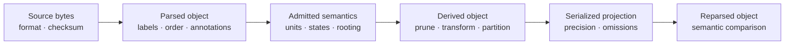

# Data Interchange And Identity

Newick, Nexus, FASTA, and delimited tables carry syntax; scientific methods
consume objects with rootedness, branch units, alphabets, partitions, taxon
namespaces, support conventions, and missing-data policies. Interchange is
successful only when the required meaning survives the boundary.

## Declare Meaning Outside The File When Necessary

| Format | Commonly represented | Meaning that may require an external declaration |
| --- | --- | --- |
| Newick | topology, tip labels, branch lengths, some labels/comments | rootedness intent, length units, support encoding, tree identity |
| Nexus | trees, character matrices, blocks and annotations | block interpretation, translation scope, software-specific metadata |
| FASTA | record identifiers and sequence strings | alphabet, alignment status, gaps, ambiguity, codon frame, partitions |
| CSV or TSV | columns and cell text | types, units, taxon key, missing values, factor/state order |

A parser cannot infer these meanings safely from a familiar filename or from
values that merely look plausible.

## Compare Semantics, Not Rendering

Textual differences do not necessarily change the object: child order can vary
for the same clade, whitespace can vary in FASTA, and column order can be
normalized under a declared table schema. Conversely, identical-looking text
can be interpreted differently when rooting, branch units, state order, or
missing-value policy changes.

Use stable comparison keys:

- descendant-taxon sets for clades and internal nodes;
- parent/child structural identity for branches;
- explicit taxon and character labels for matrices;
- record identifiers plus declared order for alignments;
- named columns and declared taxon keys for study tables;
- tree-set member identity and weight or frequency for collections.

Incidental node numbers, object addresses, display order, and filenames are not
scientific identity.

## Round-Trip Acceptance

A round trip should establish the fields it promises to preserve:

1. parse the identified source under an explicit format contract;
2. record normalized and rejected syntax;
3. serialize with declared precision, annotation, and ordering rules;
4. parse the emitted representation independently;
5. compare every required semantic field and retain any deliberate loss.

Self-round-trip success is weaker than cross-system correspondence. Two
implementations may each preserve a different subset of annotations. A lossy
writer is acceptable only when the omitted fields are outside the consuming
contract and the loss is explicit.

## Interchange Changes That Create New Objects

| Change | Required record |
| --- | --- |
| taxon rename or namespace mapping | original and normalized labels, collisions, authority, one-to-one status |
| tree pruning or rerooting | source tree identity, retained/excluded taxa, root policy, resulting topology |
| branch rescaling or time conversion | source units, transformation, parameters, calibration identity |
| sequence filtering or trimming | original coordinates, retained/deleted sites, frame and partition effects |
| alphabet or state recoding | original states, target vocabulary, ambiguous and impossible mappings |
| table join or row aggregation | join keys, cardinality, unmatched rows, aggregation rule, new population |

These are derivations, not parser conveniences. Assign a new object identity
and keep the source relationship.

## Public Boundary Surfaces

Tree-set loading and structured summaries are available through
`bijux_phylogenetics.trees:load_tree_set` and the tree-set result surfaces.
FASTA parsing and writing live under `bijux_phylogenetics.io.fasta`, including
`write_fasta_alignment`. Taxon-indexed tables and tree/trait alignment live
under `bijux_phylogenetics.datasets.study_inputs`.

Choose the narrowest public surface that retains the required semantics. A
format converter is not a substitute for tree validation, alignment
validation, taxon reconciliation, or dataset provenance.

## Minimum Handoff Record

Before a parsed or serialized object enters analysis, retain source checksum,
format and parser identity, declared semantics, dimensions, labels and order,
normalizations, warnings, exclusions, derivations, emitted checksum, and the
semantic round-trip result. Refuse the handoff when a required field is
ambiguous, silently lost, or reconstructed from an unsupported guess.

Continue with [Trees, Alignments, And Taxa](trees-alignments-and-taxa.md) for
object-specific invariants and [Datasets And Study Inputs](datasets-and-study-inputs.md)
for governed dataset families.
