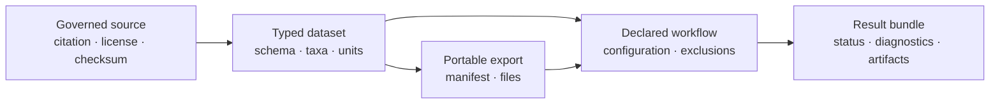

# Datasets And Study Inputs

Bijux Phylogenetics ships typed dataset families for known-answer checks,
recovery experiments, stress analysis, comparative biology, pathogens, and
phylogenomics. Each family couples source identity and schema with loaders,
exports, demonstrations, workflow results, and review artifacts. These are
different projections of one dataset contract, not interchangeable copies.

## A Dataset Role Limits The Claim

| Dataset role | Truth available | Defensible conclusion |
| --- | --- | --- |
| known-answer fixture | exact expected object or value under a compact contract | the implementation recovers that governed answer |
| simulated recovery corpus | recorded generator state and replicate population | recovery, bias, or calibration under those regimes |
| empirical study input | observed data, source, schema, and admitted population | an analysis result conditional on those observations |
| demonstration dataset | a small path through an interface or workflow | the documented surface executes and produces interpretable records |
| stress dataset | deliberately malformed, sparse, duplicated, or extreme cases | refusal, repair, and diagnostic behavior at named boundaries |

Do not borrow truth from one role into another. An empirical table has no
latent generating parameter merely because a simulator can emit the same
schema, and a demonstration that runs is not a recovery benchmark.

## Choose A Dataset By Its Evidential Role

| Role | Representative families | Appropriate use | Boundary |
| --- | --- | --- | --- |
| known answer | known-answer reference | exact contracts, parameter and node recovery | small fixtures do not establish empirical realism |
| generative recovery | continuous mode, discrete mode, macroevolution recovery | bias, coverage, topology, state, and mode recovery | conclusions remain conditional on the generator family |
| data-quality stress | catarrhine data-quality panel | duplicate taxa, missing traits, repair and exclusion behavior | failure discovery is not an accuracy benchmark |
| comparative biology | primate traits, avian reproductive traits, seashore flora | typed tree/trait workflows and biological examples | no latent truth is implied |
| sequence and phylogenomics | Pleistocene bear cyt-b, Influenza A HA, gnathostome orthologs, catarrhine mitogenomes | alignment, inference, protein, and multilocus workflows | source scope and locus selection remain material |
| host and geography | rabies cross-host, geographic transition, host-geography, method sensitivity | discrete geography, host association, migration, and sensitivity | reconstructed transitions are not observed transmission events |

Use `bijux_phylogenetics.datasets.catalog:list_public_dataset_surfaces` to
inspect the catalog contract. Use the family-specific `load_*_dataset` surface
when the dataset identity is already known. The catalog is discovery metadata;
the returned dataset object owns the actual inputs and schema.

## Keep Load, Export, Demo, And Workflow Distinct

| Surface | What it establishes | What it does not establish |
| --- | --- | --- |
| `load_*_dataset` | packaged resources can be resolved into the typed dataset contract | that any analysis was executed |
| `export_*_dataset` | a portable file set was emitted with declared identity | that exported files were consumed without change |
| `run_*_demo` | a bounded explanatory path executed | benchmark or study-wide evidence |
| `run_*_workflow` | the family workflow produced a structured result | that diagnostics or scientific acceptance passed |
| `write_*_workflow_bundle` | result projections and inventory were persisted | that missing or failed outputs became successful |

The exact family prefix identifies the scientific population. Do not replace a
specific dataset name with “example data” in a methods section or artifact
manifest.

## Admit External Study Tables

The `bijux_phylogenetics.datasets.study_inputs` surface handles taxon-indexed
tables that do not originate in a packaged family:

1. `load_taxon_table` parses the table and taxon key.
2. `inspect_taxon_table_index` and `inspect_metadata_table` expose duplicate,
   completeness, and column-shape conditions.
3. `validate_traits_table` classifies trait columns and unusable values.
4. `check_tree_and_trait_taxon_names` records namespace differences.
5. `align_tree_and_trait_table` creates the admitted tree/table population and
   preserves exclusions.

`join_table_to_taxa` and `link_tree_to_traits` are explicit joins. Row order,
renaming, pruning, missingness, and duplicate resolution are scientific input
decisions and belong in the resulting linkage record.

## Dataset Identity Record

Retain at least:

- dataset family, dataset revision, package version, and resource checksums;
- source citation, license, retrieval or derivation statement;
- tree, alignment, table, locus, partition, and metadata identities;
- taxon namespace and exact admitted, excluded, renamed, and reordered sets;
- column types, units, state vocabularies, ambiguity and missing-value policy;
- transformations, repairs, filters, and whether they were declared before
  observing results;
- workflow configuration, seed policy, output status, diagnostics, and bundle
  inventory.

An export creates a new file identity while retaining the dataset identity. A
filter, repair, taxon pruning, aggregation, or transformation creates a new
analytical population and must be recorded as a derived dataset.

## Refusal And Qualification

Refuse an unqualified analysis when the dataset resource cannot be resolved,
checksums or schema do not match, taxa are duplicated or ambiguously joined,
units or state coding are unknown, or required data are absent. Preserve a
qualified dataset when exclusions are explicit and the consuming method admits
the remaining population.

A packaged dataset demonstrates availability and a governed input contract.
Only its named workflow, benchmark, parity record, or Evidence Book bundle can
support a stronger execution or scientific claim.

Continue with [Data Interchange And Identity](data-interchange-and-identity.md)
for serialization boundaries and [Simulation And Datasets](../scientific-assurance/simulation-and-datasets.md)
for recovery design.
