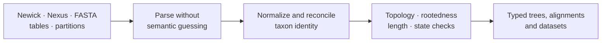
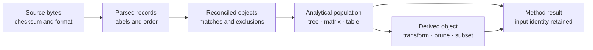

# Data And Structure

Phylogenetic methods depend on a shared structural vocabulary: taxa, trees,
branch lengths, alignments, characters, partitions, and support annotations.
This domain defines how those objects enter the runtime and which invariants
must hold before a scientific method can consume them.

Start with [Trees, Alignments, And Taxa](trees-alignments-and-taxa.md) for the
shared object contracts. Continue with
[Tree Operations And Identity](tree-operations-and-identity.md) before
rerooting, pruning, extracting, rescaling, or comparing trees.

## Choose The Data Contract

| Starting material | Read first | Decision owned there |
| --- | --- | --- |
| packaged biological or validation dataset | [Datasets And Study Inputs](datasets-and-study-inputs.md) | dataset role, provenance, schema, analytical population, and export identity |
| Newick, Nexus, FASTA, or tabular files | [Data Interchange And Identity](data-interchange-and-identity.md) | which semantics survive parsing, normalization, and serialization |
| trees, alignments, partitions, or tree sets already in memory | [Trees, Alignments, And Taxa](trees-alignments-and-taxa.md) | rootedness, branch meaning, state coding, support, and taxon reconciliation |
| a tree that must be transformed or structurally compared | [Tree Operations And Identity](tree-operations-and-identity.md) | preserved invariants, structural node/branch identity, derivation ledger, and comparison boundary |
| bootstrap, posterior, gene, candidate, or sensitivity trees | [Tree Sets, Consensus, And Support](tree-sets-consensus-and-support.md) | population meaning, member denominator, consensus policy, support identity, and selection record |

These routes meet at the admitted analytical object. A packaged dataset is not
automatically analysis-ready, and a successfully parsed file is not
automatically scientifically identified.

## Intake Contract

| Object | Required identity | Method-sensitive meaning |
| --- | --- | --- |
| tree | tip labels, topology, rootedness, branch lengths, support annotations | time versus substitutions, polytomy policy, ultrametricity |
| alignment | sequence labels, alphabet, length, gaps, ambiguity, partitions | codon frame, translation table, missing-data policy |
| trait or metadata table | taxon key, column types, missing values, units | response/predictor role, transformations, factor levels |
| tree set | member identity, ordering, weights or frequencies | posterior sample, bootstrap collection, candidate set |

Joining objects creates a new governed identity. Record retained taxa, excluded
rows, renamed labels, reordered matrices, pruned branches, and any operation
that changes the analytical population.

## The Identity Spine

Every arrow is observable. Parsing can normalize syntax without changing
scientific identity; reconciliation and derivation can change the population
and therefore require a new identity plus a ledger back to the source.

## Handoff Requirements By Consumer

| Consumer | Required structural handoff | Refuse when |
| --- | --- | --- |
| topology or branch analysis | validated tree, rooting state, tip order, branch units, support method | topology is malformed, required rooting is absent, or branch semantics are unknown |
| sequence likelihood | equal-length alignment, alphabet, taxon order, partitions, gap/ambiguity policy | state space is incoherent, partitions overlap, or tree/alignment taxa cannot be reconciled |
| comparative model | tree plus typed trait table, exact analytical population, response/predictor roles, units | duplicate taxa, unexplained exclusions, invalid design columns, or mismatched row order |
| ancestral reconstruction | tree, observed states/traits, node identity policy, transition or covariance model | tips are unmapped, state coding is incomplete, or the method’s tree assumptions fail |
| tree-set analysis | stable member identifiers, weights/frequencies, common taxon policy, failed-member ledger | members are silently discarded or summaries mix incompatible taxa/rooting |
| publication artifact | result identity, source checksums, exclusions, transforms, diagnostics | a figure/table cannot be traced to one accepted analytical object |

## Operations That Create A New Object

Pruning, rerooting, resolving or collapsing nodes, rescaling branch lengths,
filtering sites, trimming alignments, translating coding sequence, changing a
partition scheme, aggregating traits, transforming a response, imputing values,
or reordering to match another object creates a derived object. Preserve the
operation, parameters, before/after dimensions, exclusions, and source
checksum. A derived object can be valid while answering a different question
from its source.

[Tree Operations And Identity](tree-operations-and-identity.md) gives the
operation-specific acceptance rules. It separates a transformation record
from any later comparison so that taxon pruning or rerooting cannot disappear
inside a distance or support result.

## Boundary Rules

- Parsing preserves source meaning; it does not silently repair scientific
  ambiguity.
- Taxon reconciliation emits a ledger of matches, exclusions, and conflicts.
- Rooting and branch-length assumptions belong to the consuming method.
- Tree-set identity and ordering remain stable across summaries.
- Support values retain their producing method and scale.

## Refuse Ambiguous Inputs

Stop before analysis when duplicate taxon identifiers, unresolved namespace
collisions, impossible branch lengths, inconsistent sequence alphabets,
partition overlap, or unexplained tree–table loss would change the scientific
meaning. An explicit exclusion policy can resolve a known mismatch; silently
dropping unmatched records cannot.

The output of intake is therefore both a typed object and a reconciliation
record. Downstream methods should consume the former and preserve the latter.

For a population of trees, continue with
[Tree Sets, Consensus, And Support](tree-sets-consensus-and-support.md) and then
[Tree Uncertainty And Sensitivity](../scientific-assurance/tree-uncertainty-and-sensitivity.md).
