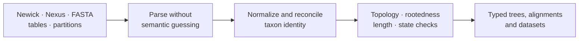

# Data And Structure

Phylogenetic methods depend on a shared structural vocabulary: taxa, trees,
branch lengths, alignments, characters, partitions, and support annotations.
This domain defines how those objects enter the runtime and which invariants
must hold before a scientific method can consume them.

Start with [Trees, Alignments, And Taxa](trees-alignments-and-taxa.md) for
rootedness, branch-length meaning, tree sets, alignment partitions, support
labels, and taxon reconciliation.

## Intake Contract

| Object | Required identity | Method-sensitive meaning |
| --- | --- | --- |
| tree | tip labels, topology, rootedness, branch lengths, support annotations | time versus substitutions, polytomy policy, ultrametricity |
| alignment | sequence labels, alphabet, length, gaps, ambiguity, partitions | codon frame, translation table, missing-data policy |
| trait or metadata table | taxon key, column types, missing values, units | response/predictor role, transformations, factor levels |
| tree set | member identity, ordering, weights or frequencies | posterior sample, bootstrap collection, candidate set |

Joining objects creates a new governed identity. Record retained taxa, excluded
rows, renamed labels, reordered matrices, pruned branches, and any operation
that changes the analytical population.

## Boundary Rules

- Parsing preserves source meaning; it does not silently repair scientific
  ambiguity.
- Taxon reconciliation emits a ledger of matches, exclusions, and conflicts.
- Rooting and branch-length assumptions belong to the consuming method.
- Tree-set identity and ordering remain stable across summaries.
- Support values retain their producing method and scale.

## Refuse Ambiguous Inputs

Stop before analysis when duplicate taxon identifiers, unresolved namespace
collisions, impossible branch lengths, inconsistent sequence alphabets,
partition overlap, or unexplained tree–table loss would change the scientific
meaning. An explicit exclusion policy can resolve a known mismatch; silently
dropping unmatched records cannot.

The output of intake is therefore both a typed object and a reconciliation
record. Downstream methods should consume the former and preserve the latter.
