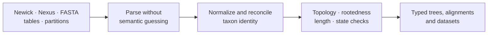

# Data And Structure

Phylogenetic methods depend on a shared structural vocabulary: taxa, trees,
branch lengths, alignments, characters, partitions, and support annotations.
This domain defines how those objects enter the runtime and which invariants
must hold before a scientific method can consume them.

Start with [Trees, Alignments, And Taxa](trees-alignments-and-taxa.md) for
rootedness, branch-length meaning, tree sets, alignment partitions, support
labels, and taxon reconciliation.

## Boundary Rules

- Parsing preserves source meaning; it does not silently repair scientific
  ambiguity.
- Taxon reconciliation emits a ledger of matches, exclusions, and conflicts.
- Rooting and branch-length assumptions belong to the consuming method.
- Tree-set identity and ordering remain stable across summaries.
- Support values retain their producing method and scale.
