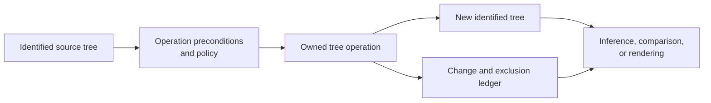
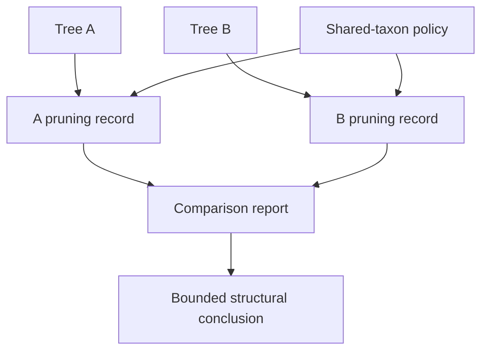

# Tree Operations And Identity

A tree operation is scientifically meaningful when its input tree, taxon
population, rooting state, branch semantics, and output identity remain
connected. Rerooting, pruning, extracting a clade, collapsing a branch, or
normalizing support can preserve some properties while changing others. The
operation name alone is therefore not a sufficient record.

## Choose The Operation By Its Invariant

| Intended change | Invariant to preserve | Required output evidence |
| --- | --- | --- |
| reroot on an outgroup | unrooted split set and admitted tips | outgroup, prior root state, resulting root state, split comparison |
| prune taxa | relationships among retained tips under the declared collapse policy | requested, retained and removed taxa; before/after topology identity |
| extract a clade | descendant-tip identity of the selected node | selector, resolved clade key, extracted tips and branch policy |
| collapse or resolve nodes | declared resolution and length/support rules | changed clades, affected branches and any information loss |
| rescale branch lengths | topology and branch correspondence | scale or transform, old/new units and branch-keyed values |
| normalize support | clade identity and producing support method | source scale, target scale, missing-value policy and clade-keyed ledger |

An invariant is part of the acceptance rule. If rerooting changes an unrooted
split, or pruning removes a taxon that was not in the requested exclusion set,
the operation is not accepted merely because it returned a valid Newick tree.

## Identify Nodes And Branches Structurally

Traversal positions and parser-assigned node numbers are representation
details. Use descendant-tip sets, with root and unary-node context where
needed, to identify internal clades. Use the corresponding split or child
clade plus parent context to identify a branch. Labels can supplement those
keys, but cannot replace them unless their uniqueness and persistence are
part of the input contract.

| Identity | Safe use | Unsafe shortcut |
| --- | --- | --- |
| tip | exact admitted taxon identifier | display label after lossy normalization |
| rooted clade | descendant-tip set | preorder index |
| unrooted split | canonical bipartition of admitted tips | child order in Newick |
| branch | structural edge key plus declared tree identity | row number in a rendered table |
| tree | content identity plus rooting and branch semantics | filename alone |

This distinction matters when two parsers order children differently, when a
root is inserted on an edge, or when a tree is serialized and loaded again.
Those representation changes can leave the scientific object unchanged while
invalidating position-based correspondence.

## Inspect Before Transforming

The public `bijux_phylogenetics.trees` surface exposes structured inspection
for tree shape, clades, and branch-length distributions. The resulting reports
make preconditions visible before a transformation is accepted.

| Public surface | Review use |
| --- | --- |
| `summarize_tree_shape` and `summarize_tree_set_shapes` | tip/node counts, binary or star-like structure, depth, height and imbalance |
| `extract_tree_clades` and `extract_tree_set_clades` | stable clade rows, support, metadata and descendant identity |
| `analyze_branch_length_distribution` | missing, zero, negative, extreme and structurally keyed branch lengths |
| `bijux_phylogenetics.compare.topology` | rooted/unrooted distance, overlap, agreement, support and branch comparison |

Inspection is not repair. A negative branch length, duplicate tip, ambiguous
root, or missing support convention remains a refusal or qualification until
the consuming method owns an explicit policy for it.

## Preserve The Derivation Record

For every derived tree, retain:

- source content identity and parse format;
- operation and exact parameters;
- rooting, branch-length and support semantics before and after;
- requested, admitted, excluded and renamed taxa;
- structural keys for changed clades or branches;
- warnings, refusals and information loss;
- output content identity and the consumer that accepted it.

The source and derived trees should coexist. Overwriting the source erases the
only direct evidence that the requested transformation and the observed
change agree.

## Distinguish Transformation From Comparison

Transformation creates a new object. Comparison creates observations about
two identified objects. A pruning workflow may transform both trees to a
shared taxon population and then compare them, but those are separate records:
the pruning ledger owns the population change, while the comparison report
owns the split, support, branch, or age observations.

A zero distance after pruning does not establish equality of the original
trees. It establishes equality of the admitted projections under the named
comparison rule. Report removed taxa and the eligible split denominator with
the result.

## Accept A Derived Tree

Accept the output only when the operation preconditions were satisfied, the
declared invariant was checked, every population change is listed, structural
identity remains resolvable, and the downstream consumer can interpret the
root, lengths, and support. Otherwise preserve the structured refusal or
qualified result. A syntactically valid tree is not evidence that a scientific
transformation was valid.
