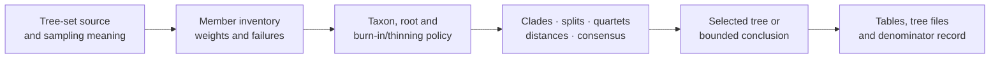
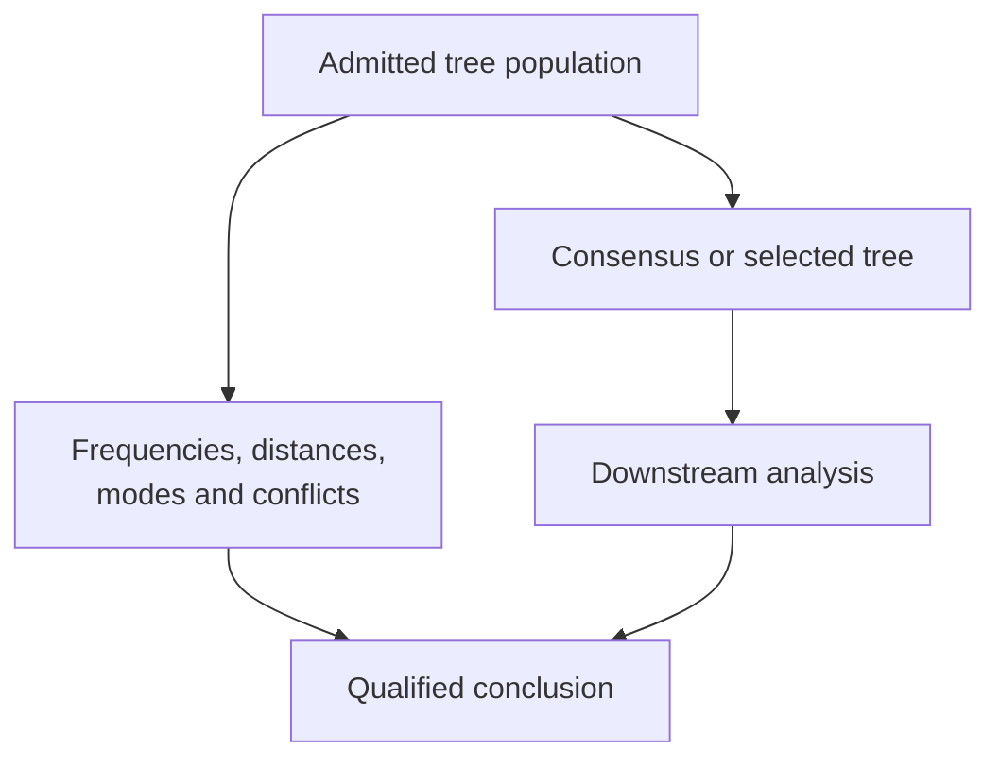

# Tree Sets, Consensus, And Support

A tree set is a population of identified trees, not a loose collection of
Newick strings. It may represent bootstrap replicates, posterior samples,
gene trees, search candidates, or a deliberately assembled sensitivity set.
The population meaning determines which consensus, support, distance, and
uncertainty summaries are valid.

## Identify The Population Before Summarizing

| Population | Members mean | Required selection record |
| --- | --- | --- |
| bootstrap trees | resampled-data inference replicates | requested, completed, failed and admitted replicates |
| posterior trees | retained states from a sampling process | chain identity, burn-in, thinning, retained indices and convergence context |
| gene trees | locus- or partition-specific histories | gene/partition identity, taxon mapping and failed loci |
| search candidates | evaluated topologies | search method, move set, starts, score and deduplication policy |
| sensitivity trees | plausible alternative structural assumptions | source of each alternative and eligibility rule |

Combining these populations changes the scientific question. A posterior clade
frequency is not a bootstrap proportion, and either can differ from the
fraction of independently inferred gene trees containing that clade.

## Use A Summary That Matches The Decision

| Decision | Public `bijux_phylogenetics.trees` surface | Preserve with the result |
| --- | --- | --- |
| count clades or splits | `compute_clade_frequency_table`, `compute_tree_set_split_frequency_table` | population, clade/split key, numerator, eligible denominator and policy |
| summarize compatible clades | `compute_strict_consensus_tree`, `compute_consensus_tree`, `compute_majority_rule_extended_consensus` | threshold, compatibility rule, accepted and rejected clades |
| select a representative posterior tree | `compute_maximum_clade_credibility_tree` | all candidate scores, tie rule and selected member identity |
| retain a credible clade set | `compute_credible_clade_set` | cumulative rule, included/excluded rows and ordering |
| compare tree-set members | `compute_tree_distance_matrix`, `compute_posterior_tree_distance_diagnostics` | distance definition, taxon/root policy, matrix labels and distribution rows |
| assess a reference tree | `compute_reference_tree_clade_support`, `compute_reference_tree_quartet_support` | reference identity, eligible observations and absent/incompatible cases |
| summarize posterior quantities | `summarize_posterior_branch_lengths`, `summarize_posterior_node_ages` | structural key, retained samples, missingness and interval definition |

No summary is the tree set itself. Retain the admitted inventory so a reviewer
can reconstruct its denominator and determine which information the summary
discarded.

## Consensus Is A Projection

A strict consensus retains only clades present throughout the admitted set. A
majority consensus applies a frequency threshold. Majority-rule extended
consensus additionally resolves compatible lower-frequency clades according
to an ordering and compatibility policy. These outputs answer different
questions even when they happen to render the same topology.

Record the method, threshold, tie ordering, root policy, taxon population,
accepted clades, rejected conflicts, and any unresolved nodes. A consensus
branch length or support label also needs a declared aggregation rule; it must
not be inherited from whichever member happened to supply the topology.

## Support Needs A Denominator And A Method

Support belongs to a structurally identified clade or split and a named
replicate population. For every reported value retain:

- clade or split key and the admitted taxon population;
- support method and scale;
- number of eligible, completed, failed, and excluded members;
- numerator and denominator used for the value;
- absent, incompatible, or unresolved treatment;
- any weighting, burn-in, thinning, or deduplication policy.

Do not merge bootstrap support, posterior clade probability, quartet support,
and gene-tree concordance into a single generic `support` field. Similar
percentages can encode different experiments and uncertainty sources.

## Separate Selection From Uncertainty

Maximum-clade-credibility selection, consensus, and quartet-puzzling produce a
tree that can be consumed downstream. The selected tree does not erase the
distribution from which it came. Comparative or ancestral analysis performed
on that tree is conditional on the selection unless sensitivity across the
tree population is evaluated separately.

## Budget Without Hiding Members

Large tree sets require explicit processing budgets. The tree-set budget
surfaces record selected members, limits, sampling or truncation policy, and
the resulting processing population. A resource limit may justify a bounded
subset; it cannot silently convert the subset into the full population.

Reject a summary when member parse failures disappear, taxon populations are
mixed without a reconciliation policy, posterior selection is unspecified,
or output rows cannot be traced to structural keys. A complete tree-set result
includes both the requested population and the population actually summarized.
