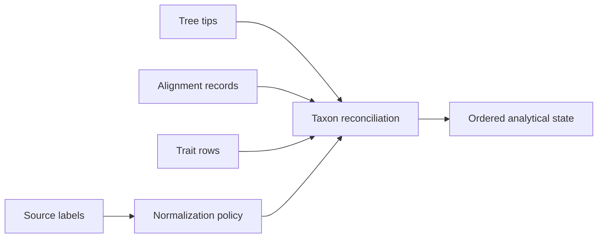

# Trees, Alignments, And Taxa

Trees and alignments become analytically compatible through taxon identity.
Every inference or comparative method depends on that relationship being
explicit before numerical work begins.

## Tree Contracts

The owned `PhyloTree` runtime represents topology, nodes, tips, rootedness,
branch lengths, support, clades, splits, and distances. Public operations cover
validation, rooting and rerooting, MRCA lookup, clade extraction, topology
comparison, support normalization, tree-set inspection, and rendering.

Rooted and unrooted trees answer different questions. Branch lengths may
represent expected substitutions, time, or another distance; algorithms must
not infer their units from file format alone. Support labels require an
explicit method and scale.

## Alignment Contracts

Alignment handling covers FASTA loading and validation, alphabet review,
trimming, coding-sequence checks, translation, identity summaries, and
partition-aware input. Equal row length is necessary but not sufficient:
homology, reading frame, stop codons, ambiguity, missingness, and partition
meaning affect downstream models.

## Taxon Reconciliation

Use set differences before reordering. Record duplicate labels, normalization,
excluded taxa, missing sequences or traits, and the final ordered identity.
Never rely on incidental file order when pairing a tree with a matrix or
vector.

| Mismatch | Risk | Required treatment |
| --- | --- | --- |
| duplicate label | observations collapse or overwrite | reject or apply an explicit aggregation rule |
| tree-only taxon | pruning changes topology and covariance | record and justify pruning |
| data-only taxon | observation is silently discarded | report exclusion or supply tree placement |
| normalized collision | distinct source names become identical | reject ambiguous normalization |
| order mismatch | values attach to the wrong species | reorder by explicit identity |

## Tree Sets And Uncertainty

A single consensus or best tree can hide topology uncertainty. Tree-set
surfaces retain split frequencies, topology diversity, support, and influence
across candidate trees. Comparative and ancestral results should state whether
they are conditional on one tree or summarized across a set.

## External Preparation

MAFFT and trimAl adapters provide governed alignment and trimming execution.
Their outputs must retain executable version, parameters, captured diagnostics,
and input identity. The adapter owns orchestration and normalization; the
external program owns its algorithm.

## Review Outputs

Prefer structured tree, taxon, support, and alignment diagnostics alongside
Newick, FASTA, SVG, or HTML presentation. A rendered tree without its topology,
branch-length, support, and provenance records is not a complete analytical
artifact.
