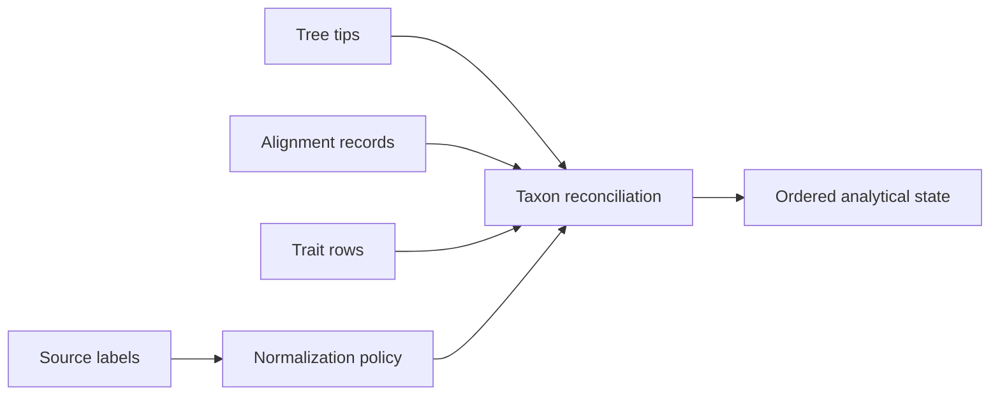
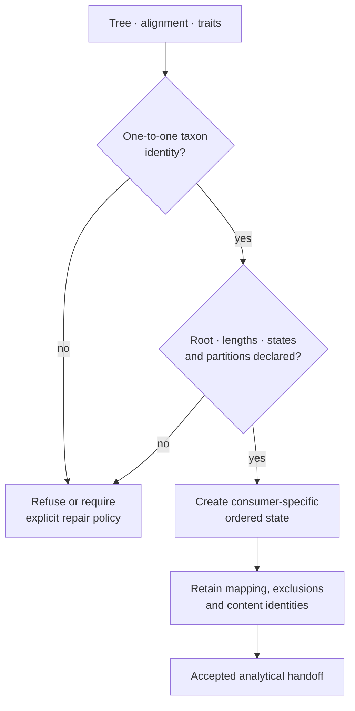

# Trees, Alignments, And Taxa

Trees and alignments become analytically compatible through taxon identity.
Every inference or comparative method depends on that relationship being
explicit before numerical work begins.

## Tree Contracts

The owned `PhyloTree` runtime represents topology, nodes, tips, rootedness,
branch lengths, support, clades, splits, and distances. Public operations cover
validation, rooting and rerooting, MRCA lookup, clade extraction, topology
comparison, support normalization, tree-set inspection, and rendering.

Rooted and unrooted trees answer different questions. Branch lengths may
represent expected substitutions, time, or another distance; algorithms must
not infer their units from file format alone. Support labels require an
explicit method and scale.

## Alignment Contracts

Alignment handling covers FASTA loading and validation, alphabet review,
trimming, coding-sequence checks, translation, identity summaries, and
partition-aware input. Equal row length is necessary but not sufficient:
homology, reading frame, stop codons, ambiguity, missingness, and partition
meaning affect downstream models.

## Runtime Locator Map

| Responsibility | Public locator | Retained state |
| --- | --- | --- |
| tree object and topology semantics | `bijux_phylogenetics.phylo.topology.PhyloTree` | nodes, tips, rootedness, branch lengths, support, topology identity |
| pruning and tree/alignment agreement | `bijux_phylogenetics.phylo.pruning` | requested taxa, retained taxa, exclusions, pruned object |
| taxon workflow and synonym review | `bijux_phylogenetics.phylo.taxa` | source labels, mappings, collisions, accepted identity |
| alignment and partition validation | `bijux_phylogenetics.phylo.alignment` | alphabet, dimensions, partitions, missing and ambiguous observations |
| topology comparison | `bijux_phylogenetics.compare.topology` | reconciled taxa, rooting policy, clade/split agreement, distances |
| tree-set inventory and uncertainty | `bijux_phylogenetics.trees.tree_sets` and `.uncertainty` | tree identity, frequency, topology diversity, support and sensitivity |

The locators expose different contracts; none is a general “tree utility”
bucket. Use topology comparison for relationships between trees, taxon
reconciliation for identity, and tree-set surfaces when the analysis unit is a
distribution rather than one selected tree.

## Taxon Reconciliation

Use set differences before reordering. Record duplicate labels, normalization,
excluded taxa, missing sequences or traits, and the final ordered identity.
Never rely on incidental file order when pairing a tree with a matrix or
vector.

| Mismatch | Risk | Required treatment |
| --- | --- | --- |
| duplicate label | observations collapse or overwrite | reject or apply an explicit aggregation rule |
| tree-only taxon | pruning changes topology and covariance | record and justify pruning |
| data-only taxon | observation is silently discarded | report exclusion or supply tree placement |
| normalized collision | distinct source names become identical | reject ambiguous normalization |
| order mismatch | values attach to the wrong species | reorder by explicit identity |

The reconciliation handoff must identify the normalization policy, original
sets, accepted one-to-one mapping, exclusions with reasons, and final order.
Hashing only the final matrix is insufficient because two different exclusion
or collision decisions can produce arrays with the same shape.

## Downstream Handoff Contracts

The same tree may enter several analyses, but each consumer requires a
different accepted state:

| Consumer | Required handoff | Refuse or qualify when |
| --- | --- | --- |
| sequence inference | equal-length alignment, alphabet and partition identity, unique ordered taxa | records differ in length, coding frame is unresolved, or partitions overlap unexpectedly |
| comparative regression | tree, ordered trait population, branch-length interpretation, formula variables | taxa are silently dropped, covariance order is implicit, or response units are unknown |
| ancestral reconstruction | rooted tree where required, tip states, model/state ordering, stable node keys | root treatment is absent, states are coerced, or node rows rely on incidental numbering |
| tree-set sensitivity | inventory of trees, common or reconciled taxa, per-tree identity and weights | failed trees vanish, taxa differ without policy, or one consensus replaces the population |
| visualization | structured topology and analytical rows with provenance links | a figure contains values or labels that cannot resolve to the accepted result |

Repair creates a new governed object. The repaired labels, pruned tree,
filtered table, or translated alignment must receive its own identity and link
back to the source plus the decision ledger; it must not overwrite the evidence
of what was rejected.

## Tree Sets And Uncertainty

A single consensus or best tree can hide topology uncertainty. Tree-set
surfaces retain split frequencies, topology diversity, support, and influence
across candidate trees. Comparative and ancestral results should state whether
they are conditional on one tree or summarized across a set.

## External Preparation

MAFFT and trimAl adapters provide governed alignment and trimming execution.
Their outputs must retain executable version, parameters, captured diagnostics,
and input identity. The adapter owns orchestration and normalization; the
external program owns its algorithm.

## Review Outputs

Prefer structured tree, taxon, support, and alignment diagnostics alongside
Newick, FASTA, SVG, or HTML presentation. A rendered tree without its topology,
branch-length, support, and provenance records is not a complete analytical
artifact.

For downstream inference, retain the exact Newick or structured topology,
ordered taxa, branch-length interpretation, support method and scale,
alignment/trait checksum, reconciliation ledger, and any pruning or rooting
operation. These fields define the scientific state handed to the model.
