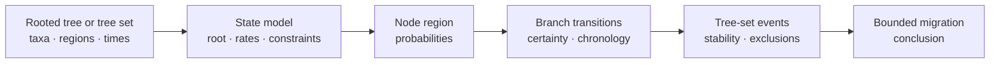

# Biogeography And Migration

Biogeographic analysis reconstructs discrete region states and derives bounded
transition, chronology, and migration-event records. Bijux exposes region
probabilities, rates, constraints, sampling-bias diagnostics, time-stratified
matrices, tree-set stability, exclusions, and report packages as separate
review surfaces.

## Choose The Biogeographic Contract

| Question | Public surface | Record that controls interpretation |
| --- | --- | --- |
| Which region states and transitions follow from one model? | `summarize_geographic_state_model` | state order, root treatment, rate rows, node probabilities, exclusions |
| Which transitions remain possible under geographic constraints? | `summarize_constrained_geographic_model` | allowed-transition policy, constrained and unconstrained fits, unsupported claims |
| Does uneven regional sampling alter the reconstruction? | `summarize_geographic_sampling_bias` | sampling counts, node and transition sensitivity, exclusions |
| Do transition opportunities change through time? | `summarize_time_stratified_geographic_transitions` | time-bin definitions, branch overlap, matrix identity, unsupported branches |
| Which dated events are reconstructed? | `summarize_biogeographic_transition_chronology` | node ages, event time, bin assignment, temporal uncertainty |
| How stable are events across trees? | `summarize_geographic_migration_event_tree_set` | admitted tree population, per-tree events, failures, event aggregation rule |

`summarize_geographic_migration_events` creates an event ledger for one tree.
It does not observe migration directly.

## Preserve Region And Transition Identity

Region labels are model states, not decorative map text. Retain their order,
normalization, spatial definition, missing-state policy, and any transition
allowlist. For every rate or event, identify source region, target region,
branch, parent and child node, descendant taxa, support class, and whether the
transition was admissible.

A forbidden transition must remain visible as an unsupported claim or failed
model condition. Silently removing it changes both the candidate process and
the event denominator.

## Time Stratification Changes The Model

Time bins define different transition opportunity regimes. Record bin
boundaries, time units, inclusivity rules, branch overlap, and which transition
matrix applies to each interval. A branch that crosses a boundary cannot be
assigned by label proximity alone.

Chronology inherits uncertainty from topology, branch times, calibrations,
state reconstruction, and bin definition. Similar event ages from different
time trees are not equivalent until those inputs align.

## Separate Count, Rate, And Stability

| Quantity | Denominator | Common overclaim |
| --- | --- | --- |
| event count | admitted branches or events on one reconstruction | more events means higher migration propensity |
| transition rate | model exposure under the declared state process | rate is an observed movement frequency |
| tree-set frequency | admitted trees with a structurally corresponding event | frequency is posterior probability without a posterior sampling contract |
| region count | admitted tips, nodes, or observations named by the record | count represents unbiased geographic prevalence |

Keep tree-level events and tree-set summaries together. Failed or incompatible
trees remain in the population record even when they cannot contribute an
event row.

## Sampling Bias And Constraints Are First-Class

Sampling concentration can change region probabilities and apparent transition
support. Constraint policies can prevent biologically or geographically
impossible transitions but can also force probability into the remaining
paths. Review unconstrained and constrained fits, boundary states, unsupported
claims, and bias-sensitive nodes before interpreting a favored route.

## Publication Packet

Retain the tree or tree-set identity, region table and vocabulary, model and
root policy, rate and transition rows, node probabilities, sampling counts,
constraint revision, time bins, event ledger, tree-set denominator, exclusions,
warnings, and report inventory. `build_biogeography_report_package` assembles
projections from these records; it does not replace them.

Refuse a migration conclusion when region identity is ambiguous, required taxa
are missing without policy, node or branch identity cannot be reconciled, time
units are unknown, the selected transition is forbidden, or tree/model
sensitivity reverses the conclusion.
