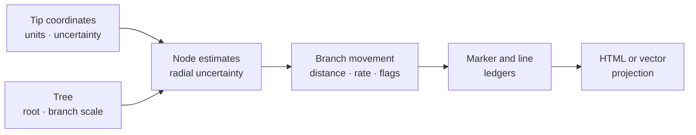

# Continuous Phylogeography And Maps

Continuous phylogeography reconstructs coordinates at internal nodes and
derives branchwise movement under a declared tree and spatial model. Bijux
keeps coordinate estimates, uncertainty, movement rows, outlier diagnostics,
exclusions, map geometry, and rendered HTML as linked but distinct artifacts.

## Owned Review Surfaces

| Surface | Output identity |
| --- | --- |
| `summarize_continuous_phylogeography` | node coordinate estimates, branch movements, outliers, exclusions, warnings, and summary |
| `summarize_continuous_phylogeography_map` | map markers and lines derived from continuous-coordinate records |
| `summarize_discrete_region_map` | map geometry derived from named region states, not continuous inference |
| `render_coordinate_movement_visualization` | coordinate-space visualization tied to the movement ledger |
| `render_geographic_map_html` | interactive projection of admitted marker and line rows |

The renderer does not fit a phylogeographic model. It consumes a structured
geographic record.

## Coordinate Admission

Record latitude and longitude columns, coordinate reference and units,
precision, missing values, duplicated localities, range checks, and taxon
reconciliation. Longitude wrapping and latitude bounds are semantic rules, not
formatting preferences.

When several observations belong to one taxon, aggregation creates a new
observation with its own uncertainty and weighting policy. A centroid is not a
substitute for retained locality variation unless the scientific question
declares that reduction.

## Read Node And Branch Rows Separately

`CoordinateEstimateRow` identifies the node structurally and retains latitude,
longitude, coordinate standard errors, radial standard error, confidence, and
instability. `CoordinateMovementBranchRow` joins parent and child estimates to
great-circle distance, branch length, rate where defined, support, and flag
codes.

Distance and rate answer different questions. A long movement on a long branch
may have a moderate rate; a short movement on a near-zero branch may have an
unstable rate. Do not rank branches without retaining both quantities and the
branch-time convention.

## Govern Outliers Before Interpretation

Impossible jumps and robust outliers are diagnostic states. Retain the median,
distance or rate threshold, flag codes, and every excluded coordinate.
Removing flagged branches after seeing the map changes the movement population
and requires a new identified analysis.

| Flag state | Correct treatment |
| --- | --- |
| coordinate invalid | exclude before fitting with the reason retained |
| node estimate unstable | qualify every movement that depends on the node |
| distance outlier | retain in the main ledger and expose the registered sensitivity result |
| rate undefined | report distance without inventing a finite rate |
| jump geographically impossible under external knowledge | preserve the analytical result and separate the domain constraint |

## Maps Are Review Projections

Every marker and line must resolve to a node, branch, state or coordinate row,
filter decision, and run identity. Style, viewport, colors, labels, and
basemaps may change presentation; endpoints, included branches, support
classes, or spatial transformations change the scientific projection.

A blank region on a map can mean no observations, exclusion, low support, a
failed geometry record, or viewport omission. The map artifact must preserve
which state applies rather than inviting visual inference.

## Acceptance Record

Retain tree and coordinate-table checksums, taxon linkage, model and alpha,
node estimates, radial uncertainty, branch lengths and units, movement rows,
outlier policy, exclusions, marker/line ledgers, rendering configuration, and
artifact inventory. Refuse an unqualified movement claim when coordinates,
tree scale, node identity, or branch-time meaning is unresolved.
