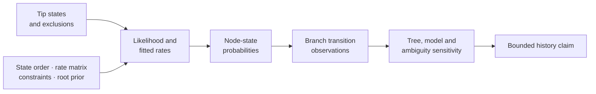
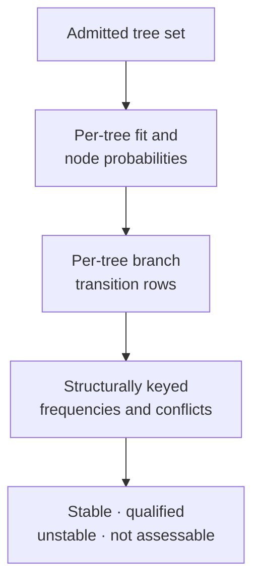

# Discrete Ancestral States And Transitions

Discrete ancestral analysis has three separate outputs: a fitted transition
model, conditional state probabilities at internal nodes, and branch-level
transition summaries derived from those states. A preferred state at a node is
not an observed history, and a branch transition is not certain merely because
its endpoint preferences differ.

## Direction Begins At The Root

An unrooted topology can define splits but not ancestors, descendants, or a
directed transition. Root placement is therefore part of the scientific model,
not a display preference applied after reconstruction.

| Root contract | Consequence for transition evidence |
| --- | --- |
| biologically justified outgroup root | direction depends on the admitted outgroup and its placement |
| clock or dated-tree root | direction inherits the clock, calibration, and time-tree assumptions |
| midpoint or other algorithmic root | direction is conditional on that rooting heuristic |
| root prior over states | basal node probabilities and early transitions depend on the declared prior |
| alternative plausible roots | node identity and transition direction must be recomputed, not relabeled |

Retain the rooted tree identity with every node and branch row. A structural
branch key must identify the descendant clade under that root; traversal
numbers and drawing orientation cannot provide durable correspondence. When a
plausible root changes a headline transition, publish the conclusion as
root-sensitive rather than selecting the visually convenient history.

## Establish State Identity

Record the complete state vocabulary, order, aliases, ambiguity symbols,
missing-state policy, and every tip exclusion. State order determines the
layout of probabilities and rate parameters. Alphabetical display sorting
must not silently change that layout.

| Input condition | Required treatment |
| --- | --- |
| unobserved but allowed state | retain in the declared state space and explain identifiability limits |
| ambiguous tip state | preserve the allowed-state set; do not coerce to one preferred value |
| missing tip state | distinguish missingness from a biologically meaningful unknown state |
| state alias or spelling variant | apply a declared mapping and retain source plus normalized value |
| duplicate taxon observation | refuse or apply an explicit aggregation/error model |

The admitted taxon population and state mapping belong to every downstream
fit, node row, transition row, and figure.

## Identify The Transition Model

The native discrete likelihood surface supports fitted Mk-family rate
structures and declared transition constraints. The model record includes the
state order, rate-matrix parameterization, fixed or estimated values, allowed
and forbidden transitions, root prior, bounds, starts, objective convention,
optimizer state, and warnings.

ER, SYM, and ARD labels are not enough by themselves. Two fits are comparable
only when their state spaces, parameter layouts, root treatment, likelihood
convention, and constraints align. Ordered and irreversible summaries add
scientific restrictions that must survive into the report even when the best
node states remain unchanged.

## Read Node Probabilities Without Inventing Certainty

Use stable structural node keys, such as descendant-tip identity under the
declared rooted tree, rather than traversal order. Retain the full probability
vector, not only the maximum state.

| Node result | Safe statement | Unsafe statement |
| --- | --- | --- |
| concentrated probability under one model/tree | one state is preferred conditionally | the ancestor was observed in that state |
| broad probability vector | the reconstruction is ambiguous | choose the maximum and omit ambiguity |
| state changes across models or trees | inference is model- or topology-sensitive | report only the preferred configuration |
| node absent after taxon/tree change | result is not structurally comparable | align rows by node number |

Probability ties and near-ties are substantive results. Preserve the tie rule
and every state within the declared materiality threshold.

## Derive Branch Transitions Explicitly

`summarize_ancestral_transitions` and the tree-set transition review surfaces
turn node reconstructions into branch-keyed observations and count ledgers.
The record must distinguish:

- preferred-state change between parent and child;
- probability-weighted evidence for a change;
- a transition allowed or forbidden by the model;
- a simulated or sampled event history;
- an observed opportunity with no supported transition.

These are not interchangeable. Endpoint preferences can suggest a change but
do not locate an event within a branch or establish the number of changes.

## Use Opportunity-Aware Denominators

Count transitions relative to eligible branches, time, or another declared
exposure. Retain branches with ambiguous endpoints, unavailable nodes,
forbidden transitions, exclusions, and failed tree-set members. Reporting only
branches classified as changes makes rates and burdens uninterpretable.

| Summary | Denominator to retain |
| --- | --- |
| transition count by state pair | all eligible directed branch opportunities under the state model |
| clade transition burden | eligible branches in the structurally identified clade |
| tree-set transition frequency | admitted trees in which the branch/clade identity is resolvable |
| temporal transition count | branches and exposure assigned to each declared time bin |

## Propagate Across A Tree Set

Tree-set review repeats reconstruction and transition summarization for an
identified tree population. Preserve per-tree fit state, branch observations,
unresolvable clades, failures, and aggregation rules before computing a
frequency or stable conclusion.

A transition supported on one selected tree is conditional evidence. A
tree-set frequency is meaningful only over members where the relevant
structural identity and states were eligible for evaluation.

## Publish The Complete Record

Retain the tree or tree-set identity, tip-state table and mapping, admitted and
excluded taxa, model and parameter layout, root prior, optimizer diagnostics,
full node probabilities, branch-keyed transition rows, opportunity
denominators, sensitivity results, and structured artifact inventory. Rendered
state trees and migration diagrams are projections of those records.

Refuse an unqualified historical claim when node identity is unstable, the
state model is unidentified, endpoint ambiguity is substantial, or plausible
trees and constraints change the transition conclusion.
