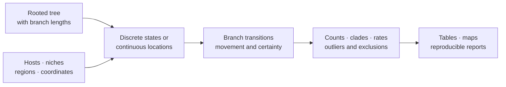

# Cross-Domain Ecology And Geography

Bijux turns reconstructed host, niche, region, and coordinate histories into
reviewable branch and clade records. The owned contract is an analytical
ledger with explicit uncertainty and exclusions; a map or transition count is
a projection of that ledger, not an independent historical fact.

This guide owns the integration path. Use
[Biogeography And Migration](biogeography-and-migration.md) for discrete region
models and event chronology,
[Continuous Phylogeography And Maps](continuous-phylogeography-and-maps.md) for
coordinate reconstruction and map ledgers, and
[Host Association And Niche Evolution](host-association-and-niche-evolution.md)
for host and niche transitions.

## Select The Historical Question

| Question | Native review surface | Required qualification |
| --- | --- | --- |
| Where are host changes supported on a pathogen or parasite tree? | `summarize_host_switching` | ancestral model, host coding, allowed transitions, branch certainty |
| How often and where did ecological niches change? | `summarize_niche_transitions` | niche states, transition model, root treatment, clade denominator |
| Which discrete regions are connected by reconstructed movement? | `summarize_discrete_region_map` | region vocabulary, centroids, state uncertainty, branch filtering |
| Which continuous movements and locations are reconstructed? | `summarize_continuous_phylogeography` | coordinate units, node identity, radial uncertainty, outlier policy |
| How should an analytical movement ledger be visualized? | `summarize_continuous_phylogeography_map` or `render_geographic_map_html` | the rendered markers and lines remain traceable to structured rows |

These surfaces summarize histories conditioned on a tree and reconstruction
model. They do not identify migration, host adaptation, dispersal mechanism,
or causal ecological process without additional evidence.

## Host-Switching Records

`bijux_phylogenetics.ecology:summarize_host_switching` produces distinct node,
branch, count, fit, unsupported-claim, exclusion, and summary records. This
separation matters:

- node rows retain reconstructed host states and their certainty;
- branch rows retain parent and child state identity;
- count rows preserve denominators rather than reporting only selected changes;
- fit rows record model behavior;
- unsupported-claim rows prevent a convenient narrative from outrunning the
  reconstruction;
- exclusion rows retain taxa or branches that could not enter the analysis.

An allowed-transition table is a scientific constraint. Its revision and the
host-state vocabulary belong in the run identity. A transition absent from the
allowlist must not disappear; it belongs in the unsupported or exclusion
record.

## Ecological Niche Transitions

`bijux_phylogenetics.ecology:summarize_niche_transitions` joins discrete
ancestral states to branch transitions, counts, rates, clade summaries, and
exclusions. The report distinguishes a change in the dominant reconstructed
state from certainty about that change.

Review state order, ER/SYM/ARD parameterization, root prior, missing taxa,
transition certainty class, branch length, and clade membership before
interpreting a shift count. A clade with more opportunities can have more
transitions without a greater rate.

## Discrete And Continuous Geography

Discrete geography treats named regions as states. Continuous geography treats
latitude and longitude as coordinates with movement distances and uncertainty.
They require different contracts.

| Dimension | Discrete region model | Continuous coordinate model |
| --- | --- | --- |
| observation | named region | latitude and longitude |
| ancestral output | state probabilities or selected state | coordinate estimate and uncertainty |
| branch output | region transition | great-circle movement and direction |
| central sensitivity | state coding and transition model | coordinate quality, covariance, and branch-time scale |
| invalid comparison | raw transition count across different vocabularies | raw distance across different units or time scales |

`summarize_continuous_phylogeography` emits coordinate estimates, branch
movements, robust outlier rows, exclusions, and a summary. Depth filters and
outlier thresholds are part of the analysis identity. Removing long movements
after viewing them changes the question and must create a new governed run.

## Stable Node And Branch Identity

Node numbers from another library or tree revision are not durable identities.
Use descendant-taxon signatures or another explicit structural key. Every
branch row should identify its parent and child against the exact tree used for
reconstruction. Tree pruning, rerooting, or topology changes invalidate
position-only joins.

## Integrate Without Merging Event Meanings

A host change, niche change, discrete region transition, and continuous
coordinate movement can share a branch identity without being the same event.
Join them through the exact tree and branch ledger, then retain separate model,
support, exclusion, and uncertainty fields for each analysis.

| Joined observation | Valid question | Invalid shortcut |
| --- | --- | --- |
| host switch and region transition on one branch | do independently reconstructed changes co-occur under declared support rules? | the host switch caused geographic spread |
| niche transition and coordinate movement | are inferred shifts colocated in the retained tree? | movement proves adaptation |
| discrete and continuous geography | do region-state and coordinate summaries tell a compatible bounded story? | region centroids are the inferred ancestral coordinates |
| repeated branch events across a tree set | how stable is co-occurrence across admitted trees? | the preferred tree represents event certainty |

An integrated report must preserve unmatched branches and failed component
analyses. Requiring every component to succeed and then reporting only the
surviving intersection changes the denominator and can manufacture apparent
co-occurrence.

## Presentation Is Downstream

`render_coordinate_movement_visualization` and `render_geographic_map_html`
consume structured marker and line records. A reviewer should be able to move
from a line on a map to its branch identity, endpoint states or coordinates,
support class, filtering decision, and source run.

Map style, colors, centroids, and viewport may change without changing the
scientific record. Conversely, altering state assignments, branch inclusion,
coordinate estimates, or uncertainty requires a new analytical record even if
the figure looks similar.

## Acceptance Record

Before publishing an ecological or geographic conclusion, retain:

1. the tree and observation-table identities and their taxon reconciliation;
2. state vocabulary or coordinate schema, units, and missing-data policy;
3. reconstruction model, root treatment, transition constraints, and software
   identity;
4. node, branch, count or movement, outlier, and exclusion rows;
5. sensitivity to plausible trees, models, coding, and filters;
6. a bounded conclusion that distinguishes reconstructed history from causal
   mechanism.

The host-switch, niche-transition, and phylogeographic writers expose separate
TSV artifacts for these records. Preserve them alongside any map or narrative
summary.
