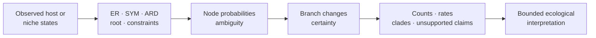

# Host Association And Niche Evolution

Host-switch and niche-transition reviews transform discrete tip observations
and ancestral-state probabilities into node, branch, count, rate, clade,
constraint, and exclusion records. They describe histories conditional on a
tree and state model; they do not directly observe transmission, adaptation,
or ecological mechanism.

## Define The Observation Unit Before The State

A tip label such as `host = bat` or `niche = marine` may summarize very
different evidence. The analysis contract must identify what was observed and
how it became one state per admitted tip.

| Source condition | Required evidence | Why it changes interpretation |
| --- | --- | --- |
| one observation per sampled individual | specimen identity, collection context, taxon mapping | the state is directly tied to one sampling unit |
| several observations collapsed to one taxon | aggregation rule, counts, conflicts, uncertainty | a taxon consensus can hide within-taxon variation |
| several simultaneous host associations | multi-state or ambiguity encoding, not an arbitrary preferred host | co-occurrence is different from missingness or uncertainty |
| niche derived from environmental measurements | variables, transformation, thresholds, and provenance | discretization creates the state vocabulary being reconstructed |
| literature- or database-derived association | source record, evidence class, reconciliation, access identity | reported association strength and sampling coverage may differ |

The admitted population is therefore the set of reconciled observation units,
not merely the set of tree labels. Every exclusion, aggregation, and state
coercion changes the branches on which a switch or shift could be inferred.

## Select The Owning Contract

| Question | Public surface | Distinct retained evidence |
| --- | --- | --- |
| Where are host changes reconstructed? | `summarize_host_switching` | host-state nodes, branch switches, counts, constrained/unconstrained fits, unsupported claims |
| Where and how often do niches change? | `summarize_niche_transitions` | niche-state nodes, transition rates, branch changes, counts, clade shift burden |

Both surfaces preserve exclusions and warnings. Neither converts a most-likely
state change into a certain historical event.

## State Vocabulary Is Part Of The Model

Retain raw and normalized states, state order, missing/ambiguous coding,
allowed-transition policy, ER/SYM/ARD parameterization, root treatment, and
taxon reconciliation. Merging rare states or changing an “unknown” code alters
the rate matrix and every downstream transition opportunity.

Host constraints are especially consequential. Compare constrained and
unconstrained fit records and preserve `UnsupportedHostSwitchClaimRow` entries.
A forbidden transition is not repaired by omitting the branch from the
headline count.

## Read Probability Before Change

A branch change joins two uncertain node reconstructions. Review parent and
child probability vectors, their overlapping plausible state sets, confidence,
certainty class, branch identity, and support before treating the row as a
switch or shift.

| Record | Question answered | Not established |
| --- | --- | --- |
| node row | which states are supported at one node? | an observed ancestral ecology |
| branch row | how do parent and child reconstructions differ? | a witnessed event or mechanism |
| count row | how many retained rows fall into each transition class? | rate without an opportunity or time denominator |
| rate row | what transition intensity follows from the declared model? | empirical frequency independent of model |
| clade row | where do retained shift burdens concentrate? | causation or comparable opportunity across clades |

## Preserve Opportunity And Repetition

Raw counts depend on branch number, branch length, state availability, missing
taxa, and certainty policy. Compare clades only with their descendant and
internal-node populations, changed-branch count, transition diversity, and
repeated-shift definition visible.

A dominant transition can arise from one strongly supported change or several
uncertain changes. Preserve certain, uncertain, and strongly supported counts
separately.

## Separate Association From Causation

Coincidence between a reconstructed host switch and diversification,
geographic movement, phenotype, or outbreak does not establish a causal path.
Such a claim requires an explicit joined design, temporal and sampling
assumptions, alternative explanations, and sensitivity to tree and state
uncertainty.

Appropriate language is “the declared model reconstructs a host change on this
branch with this certainty.” Avoid “the lineage adapted to the host here”
unless independent evidence supports adaptation and timing.

## Publication Packet

Retain the tree, observed-state table, state vocabulary, root and transition
model, constraint identity, node probabilities, rate rows, branch changes,
counts, clade summaries, constrained/unconstrained fits, unsupported claims,
exclusions, warnings, and artifact inventory.

Refuse a clean ecological conclusion when states cannot be reconciled,
constraints are missing or contradictory, root/model sensitivity reverses the
result, node ambiguity makes the branch classification unstable, or excluded
taxa change the relevant opportunity population.
