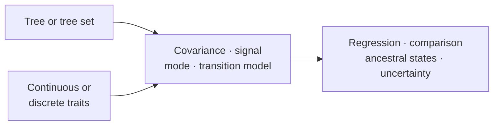

# Evolutionary Analysis

Evolutionary analysis asks how traits covary across related taxa, which modes
of change are supported, what can be inferred about internal nodes, and how
results change across plausible trees and model assumptions.

[Comparative And Ancestral Methods](comparative-and-ancestral-methods.md)
covers PGLS, phylogenetic signal, continuous and discrete evolutionary modes,
ancestral reconstruction, diversification summaries, and sensitivity review.

## Interpretation Boundary

Trait results inherit the taxon mapping, tree scale, covariance or transition
model, transformation policy, and uncertainty treatment used to produce them.
Model ranking describes the declared candidate set; ancestral estimates remain
conditional on both model and tree.
