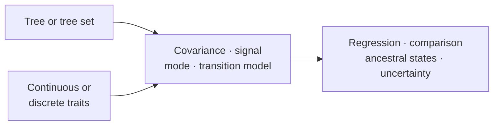

# Evolutionary Analysis

Evolutionary analysis asks how traits covary across related taxa, which modes
of change are supported, what can be inferred about internal nodes, and how
results change across plausible trees and model assumptions.

[Comparative And Ancestral Methods](comparative-and-ancestral-methods.md)
covers PGLS, phylogenetic signal, continuous and discrete evolutionary modes,
ancestral reconstruction, diversification summaries, and sensitivity review.

## Match The Question To The Model Family

| Scientific question | Model family | Interpretation that must remain explicit |
| --- | --- | --- |
| Does a trait covary with predictors after phylogenetic dependence? | PGLS or comparative regression | design matrix, covariance transformation, coefficient scale |
| Is trait resemblance associated with phylogeny? | signal statistics and fitted transformations | null model, tree scale, boundary estimates |
| Which continuous evolutionary mode is most supported? | Brownian, OU, early-burst, or regime-aware comparison | candidate set, parameter bounds, likelihood convention |
| How do discrete states change? | Mk and transition-model comparison | state coding, root prior, forbidden transitions |
| What values or states are supported at internal nodes? | continuous or discrete ancestral reconstruction | node identity, uncertainty, conditioning model |
| Do conclusions survive tree or model uncertainty? | tree-set and sensitivity review | aggregation rule, failed members, instability |

Do not select a method by output shape. Several models produce coefficients,
rates, node values, or information criteria with different conditioning
assumptions and meanings.

## Sensitivity Axes

At minimum, consider taxon inclusion, tree choice, branch-length scale,
rooting, trait transformation, factor coding, covariance or transition model,
parameter bounds, and missing-data policy. A result that changes materially
along one axis should report that dependence rather than hide it behind the
preferred fit.

## Interpretation Boundary

Trait results inherit the taxon mapping, tree scale, covariance or transition
model, transformation policy, and uncertainty treatment used to produce them.
Model ranking describes the declared candidate set; ancestral estimates remain
conditional on both model and tree.

Comparative results also inherit the observation unit. Species means,
individual observations, repeated measures, and aggregated counts imply
different error and random-effect structures; they are not interchangeable
representations of the same analysis.
