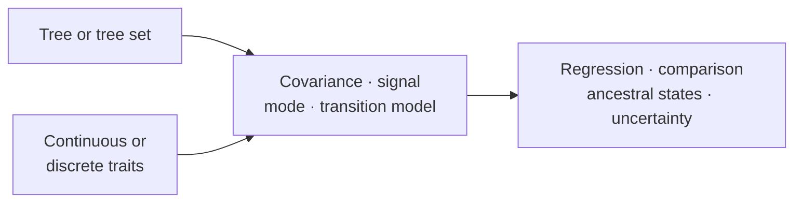
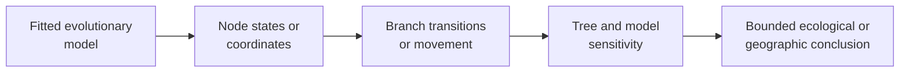

# Evolutionary Analysis

Evolutionary analysis asks how traits covary across related taxa, which modes
of change are supported, what can be inferred about internal nodes, and how
results change across plausible trees and model assumptions.

## Begin With What Was Actually Observed

Most evolutionary outputs concern quantities that were not directly observed.
Name the boundary before interpreting a result:

| Quantity | Evidence status | Required conditioning record |
| --- | --- | --- |
| measured tip trait or state | observation for an admitted sampling unit | source, unit, uncertainty, mapping, missingness, and exclusions |
| fitted coefficient, rate, or covariance parameter | model estimate | tree, population, design, likelihood, constraints, and diagnostics |
| internal-node value or state probability | conditional reconstruction | fitted model, rooted node identity, uncertainty, and tree sensitivity |
| branch transition or movement | derived historical summary | endpoint or sampled-history rule, branch identity, opportunity, and ambiguity |
| ecological or geographic narrative | interpretation | explicit claim linking only the accepted observations and reconstructions |

This ordering prevents a reconstruction from being described as a recovered
observation. It also prevents a visual narrative—such as an annotated tree or
map—from silently becoming the source of a transition that was only weakly or
conditionally supported in the structured result.

[Comparative And Ancestral Methods](comparative-and-ancestral-methods.md)
covers PGLS, phylogenetic signal, continuous and discrete evolutionary modes,
ancestral reconstruction, diversification summaries, and sensitivity review.
[Discrete Ancestral States And Transitions](discrete-ancestral-states-and-transitions.md)
follows state identity, Mk-family fitting, node probabilities, branch
transition ledgers, opportunity denominators, and tree-set sensitivity.
[Cross-Domain Ecology And Geography](ecology-and-phylogeography.md) follows a
result across host, niche, region, coordinate, and presentation boundaries.
Use the dedicated guides for [Biogeography And Migration](biogeography-and-migration.md),
[Continuous Phylogeography And Maps](continuous-phylogeography-and-maps.md),
and [Host Association And Niche Evolution](host-association-and-niche-evolution.md)
when one of those contracts owns the scientific question.

## Choose The Evolutionary Object

| Object being inferred | Owning guide | Primary uncertainty |
| --- | --- | --- |
| trait association, signal, mode, or ancestral state | [Comparative And Ancestral Methods](comparative-and-ancestral-methods.md) | covariance, tree, model, state, and parameter uncertainty |
| discrete node state or branch transition | [Discrete Ancestral States And Transitions](discrete-ancestral-states-and-transitions.md) | state order, root prior, transition constraints, node identity, opportunity, and tree-set stability |
| region state, constrained transition, chronology, or migration event | [Biogeography And Migration](biogeography-and-migration.md) | state coding, root prior, transition policy, time bins, and tree set |
| coordinate estimate, branch movement, outlier, or map ledger | [Continuous Phylogeography And Maps](continuous-phylogeography-and-maps.md) | spatial error, branch scale, node identity, and filter policy |
| host switch, niche transition, or clade shift burden | [Host Association And Niche Evolution](host-association-and-niche-evolution.md) | ancestral-state ambiguity, transition constraints, opportunity, and sampling |
| joined ecological and geographic narrative | [Cross-Domain Ecology And Geography](ecology-and-phylogeography.md) | whether every handoff preserves the same tree, taxa, states, and branch identities |

## Establish The Observation Population

Before fitting an evolutionary model, identify what one row means. A species
mean, an individual, a population, a branch event, and a spatial observation
are different sampling units even when all carry the same taxon label.

| Population decision | Record | Consequence when omitted |
| --- | --- | --- |
| unit of observation | species, individual, population, branch, locality, or aggregate | uncertainty and independence are misrepresented |
| repeated measurements | subject/taxon grouping and within-group error model | pseudo-replication or discarded variation |
| taxon reconciliation | retained, excluded, duplicated, aggregated, and reordered rows | model changes are confounded with population changes |
| trait scale | units, transform, centering, standardization, factor coding | coefficients and reconstructed values lose meaning |
| missingness | missing mechanism, exclusion/imputation rule, affected columns | fitted population and uncertainty become irreproducible |
| tree uncertainty | selected tree or weighted tree set plus failed members | one topology is treated as known history |

## From Reconstructed State To Historical Claim

A branch transition inherits uncertainty from the tree, state model, root
treatment, and observations. An ecological or geographic interpretation must
retain that chain rather than treating a rendered map as primary evidence.

## Keep Three Result Layers Separate

| Layer | Examples | What it establishes | What it cannot establish alone |
| --- | --- | --- | --- |
| fitted model | covariance parameter, transition rates, regression coefficients, likelihood | behavior under the declared tree, data and model | literal truth of the evolutionary process |
| reconstruction | node value/state, branch transition, stochastic history, coordinate path | conditional historical estimate or sample | observed history or certainty at an internal node |
| interpretation | trait association, host shift, niche transition, geographic movement | bounded biological reading of the retained results | causation, completeness, or robustness outside sensitivity checks |

Move forward only when identity and uncertainty survive the handoff. A map or
annotated tree is a projection of reconstruction records; it must not become a
new source of node states or branch events.

## Match The Question To The Model Family

| Scientific question | Model family | Interpretation that must remain explicit |
| --- | --- | --- |
| Does a trait covary with predictors after phylogenetic dependence? | PGLS or comparative regression | design matrix, covariance transformation, coefficient scale |
| Is trait resemblance associated with phylogeny? | signal statistics and fitted transformations | null model, tree scale, boundary estimates |
| Which continuous evolutionary mode is most supported? | Brownian, OU, early-burst, or regime-aware comparison | candidate set, parameter bounds, likelihood convention |
| How do discrete states change? | Mk and transition-model comparison | state coding, root prior, forbidden transitions |
| What values or states are supported at internal nodes? | continuous or discrete ancestral reconstruction | node identity, uncertainty, conditioning model |
| Do conclusions survive tree or model uncertainty? | tree-set and sensitivity review | aggregation rule, failed members, instability |
| Where are host, niche, or region changes reconstructed? | ecological and phylogeographic branch review | state certainty, transition constraints, branch identity, exclusions |
| Which continuous movements are supported? | coordinate reconstruction and movement review | coordinate units, uncertainty, tree scale, outlier policy |

Do not select a method by output shape. Several models produce coefficients,
rates, node values, or information criteria with different conditioning
assumptions and meanings.

## Sensitivity Axes

At minimum, consider taxon inclusion, tree choice, branch-length scale,
rooting, trait transformation, factor coding, covariance or transition model,
parameter bounds, and missing-data policy. A result that changes materially
along one axis should report that dependence rather than hide it behind the
preferred fit.

## Refusal And Qualification Boundaries

Refuse a clean evolutionary conclusion when the analytical population is
ambiguous, the tree lacks required branch semantics, the design matrix is
rank-deficient, an estimated covariance/transition parameter is unidentified,
node identities cannot be reconciled, or plausible trees/models reverse the
conclusion. Qualify rather than suppress boundary estimates, unstable clades,
failed tree-set members, weakly supported transitions, and scale-dependent
effects.

## Interpretation Boundary

Trait results inherit the taxon mapping, tree scale, covariance or transition
model, transformation policy, and uncertainty treatment used to produce them.
Model ranking describes the declared candidate set; ancestral estimates remain
conditional on both model and tree.

Comparative results also inherit the observation unit. Species means,
individual observations, repeated measures, and aggregated counts imply
different error and random-effect structures; they are not interchangeable
representations of the same analysis.
