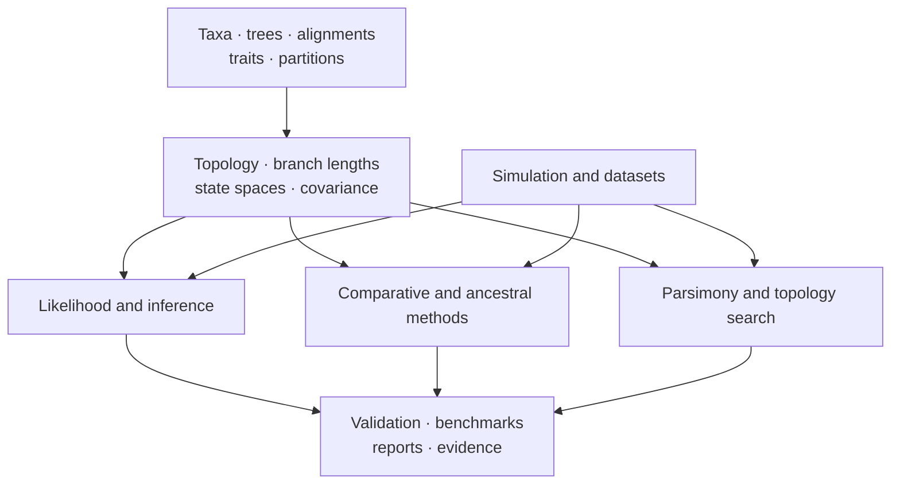

# Scientific Domains

The runtime is organized around scientific responsibilities rather than a
single end-to-end pipeline. Tree and alignment contracts support likelihood,
inference, comparative, ancestral, and parsimony methods. Simulation and
datasets provide controlled inputs. Validation, benchmarks, and reporting make
results inspectable.

## Domain Map

| Domain | Core scientific objects | Representative outputs |
| --- | --- | --- |
| [Trees, alignments, and taxa](data-and-structure/trees-alignments-and-taxa.md) | topology, rootedness, branch lengths, support, sequences, partitions, identifiers | validated trees, reconciled alignments, topology and support ledgers |
| [Likelihood and inference](inference/likelihood-and-inference.md) | state spaces, rate matrices, likelihoods, priors, search and sampling | fitted models, inferred trees, search traces, posterior samples |
| [Comparative and ancestral methods](evolutionary-analysis/comparative-and-ancestral-methods.md) | trait covariance, signal, regression, evolutionary modes, node states | coefficients, model comparisons, uncertainty and ancestral ledgers |
| [Parsimony](inference/parsimony.md) | character costs, ancestral sets, topology moves, resampling | scores, reconstructions, consensus and support summaries |
| [Simulation and datasets](scientific-assurance/simulation-and-datasets.md) | generative models, known truths, reference and stress corpora | simulated trees/traits/alignments, dataset manifests |
| [Validation, benchmarks, and reporting](scientific-assurance/validation-benchmarks-and-reporting.md) | invariants, tolerances, metrics, provenance, publication contracts | diagnostics, benchmark reports, manifests, tables and figures |

## Shared Scientific Invariants

- Taxon identity must remain stable across every joined object.
- Tree rootedness and branch-length meaning must match the chosen method.
- Character or sequence state space must be explicit.
- Model parameterization and transformation conventions must be retained with
  estimates.
- Search, optimization, and sampling diagnostics qualify final values.
- Structured results are canonical; figures and prose are projections.
- Validation scope is named rather than inherited from a neighboring method.

## Native And External Ownership

The package owns substantial tree, likelihood, inference, comparative,
ancestral, parsimony, simulation, validation, and reporting implementations.
It also integrates MAFFT, trimAl, IQ-TREE2, FastTree, MrBayes, and BEAST where
those programs remain the computational owner. Both paths converge on typed
results and artifacts, but their installation, provenance, and failure
boundaries remain different.

## Connecting Domains To Evidence

Scientific-domain coverage describes what the runtime implements. The
[Evidence Book](../03-bijux-phylogenetics-evidence-book/index.md) records
bounded study comparisons. A domain can be mature in code and tests without a
course-study bundle; an evidence bundle can depend on an external engine
without claiming native ownership.
