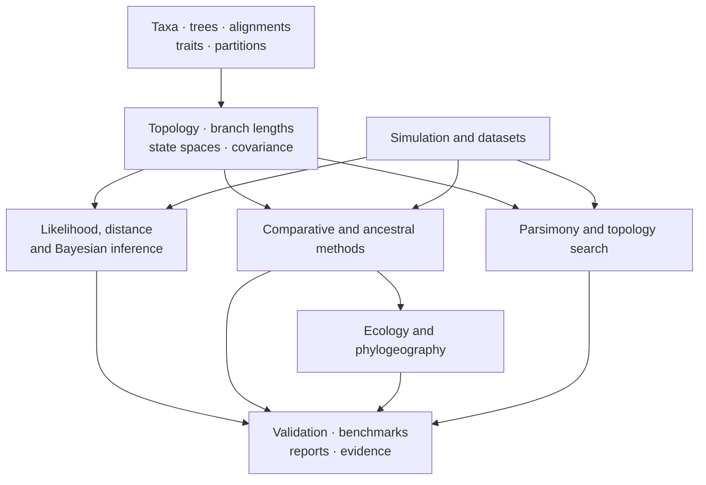
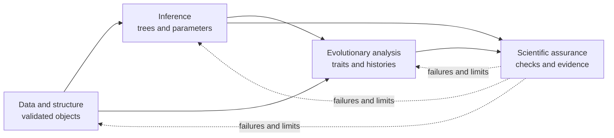

# Scientific Domains

The runtime is organized around scientific responsibilities rather than a
single end-to-end pipeline. Tree and alignment contracts support likelihood,
inference, comparative, ancestral, and parsimony methods. Simulation and
datasets provide controlled inputs. Validation, benchmarks, and reporting make
results inspectable.

## Track The Scientific Object That Changes

Most cross-domain errors come from carrying a value forward after the object
that gives it meaning has changed. Use the object transition—not the command
sequence—to decide when a new identity and review record are required.

| Transition | Scientific meaning that changes | Record to carry forward |
| --- | --- | --- |
| raw records → admitted taxa or characters | analysis population and denominator | included, excluded, aggregated, and refused records with reasons |
| source tree → pruned, rerooted, scaled, or transformed tree | branch/clade identity and covariance geometry | parent identity, operation, parameters, invariants, and new tree identity |
| alignment → trimmed or partitioned alignment | site population and model assignment | retained/removed sites, partition coordinates, alphabet, and new checksum |
| traits → transformed design matrix | estimand, intercept, contrasts, and coefficient meaning | formula, transforms, levels, column order, and row/taxon order |
| model configuration → fitted result | likelihood, prior, objective, and uncertainty convention | complete configuration, estimates/samples, diagnostics, warnings, and status |
| fitted result → table, tree, map, or figure | selection and visual encoding | source result identity, selected rows/marks, units, omissions, and transform |

Two objects may contain the same visible labels or headline value while having
different scientific identities. A pruned tree is not merely a shorter file;
a standardized predictor is not merely the same column in another unit; a
consensus tree is not one sampled tree with extra support labels.

## Domain Map

| Domain | Core scientific objects | Representative outputs |
| --- | --- | --- |
| [Trees, alignments, and taxa](data-and-structure/trees-alignments-and-taxa.md) | topology, rootedness, branch lengths, support, sequences, partitions, identifiers | validated trees, reconciled alignments, topology and support ledgers |
| [Tree operations and identity](data-and-structure/tree-operations-and-identity.md) | rerooting, pruning, clade/branch identity, derivation and comparison | derived trees, population-change ledgers and invariant checks |
| [Tree sets, consensus, and support](data-and-structure/tree-sets-consensus-and-support.md) | bootstrap, posterior, gene, candidate and sensitivity tree populations | inventories, consensus, representative trees, clade/split/quartet support |
| [Likelihood and inference](inference/likelihood-and-inference.md) | state spaces, rate matrices, likelihoods, priors, search and sampling | fitted models, inferred trees, search traces, posterior samples |
| [Distance-based inference](inference/distance-based-inference.md) | pairwise distances, matrix assumptions, joining and least-squares objectives | inferred trees, residuals, influence ledgers, bootstrap support |
| [Bayesian inference](inference/bayesian-inference.md) | likelihoods, priors, proposals, chains, clocks and topology distributions | run manifests, checkpoints, posterior samples, diagnostics and predictive summaries |
| [Comparative and ancestral methods](evolutionary-analysis/comparative-and-ancestral-methods.md) | trait covariance, signal, regression, evolutionary modes, node states | coefficients, model comparisons, uncertainty and ancestral ledgers |
| [Ecology and phylogeography](evolutionary-analysis/ecology-and-phylogeography.md) | host, niche, region and coordinate histories on trees | transition, movement, outlier, exclusion and map ledgers |
| [Parsimony](inference/parsimony.md) | character costs, ancestral sets, topology moves, resampling | scores, reconstructions, consensus and support summaries |
| [Search, model selection, and support](inference/search-model-selection-and-support.md) | candidate populations, objectives, search state, selection rules and ties | traces, candidate ledgers, selected results and method-specific support |
| [Discrete ancestral states and transitions](evolutionary-analysis/discrete-ancestral-states-and-transitions.md) | state order, Mk rates, root priors, node probabilities and branch opportunities | fit, node-state, transition, exclusion and tree-set stability ledgers |
| [Simulation and datasets](scientific-assurance/simulation-and-datasets.md) | generative models, known truths, reference and stress corpora | simulated trees/traits/alignments, dataset manifests |
| [Simulation recovery and calibration](scientific-assurance/simulation-recovery-and-calibration.md) | generator/estimator contracts, replicate states, regimes, metrics and independence | recovery rows, calibration summaries, failures and bounded conclusions |
| [Validation, benchmarks, and reporting](scientific-assurance/validation-benchmarks-and-reporting.md) | invariants, tolerances, metrics, provenance, publication contracts | diagnostics, benchmark reports, manifests, tables and figures |
| [Diagnostics and sensitivity](scientific-assurance/diagnostics-and-sensitivity.md) | tree assumptions, temporal signal, alternative trees, models and policies | findings, stability rows, refusal reasons and decision records |
| [Tree uncertainty and sensitivity](scientific-assurance/tree-uncertainty-and-sensitivity.md) | topology modes, unstable clades/taxa, run comparison and tree-population policies | conflict, instability, sensitivity and consequence records |

## Choose By Scientific Question

| Question | Begin in | Continue into |
| --- | --- | --- |
| Are the taxa, topology, lengths, states, and partitions coherent? | [data and structure](data-and-structure/index.md) | the method that consumes the validated objects |
| What changes when a tree is transformed or a tree population is summarized? | [tree operations](data-and-structure/tree-operations-and-identity.md) | [tree sets, consensus and support](data-and-structure/tree-sets-consensus-and-support.md) |
| Which topology or model parameters best explain observed characters? | [inference](inference/index.md) | support, sensitivity, and assurance review |
| Was selection reviewable across every candidate, failure and tie? | [search, model selection and support](inference/search-model-selection-and-support.md) | method-specific diagnostics and benchmark evidence |
| How do traits vary with ancestry, predictors, or internal nodes? | [evolutionary analysis](evolutionary-analysis/index.md) | model comparison and tree/model sensitivity |
| Which discrete states or transitions remain supported across trees and models? | [discrete ancestral states and transitions](evolutionary-analysis/discrete-ancestral-states-and-transitions.md) | [tree uncertainty and sensitivity](scientific-assurance/tree-uncertainty-and-sensitivity.md) |
| Is an implementation recovering known truth or matching a reference? | [scientific assurance](scientific-assurance/index.md) | benchmark or Evidence Book artifacts |
| Is simulated recovery calibrated over the declared regimes and failures? | [simulation recovery and calibration](scientific-assurance/simulation-recovery-and-calibration.md) | validation and evidence promotion |

Scientific questions commonly cross domains, but ownership remains local. A
taxon mismatch is resolved before model fitting; a convergence failure is not
recast as a reporting concern; and a visually persuasive figure cannot replace
an uncertainty or sensitivity record.

## Domain Handoffs

Each handoff carries identities and assumptions, not only values. Tree scale,
rooting, taxon order, state encoding, model parameterization, search or sampler
configuration, and software provenance remain attached to downstream results.

## Cross-Domain Handoff Record

| Field | Why the next domain needs it |
| --- | --- |
| object identity | prevents a tree, matrix, alignment, or dataset revision from being substituted silently |
| taxon population and order | preserves joins, pruning decisions, matrix row meaning, and denominators |
| units and scale | distinguishes time, substitutions, distance, rates, transformed traits, and probabilities |
| model and state conventions | fixes alphabets, ambiguity, partitions, covariance, transition rules, and parameterization |
| execution state | distinguishes complete, partial, refused, failed, and externally unavailable work |
| diagnostics and exclusions | prevents downstream presentation from retaining only successful values |
| provenance | identifies implementation or engine owner, version, configuration, and source inputs |

A downstream method may add context, but it must not erase upstream identity or
reinterpret an unresolved condition as an ordinary value.

## Recognize When A Handoff Changes The Question

Some transformations produce a new scientific object or estimand rather than
merely preparing the old one. The downstream record must name that change so a
result is not attributed to the original question unchanged.

| Handoff decision | Original question | New question that must be declared |
| --- | --- | --- |
| prune to shared taxa | relationship on the declared taxa | relationship on the retained intersection |
| trim sites or exclude sequences | inference from the admitted character matrix | inference from a selected matrix under a removal policy |
| root, reroot, or rescale a tree | topology or process under the supplied tree identity | topology, direction, or rate under a transformed tree |
| standardize, log, aggregate, or impute traits | effect on the observed response and population | effect on a transformed or reconstructed quantity |
| select a model after screening candidates | fit of one predeclared model | selection-conditional result over a candidate set |
| summarize across trees, chains, or replicates | result for one execution state | distribution or consensus over a declared population |
| normalize outputs across implementations | engine- or method-specific quantity | correspondence under an explicit mapping rule |

The transformation can be scientifically valid. The defect is allowing the
new population, scale, conditioning event, or estimand to inherit the old
label without a parent-child record and an interpretation update.

## Attribute Failure To The Deciding Domain

Parsing and identity defects belong to data and structure. Undefined
likelihoods, search exhaustion, or poor chain behavior belong to inference.
Model sensitivity and unidentified covariance or transition assumptions belong
to evolutionary analysis. Missing independent truth, reference incompatibility,
or incomplete denominators belong to scientific assurance. Reports carry these
states; they do not become their owner.

## Leave With The Owning Record

| After the domain decision | Continue with | Preserve |
| --- | --- | --- |
| execute an owned or external method | the [product handbook](../01-bijux-phylogenetics/index.md) | computational owner, input identity, configuration, status, diagnostics, artifacts |
| compare implementations | the [verification matrix](../04-bijux-phylogenetics-parities/correspondence/verification-matrix.md) | both owners, selected cases, normalization, observations, tolerance, denominator |
| evaluate a study statement | the [Evidence Book](../03-bijux-phylogenetics-evidence-book/index.md) | claim, source, primary outputs, checks, freshness, verdict, limitations |
| publish a table, figure, or package | [publication artifact review](scientific-assurance/publication-artifact-review.md) | structured source, visual encoding, inventory, consumer acceptance, revalidation identity |

Domain coverage states what the runtime can express; it is not an assurance
shortcut. Native methods and external engines retain different computational
owners, and neither acquires study evidence until a governed claim consumes
the exact result.
