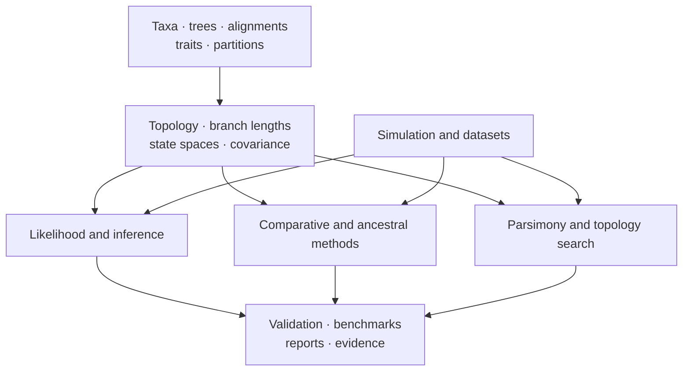
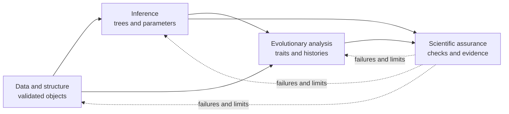

# Scientific Domains

The runtime is organized around scientific responsibilities rather than a
single end-to-end pipeline. Tree and alignment contracts support likelihood,
inference, comparative, ancestral, and parsimony methods. Simulation and
datasets provide controlled inputs. Validation, benchmarks, and reporting make
results inspectable.

## Domain Map

| Domain | Core scientific objects | Representative outputs |
| --- | --- | --- |
| [Trees, alignments, and taxa](data-and-structure/trees-alignments-and-taxa.md) | topology, rootedness, branch lengths, support, sequences, partitions, identifiers | validated trees, reconciled alignments, topology and support ledgers |
| [Likelihood and inference](inference/likelihood-and-inference.md) | state spaces, rate matrices, likelihoods, priors, search and sampling | fitted models, inferred trees, search traces, posterior samples |
| [Comparative and ancestral methods](evolutionary-analysis/comparative-and-ancestral-methods.md) | trait covariance, signal, regression, evolutionary modes, node states | coefficients, model comparisons, uncertainty and ancestral ledgers |
| [Parsimony](inference/parsimony.md) | character costs, ancestral sets, topology moves, resampling | scores, reconstructions, consensus and support summaries |
| [Simulation and datasets](scientific-assurance/simulation-and-datasets.md) | generative models, known truths, reference and stress corpora | simulated trees/traits/alignments, dataset manifests |
| [Validation, benchmarks, and reporting](scientific-assurance/validation-benchmarks-and-reporting.md) | invariants, tolerances, metrics, provenance, publication contracts | diagnostics, benchmark reports, manifests, tables and figures |

## Choose By Scientific Question

| Question | Begin in | Continue into |
| --- | --- | --- |
| Are the taxa, topology, lengths, states, and partitions coherent? | [data and structure](data-and-structure/index.md) | the method that consumes the validated objects |
| Which topology or model parameters best explain observed characters? | [inference](inference/index.md) | support, sensitivity, and assurance review |
| How do traits vary with ancestry, predictors, or internal nodes? | [evolutionary analysis](evolutionary-analysis/index.md) | model comparison and tree/model sensitivity |
| Is an implementation recovering known truth or matching a reference? | [scientific assurance](scientific-assurance/index.md) | benchmark or Evidence Book artifacts |

Scientific questions commonly cross domains, but ownership remains local. A
taxon mismatch is resolved before model fitting; a convergence failure is not
recast as a reporting concern; and a visually persuasive figure cannot replace
an uncertainty or sensitivity record.

## Domain Handoffs

Each handoff carries identities and assumptions, not only values. Tree scale,
rooting, taxon order, state encoding, model parameterization, search or sampler
configuration, and software provenance remain attached to downstream results.

## Shared Scientific Invariants

- Taxon identity must remain stable across every joined object.
- Tree rootedness and branch-length meaning must match the chosen method.
- Character or sequence state space must be explicit.
- Model parameterization and transformation conventions must be retained with
  estimates.
- Search, optimization, and sampling diagnostics qualify final values.
- Structured results are canonical; figures and prose are projections.
- Validation scope is named rather than inherited from a neighboring method.

## Native And External Ownership

The package owns substantial tree, likelihood, inference, comparative,
ancestral, parsimony, simulation, validation, and reporting implementations.
It also integrates MAFFT, trimAl, IQ-TREE2, FastTree, MrBayes, and BEAST where
those programs remain the computational owner. Both paths converge on typed
results and artifacts, but their installation, provenance, and failure
boundaries remain different.

## Connecting Domains To Evidence

Scientific-domain coverage describes what the runtime implements. The
[Evidence Book](../03-bijux-phylogenetics-evidence-book/index.md) records
bounded study comparisons. A domain can be mature in code and tests without a
course-study bundle; an evidence bundle can depend on an external engine
without claiming native ownership.

For cross-implementation questions, use the
[verification matrix](../04-bijux-phylogenetics-parities/correspondence/verification-matrix.md)
to distinguish live parity, checked fixtures, and governed external execution.
